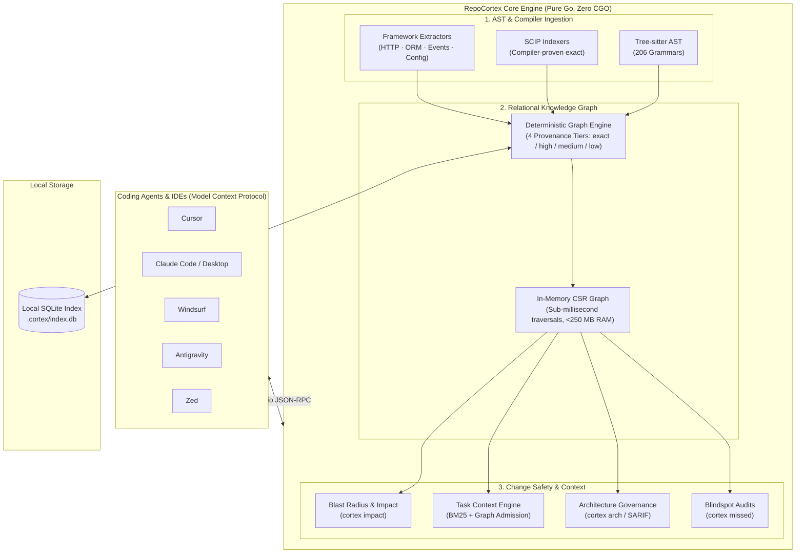

<div align="center">

# RepoCortex

**Deterministic code intelligence and change safety for AI coding agents.**<br>
Compiler-proven call graphs over [MCP](https://modelcontextprotocol.io), instead of flaky vector RAG.<br>
**~90% fewer tokens · 100% local · zero CGO · single binary**

[](https://github.com/satyendrakumarsingh/repocortex/releases)
[](https://github.com/satyendrakumarsingh/repocortex/actions/workflows/ci.yml)
[](https://modelcontextprotocol.io)
[](https://go.dev)
[](LICENSE)

Works with `Cursor` · `Claude Code` · `Windsurf` · `Antigravity` · `Claude Desktop` · `Zed`

[Quickstart](#quickstart) ·
[Why not vector RAG?](docs/WHY_NOT_VECTOR_RAG.md) ·
[How it works](#how-it-works) ·
[Accuracy](#accuracy) ·
[Agent setup](#connect-your-agent) ·
[Docs](#documentation) ·
[`llms.txt`](llms.txt)

</div>

```text
$ cortex impact --base main..HEAD

⚡ Risk: HIGH (82/100) — 14 symbols reached from 2 changed

  🟢 85% exact   compiler type-checked via SCIP
  🔵 15% high    AST receiver & import validated

  ● PaymentGateway.ChargeToken()           internal/pay/gateway.go:42
    └── CheckoutHandler.HandleOrder()      api/controllers/order.go:118
        └── Kafka topic "orders.charged"   (3 downstream services)

  ✓ TestOrderCheckoutFlow (proven call edge)   tests/order_test.go:56
```

Your agent burns ~40k tokens on exploratory greps and still misses interface implementations. RepoCortex parses your repo locally into a deterministic graph of symbols, call hierarchies, HTTP routes, SQL tables and test coverage. The agent then asks one question and gets a proven answer in ~800 tokens.

## Quickstart

**1. Install**

```bash
brew install satyendrakumarsingh/tap/cortex      # macOS / Linux
```

<details>
<summary>Other install methods (curl, Go, Windows, offline binaries)</summary>

```bash
# macOS / Linux, checksum-verified
curl -fsSL https://raw.githubusercontent.com/satyendrakumarsingh/repocortex/main/install.sh | sh

# Go 1.26+ (no CGO, no external build dependencies)
go install github.com/satyendrakumarsingh/repocortex/cmd/cortex@latest
```

```powershell
# Windows (PowerShell)
Invoke-WebRequest -Uri https://raw.githubusercontent.com/satyendrakumarsingh/repocortex/main/install.ps1 -OutFile install.ps1
Unblock-File .\install.ps1
.\install.ps1
```

Pre-built binaries for macOS (Apple Silicon and Intel), Linux (amd64, arm64) and Windows (amd64) are on the [Releases](https://github.com/satyendrakumarsingh/repocortex/releases) page, for air-gapped machines. The command is `cortex`; `repocortex` also works.

</details>

**2. Index your repo** (seconds; creates a local SQLite graph in `.cortex/`)

```bash
cd your-project
cortex init && cortex index && cortex resolve
```

**3. Connect your agent**

```bash
cortex install --rules     # detects Cursor, Claude, Windsurf, Antigravity
```

Restart the agent. It now calls `get_task_context` and `impact_analysis` instead of grepping.

**4. Check it works**

```bash
cortex context "how does authentication work?"
```

## Before and after

| | Without RepoCortex (RAG / grep) | With RepoCortex |
|---|:---:|:---:|
| **Task discovery** | 15+ greps and reads (~35k tokens, 30s) | **1 call**, `get_task_context` (~800 tokens, 10ms) |
| **Blast radius** | Misses callers with different names | **Complete and compiler-proven**, with confidence tiers |
| **Test gaps** | Filename matching, misses indirect tests | **Traces proven call edges** (`cortex missed`) |
| **Privacy** | Code chunked and sent to embedding APIs | **100% local SQLite**, nothing leaves your machine |
| **Accuracy** | Edges guessed from text similarity | **`exact` (SCIP)** and AST-proven `high` edges |
| **CI gates** | None | **Blocking gates** (`arch`, `missed`, `impact`) with SARIF 2.1.0 |

> [!TIP]
> Why semantic search fails on source code: [Why Vector RAG Fails for Code](docs/WHY_NOT_VECTOR_RAG.md)

## How it works

Tree-sitter AST extraction, compiler-backed SCIP indexers and framework extractors feed one relational graph in local SQLite.



### The 4 confidence tiers

Every edge carries immutable provenance, so a compiler fact is never confused with a regex guess.

### The 4 Confidence Tiers

RepoCortex never conflates a compiler fact with a regex guess. Every edge in the graph carries immutable provenance:

| Tier | Source | Measured Precision | What Your Agent Does |
|---|---|:---:|---|
| `exact` | Compiler-backed SCIP index (`scip-go`, `scip-typescript`, etc.) | **100.0%** | Safe for automated refactoring, renames, and blocking CI gates. |
| `high` | Tree-Sitter AST with explicit package imports and receiver matching | **86.8% – 99.5%** | Reliable primary guidance for code exploration and planning. |
| `medium` | Multi-candidate type inference or package-level heuristics | **5.7% – 37.5%** | Treated as investigatory leads; never acted upon without human review. |
| `low` | Loose identifier matches across unrelated packages | **0.0% – 2.8%** | Filtered by default. Exposed only when explicitly requested. |

## Key features

<table>
<tr>
<td width="50%" valign="top">

### 🧠 Deterministic Code Intelligence
* **206 Tree-sitter Grammars**: Definitions, imports, and cross-file references across 14 core languages.
* **Compiler-Backed Precision**: Integrates with [SCIP](https://github.com/scip-code/scip) for compiler-checked `exact` call graphs.
* **Arity & Receiver Disambiguation**: Resolves overloaded methods by parameter counts in Java, TypeScript, and C#.

</td>
<td width="50%" valign="top">

### 🛡️ Change Safety & Blast Radius
* **Transitive Blast Radius (`cortex impact`)**: Recursive caller traversal with hub pruning across loggers and base classes.
* **Test Gap Detection (`cortex missed`)**: Finds which execution branches lack test coverage before you merge.
* **Safe Automated Refactoring (`cortex rename`)**: Multi-file identifier updates with automated atomic rollback.

</td>
</tr>
<tr>
<td width="50%" valign="top">

### 🌐 Cross-Stack Topologies
* **HTTP / REST Endpoints**: Statically extracts route handlers across Spring, Gin, Express, FastAPI, Django, and NestJS.
* **Database Access Maps**: Maps SQL queries and ORM models (Prisma, GORM, Hibernate, SQLAlchemy) to caller methods.
* **Event Broker Queues**: Discovers producers and consumers across Kafka, RabbitMQ, SQS, SNS, and GCP Pub/Sub.

</td>
<td width="50%" valign="top">

### 🏛️ Architecture Governance & CI
* **Boundary Rules (`cortex arch`)**: Declaratively enforce architectural invariants (e.g. `domain` must never import `controller`).
* **Pull Request Gates**: Posts sticky, bounded PR comments with risk scores and uploads SARIF 2.1.0 to GitHub Code Scanning.
* **100% Offline & Private**: Zero telemetry, zero cloud dependencies. Your code never leaves your runner.

</td>
</tr>
</table>

## Accuracy

Measured on five real production repositories (8,151 files, 91,548 symbols), adjudicated against compiler ground truth:

| Language | `high` Precision | `high` Recall | F1 Score | Adjudicated Edges |
|---|:---:|:---:|:---:|:---:|
| **TypeScript** | **99.5%** | 66.4% | 79.6% | 12,410 |
| **Go** | **98.6%** | 60.4% | 75.0% | 11,353 |
| **Python** | **94.2%** | 56.3% | 70.4% | 7,130 |
| **Java** (Spring REST) | **100.0%** | 32.7% | 49.2% | 82 |

> **The Honest Engineering Headline**: Between one-third and two-fifths of call sites cannot be uniquely resolved by heuristic AST parsing alone. That is why RepoCortex explicitly reports **coverage gaps** rather than showing empty results, and provides a 1-command upgrade to compiler SCIP indexing (`cortex scip import`).

Methodology and reproduction: [docs/accuracy.md](docs/accuracy.md), [docs/BENCHMARKING.md](docs/BENCHMARKING.md). Run it on your own project with `cortex accuracy`.

## RepoCortex vs. alternatives

| Capability | RepoCortex | Vector RAG Embeddings | Traditional LSP (gopls, tsserver) | Heavy SAST (CodeQL, Semgrep) | Text Greppers (`rg`) |
|:---|:---:|:---:|:---:|:---:|:---:|
| **Zero-Setup Polyglot Indexing** | **✅ Yes** (Pure Go) | ⚠️ Yes (Raw text) | ❌ No (Toolchain per language) | ❌ No (Complex setups) | **✅ Yes** |
| **Deterministic Call Graph** | **✅ Yes** | ❌ No (Fuzzy similarity) | ✅ Yes (Single language) | ✅ Yes | ❌ No (String match) |
| **Cross-Stack Topologies (DB/API/Events)** | **✅ Yes** | ❌ No | ❌ No | ⚠️ Partial (Security only) | ❌ No |
| **Calibrated Confidence Provenance** | **✅ Yes** (4 Tiers) | ❌ No (Float distance) | ⚠️ Implicit | ❌ No | ❌ No |
| **Transitive Blast Radius (`impact`)** | **✅ Yes** (Hub pruned) | ❌ No | ❌ No | ❌ No | ❌ No |
| **AI Agent MCP Server Native** | **✅ Yes** | ⚠️ Partial (Retrieval only) | ❌ No | ❌ No | ❌ No |
| **Atomic Multi-File Refactor Rollback**| **✅ Yes** | ❌ No | ⚠️ Partial (LSP rename) | ❌ No | ❌ No |
| **Incremental File Watch Latency** | **⚡ <50 ms** | ⏱️ Seconds to minutes | ⏱️ <100 ms | 🐢 Hours (Batch only) | ⚡ Stateless |
| **Memory Footprint (10k Files)** | **⚡ <250 MB** | 🐢 1–3 GB + Vector DB | 🐢 2–6 GB (Multiple daemons)| 🐢 4–16 GB | ⚡ <50 MB |
| **100% Air-Gapped / Local Operation** | **✅ Yes** | ⚠️ Often needs cloud API | **✅ Yes** | ⚠️ Often cloud-hosted | **✅ Yes** |
| **Single Standalone Static Binary** | **✅ Yes** (Zero CGO) | ❌ No | ❌ No | ❌ No | **✅ Yes** |

## Connect your agent

`cortex install --rules` registers RepoCortex in Cursor (`~/.cursor/mcp.json`), Windsurf (`~/.codeium/windsurf/mcp_config.json`), Claude Desktop, Antigravity (`~/.gemini/antigravity/mcp_config.json`) and Claude Code (`~/.claude.json`). It also adds guidance to `.cursorrules`, `CLAUDE.md` or `AGENTS.md`.

**Claude Code, one line:**

```bash
claude mcp add cortex -- cortex --project "$(pwd)" serve
```

**Any stdio MCP client** (Cursor, Windsurf, Zed, Claude Desktop):

```json
{
  "mcpServers": {
    "cortex": {
      "command": "cortex",
      "args": ["serve", "--project", "/absolute/path/to/repo"]
    }
  }
}
```

<details>
<summary>MCP tools and profiles</summary>

| Tool | Purpose | Profile |
|---|---|:---:|
| `get_task_context` | Resolves relevant files, symbols, callers, and tests for a task prompt in 1 call | `minimal` (default) |
| `get_project_overview` | Languages, size, coverage, entry points | `minimal` |
| `search_code` | SQLite FTS5 BM25 search across indexed code | `minimal` |
| `find_symbol` | Exact symbol definition lookups | `minimal` |
| `find_references` | Cross-file references to a symbol | `minimal` |
| `find_callers` | Direct call edges entering a symbol | `minimal` |
| `impact_analysis` | Transitive blast radius of modifying a symbol | `standard` / `full` |
| `find_tests` | Covering test functions discovered along call paths | `standard` / `full` |
| `find_api_endpoints` | HTTP routes, method types, and route handlers | `standard` / `full` |
| `find_db_access` | Database tables and caller methods reading/writing them | `standard` / `full` |
| `detect_blindspots` | Unresolved calls, orphan tables, unmapped endpoints | `standard` / `full` |
| `plan_change` | Synthesizes an ordered refactoring blueprint with test gates | `standard` / `full` |

</details>

## CI change-safety gate

Fail pull requests that break architecture rules or add high-severity blindspots, and post a sticky PR comment with the risk score:

```yaml
- run: go install github.com/satyendrakumarsingh/repocortex/cmd/cortex@latest
- run: cortex init && cortex index && cortex resolve
- run: cortex arch --fail-on high && cortex missed --fail-on high
- run: cortex impact --base origin/${{ github.base_ref }} --head HEAD --json > impact.json && cortex report pr --impact impact.json
```

Ready-made workflow: [`cortex-gate.yml`](.github/workflows/cortex-gate.yml). Details and SARIF upload: [docs/operations/ci-cd-gates.md](docs/operations/ci-cd-gates.md).

## Also included

- **CLI**: 35+ commands for indexing, navigation, safe rename, architecture audits and reports. See the [CLI reference](docs/CLI.md).
- **Local web portal**: `cortex ui` opens code maps, a blast-radius explorer and a symbol inspector at `http://localhost:7777`. It is offline and binds to loopback only.

## Security and privacy

- **Local and air-gapped**: indexing, resolution and MCP serving make zero outbound network connections.
- **No telemetry** of any kind.
- **Secret redaction**: high-entropy strings and credential patterns are stripped before indexing.
- **No code execution from repo config**: `.cortex.yml` cannot run commands.
- **Untrusted-evidence labelling**: MCP responses tag repository code as untrusted, to resist prompt injection.

Full threat model: [docs/security.md](docs/security.md).

## FAQ

Short answers on what RepoCortex is, why it beats vector RAG for code, where the 90% token saving comes from, which agents work, and what stays local are in the [FAQ](docs/FAQ.md).

## Documentation

| Guide | What it covers |
|---|---|
| [User Guide](docs/USER_GUIDE.md) | Enterprise guide and tool comparison |
| [Agent Integration](docs/agent-integration.md) | Cursor, Claude, Windsurf, Antigravity, custom clients |
| [CLI Reference](docs/CLI.md) | Every command and flag |
| [Architecture and Design](docs/DESIGN_AND_ARCHITECTURE.md) | Package boundaries and invariants |
| [Accuracy](docs/accuracy.md) · [Performance](docs/performance.md) | Measured benchmarks |
| [Security Model](docs/security.md) | Threat model and reporting |
| [Why Not Vector RAG?](docs/WHY_NOT_VECTOR_RAG.md) | Technical essay |

## Contributing

Contributions welcome. See [CONTRIBUTING.md](.github/CONTRIBUTING.md), the [Code of Conduct](.github/CODE_OF_CONDUCT.md) and the [Security Policy](.github/SECURITY.md).

Licensed under the [Apache License 2.0](LICENSE).
