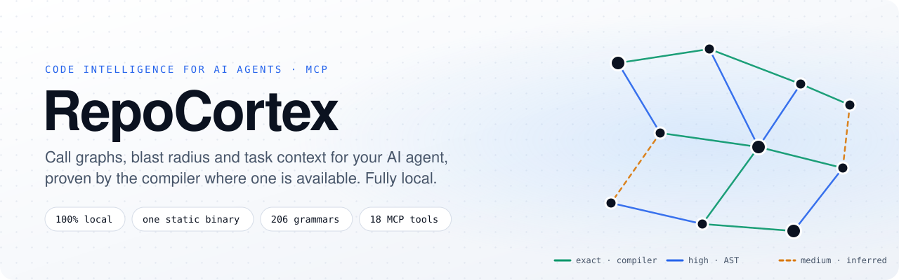
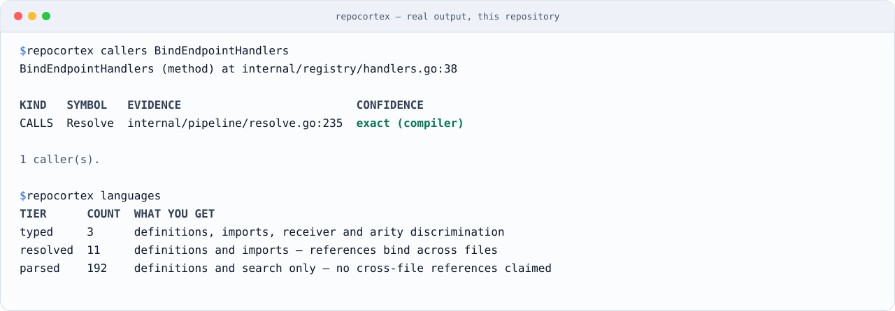
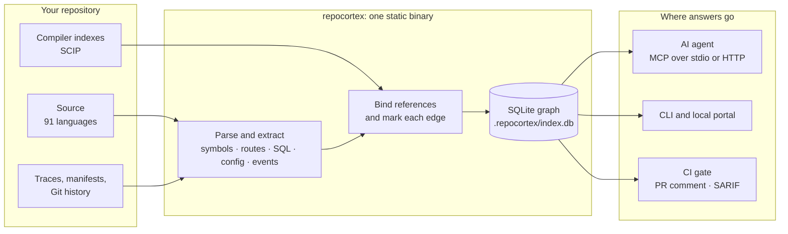

<div align="center">

<picture>
  <source media="(prefers-color-scheme: dark)" srcset="docs/assets/hero-dark.svg">
  
</picture>

# RepoCortex: Deterministic Code Graph & Intelligence MCP Server for AI Agents

[](https://github.com/satyendrakumarsingh/repocortex/actions/workflows/ci.yml)
[](#mcp-tools)
[](https://go.dev)
[](#security-and-privacy)
[](LICENSE)
[](llms.txt)

<p>
<a href="docs/guides/coding-agents.md">


</a>
</p>

**[Quickstart](#quickstart)** · **[Supported agents](#connect-your-agent)** · **[Agent Install Guide](llms-install.md)** · **[llms.txt](llms.txt)** · **[Docs](#guides-and-documentation)** · **[Roadmap](docs/ROADMAP.md)**

</div>

**Give your AI coding agent a map of your codebase, not a search box.**

RepoCortex is an open-source MCP server and CLI (`repocortex`) that indexes a repository into a graph of functions, call edges, HTTP routes, SQL tables, configuration keys and tests, and serves it to your coding agent over the [Model Context Protocol](https://modelcontextprotocol.io). Instead of grepping and reading twenty files, the agent asks one question, such as *what does this task touch?* or *what breaks if I change this?*, and gets callers, tests and blast radius, each marked with how it was found and what the index could not see.

One Go binary. A SQLite file in `.repocortex/`. Nothing leaves your machine.

| | |
|---|---|
| **What it is** | A local code-intelligence server: it turns a repository into a call graph and answers an AI coding agent's questions about it |
| **Who it is for** | Developers using Claude Code, Cursor, Codex, Copilot, Gemini CLI, Windsurf or any other coding agent on a real codebase |
| **What it answers** | Who calls this, what breaks if I change it, single-turn symbol exploration (`explore`), PR blast radius (`pr-impact`), AI packing (`pack`), which tests to run, what is unused |
| **How agents reach it** | MCP (stdio or HTTP), a REST API with OpenAPI, or the command line: the same 30 tools on each |
| **What makes it different** | Every relationship is marked `exact`, `high`, `medium` or `low` with measured precision, and every answer states what the index could not see |
| **Where it runs** | Your machine or your CI runner. No account, no cloud index, no model, no telemetry |
| **Licence** | Apache-2.0, free for commercial use |

<table>
<tr>
<td align="center" width="20%"><h3>91</h3><sub>languages with definitions extracted, of 206 grammars bundled</sub></td>
<td align="center" width="20%"><h3>30</h3><sub>tools for agents, over MCP, HTTP or the shell</sub></td>
<td align="center" width="20%"><h3>30</h3><sub>coding agents configured by one install command</sub></td>
<td align="center" width="20%"><h3>405 of 420</h3><sub>sampled syntax-tree <code>high</code> edges judged right by hand, 14 projects (73–100% by project)</sub></td>
<td align="center" width="20%"><h3>0</h3><sub>network calls while indexing or serving your code</sub></td>
</tr>
</table>

## Contents

| Get started | Use it | Trust it | Reference | Go deeper |
|---|---|---|---|---|
| [Why RepoCortex](#why-repocortex) | [What it answers](#what-it-answers) | [How it works](#how-it-works) | [MCP tools](#mcp-tools) | [User guide](docs/USER_GUIDE.md) |
| [Compared with other tools](#repocortex-compared-with-other-code-intelligence--graph-tools) | [How it compares to RAG](#how-repocortex-compares-to-rag) | [Token use](#token-use) | [Naming conventions](docs/reference/naming-conventions.md) | [Benchmarking](docs/BENCHMARKING.md) |
| [Who it's for](#who-its-for) | [Recipes](#recipes) | [Confidence tiers](#confidence-tiers) | [Language support](#language-support) | [Portal guide](docs/guides/portal-guide.md) |
| [Quickstart](#quickstart) | [How an agent uses it](#how-an-agent-uses-it) | [Accuracy](#accuracy) | [Guides and docs](#guides-and-documentation) | [CLI reference](docs/CLI.md) |
| [Install options](#install-options) | [Blast radius in CI](#blast-radius-in-ci) | [Performance](#performance) | [FAQ](#faq) | [Architecture](docs/DESIGN_AND_ARCHITECTURE.md) |
| [Connect your agent](#connect-your-agent) | [Local portal](#local-portal) | [Security and privacy](#security-and-privacy) | [Roadmap and community](#roadmap-and-community) | [Why not vector search](docs/WHY_NOT_VECTOR_RAG.md) |
| [Set up with your AI agent](#set-up-with-your-ai-agent) | [CLI output guide](docs/guides/cli-output-guide.md) | [Troubleshooting](docs/troubleshooting.md) | [Agent integration](docs/agent-integration.md) | [Security model](docs/security.md) |
| [Before and after](#before-and-after) | [What's new](#whats-new) | [Scale testing](docs/operations/scale-testing.md) | [Coding agents guide](docs/guides/coding-agents.md) | [Changelog](CHANGELOG.md) |

## Why RepoCortex

<table>
<tr>
<td width="33%" valign="top">

### Proven, not guessed
Every edge says how it was found: **exact** when a compiler proved it, **high** when the syntax tree and imports did, **medium** when it was inferred. Nothing is a similarity score.

</td>
<td width="33%" valign="top">

### Local by construction
One static binary and a SQLite file. No account, no telemetry, and no network calls while indexing or serving. Your code stays on your machine or your CI runner.

</td>
<td width="33%" valign="top">

### Built for agents
`get_task_context` returns the files, symbols, callers and tests a task needs in one call, and every answer states what it could not see.

</td>
</tr>
</table>

<picture>
  <source media="(prefers-color-scheme: dark)" srcset="docs/assets/demo-dark.svg">
  
</picture>

<div align="center"><sub>Real output from this repository. The caller is marked <code>exact (compiler)</code> because <code>scip-go</code> proved it.</sub></div>

## Before and after

The same task, *"change how `mergeJSONKey` writes agent configs"*, as an agent works it:

<table>
<tr>
<th width="50%">Without RepoCortex</th>
<th width="50%">With RepoCortex</th>
</tr>
<tr>
<td valign="top">

1. Searches the repository for `mergeJSONKey`
2. Opens each file the search returns, top to bottom
3. Guesses which hits are calls and which are comments or strings
4. Edits, and hopes no caller was missed
5. Runs the whole test suite, or none of it

</td>
<td valign="top">

1. Calls `find_callers` once
2. Gets every caller with file, line and how sure the edge is
3. Calls `find_tests` and runs the tests that reach the change
4. Reads the note on what the index could not see before trusting an empty list

</td>
</tr>
<tr>
<td colspan="2">

```console
$ repocortex callers mergeJSONKey
mergeJSONKey (function) at internal/cli/clients.go:367

KIND   SYMBOL                                             EVIDENCE                         CONFIDENCE
CALLS  mergeClientConfig                                  internal/cli/clients.go:355      high (source_code)
CALLS  TestMergeJSONKeyUsesEachClientsKeyAndKeepsTheRest  internal/cli/clients_test.go:65  high (source_code)
CALLS  TestMergeJSONKeyRefusesJSONWithComments            internal/cli/clients_test.go:96  high (source_code)
CALLS  mergeMCPConfig                                     internal/cli/install.go:47       high (source_code)
```

<sub>Real output from this repository, shortened to one line per caller. The agent gets the same answer from <code>find_callers</code>.</sub>

</td>
</tr>
</table>

## What's new

| Feature | What changed |
|---|---|
| **Every protocol** | The same tools are now served as plain HTTP with an OpenAPI document (`/api/v1`) and from the shell (`repocortex tool call`), through one implementation. [Protocols](docs/guides/protocols.md) |
| **Unused code and hotspots** | `repocortex dead-code` grades what nothing calls and checks it against the source text; `repocortex hotspots` ranks where change concentrates and names files that change together. [What it answers](#what-it-answers) |
| **A redesigned portal** | `repocortex ui`: one page per symbol, with its callers, reach and tests as tabs. [Portal guide](docs/guides/portal-guide.md) |
| **HTTP transport** | `repocortex serve --http` serves MCP over Streamable HTTP, with a token on every request, so ChatGPT, Android Studio and other remote-only clients can connect. [Details](docs/guides/coding-agents.md#remote-mcp-over-http) |
| **30 agents in one command** | `repocortex install` writes each agent's own config format (JSON, TOML or YAML), keeps everything else in the file, and prints the steps for 10 more. [Coding agents guide](docs/guides/coding-agents.md) |
| **Agent setup prompt** | Paste one prompt into your coding agent and it installs, indexes and registers RepoCortex for you. [Set up with your AI agent](#set-up-with-your-ai-agent) |

Full history: [CHANGELOG.md](CHANGELOG.md).

## Who it's for

| You are | What you get |
|---|---|
| A developer using an AI agent on a real codebase | The agent finds every caller and the tests to run, instead of guessing from search results |
| A reviewer or tech lead | The blast radius and architecture violations of a pull request, in the pull request |
| A team that can't send code to a cloud index | The whole graph built and served locally or on your own CI runner |
| An engineer new to a codebase | Its routes, tables, events, owners and call paths in minutes, from one index |

## Quickstart

```bash
# Install (Go 1.26+; one static binary, no CGO)
go install github.com/satyendrakumarsingh/repocortex/cmd/repocortex@latest

# Build the graph for your project (writes .repocortex/index.db)
cd your-project
repocortex init && repocortex index && repocortex resolve

# Register with the agents installed on this machine and add their guidance
repocortex install --rules
```

Restart your agent. Then try the same questions it will ask:

```bash
repocortex context "how does authentication work?"
repocortex impact --base main --head HEAD
```

> [!NOTE]
> `repocortex install` points each agent at *this* repository; run it again when you switch projects. Until v1.0.1 the command was `cortex`.

## Set up with your AI agent

Already in Claude Code, Cursor, Windsurf or another coding agent? Paste this prompt into it. The agent installs RepoCortex, builds the index for the repository you have open, and registers the server. It stops before it changes any agent configuration, so you can review it first.

```text
Set up RepoCortex for this repository. Follow the steps in order.

1. Check the toolchain: run `go version`. RepoCortex needs Go 1.26 or newer.
   If Go is missing or older, tell me what to install and stop.
2. Install the binary: run
   `go install github.com/satyendrakumarsingh/repocortex/cmd/repocortex@latest`,
   then `repocortex --version` to confirm it works.
3. Build the index for this repository: run `repocortex init`, `repocortex index`
   and `repocortex resolve`. These write only to `.repocortex/` in this repository.
4. Check the index: run `repocortex status`. Report the file and symbol counts.
5. Test it: run `repocortex context "<describe a small task in this codebase>"`
   and summarise which files and symbols it returned.
6. Preview the agent registration: run `repocortex install --rules --dry-run`
   and show me every file it would change. Wait for my approval.
7. After I approve, run `repocortex install --rules` and tell me to restart you.
8. Do not edit any file other than the ones `repocortex` writes. Do not commit,
   push, change git configuration or install anything else.
9. End with a short summary: the version installed, the index location, and
   the one command I should run first.
```

Prefer a shorter version? Give your agent this line instead, and it will read the steps from this README:

```text
Set up RepoCortex in this repository by following the "Set up with your AI agent" section of https://github.com/satyendrakumarsingh/repocortex/blob/main/README.md
```

Troubleshooting if a step fails: [docs/troubleshooting.md](docs/troubleshooting.md).

## Install options

| Platform | Command | Available |
|---|---|---|
| Any OS with Go 1.26+ | `go install github.com/satyendrakumarsingh/repocortex/cmd/repocortex@latest` | Now |
| macOS / Linux (Homebrew) | `brew install satyendrakumarsingh/tap/repocortex` | When the tap formula is updated for v1.0.1 |
| macOS / Linux (script) | `curl -fsSL https://raw.githubusercontent.com/satyendrakumarsingh/repocortex/main/install.sh \| sh` | From v1.0.1 |
| Windows (PowerShell) | Download [`install.ps1`](install.ps1), then `Unblock-File .\install.ps1; .\install.ps1` | From v1.0.1 |
| Offline / air-gapped | An archive from [Releases](https://github.com/satyendrakumarsingh/repocortex/releases), checked against `SHA256SUMS` | From v1.0.1 |

Builds cover macOS (Apple Silicon and Intel), Linux (amd64, arm64) and Windows (amd64). The command is `repocortex`.

A container image, Scoop and winget manifests and an MCP bundle for Claude Desktop come with the release after v1.0.1; [installation](docs/getting-started/installation.md) says which are available, and [verifying a release](docs/operations/verifying-a-release.md) checks a download. A [VS Code extension](docs/guides/editor-extension.md) that shows callers, impact and tests for the symbol under the cursor is in `editors/vscode`; it needs a binary newer than v1.0.1.

## Connect your agent

`repocortex install --rules` finds the coding agents on this machine, adds RepoCortex to each one's MCP configuration in the format that agent expects, and writes short guidance to `AGENTS.md` (and to `CLAUDE.md`, `GEMINI.md`, `.cursorrules` and similar files that already exist) so the agent asks the graph before it searches. Other servers and settings in those files are kept.

```bash
repocortex install --list      # supported agents, which are detected here, and the file each uses
repocortex install --rules     # write the configs and the guidance
```

| Agents | How they connect |
|---|---|
| **CLI agents:** Claude Code, Codex CLI, Copilot CLI, Gemini CLI, Qwen Code, Amp, Auggie, Cline CLI, CodeBuddy, Codebuff, Factory Droid, Junie, Kilo Code, Kimi Code, Kiro, Qoder, Tabnine, Goose, Warp | `repocortex install --rules` |
| **Desktop apps and editors:** Cursor, VS Code (Copilot), Visual Studio, Windsurf, Devin Desktop, Antigravity, Claude Desktop, Zed, Continue, LM Studio, Neovim (mcphub.nvim) | `repocortex install --rules` |
| **Configured in their own UI or command:** Amazon Q CLI, Cline extension, Roo Code, JetBrains AI Assistant, Eclipse, OpenCode, Crush, Jan, Trae, Qoder IDE, Raycast, Cherry Studio | `repocortex install --list` prints the exact step for each |
| **No MCP:** Aider, Plandex | The CLI: `--rules` writes a `CONVENTIONS.md` block for Aider |
| **Remote MCP only:** ChatGPT, Android Studio | `repocortex serve --http 127.0.0.1:7788`, with a token on every request ([details](docs/guides/coding-agents.md#remote-mcp-over-http)) |
| **HTTP function calling, scripts, bots** | `repocortex serve --http 127.0.0.1:7788`, then `POST /api/v1/tools/{name}`; OpenAPI at `/api/v1/openapi.json` ([protocols](docs/guides/protocols.md)) |
| **A shell and nothing else** | `repocortex tool call find_callers name=ParseConfig` |
| **Any other MCP client** | Add the server below to its configuration |

```json
{
  "mcpServers": {
    "repocortex": { "command": "repocortex", "args": ["--project", "/absolute/path/to/repo", "serve"] }
  }
}
```

Every agent, its config file and format, and the plan for the ones without local MCP: [docs/guides/coding-agents.md](docs/guides/coding-agents.md).

## What it answers

Every question is a CLI command, and most are also an MCP tool your agent calls directly.

| You want to know | CLI | MCP tool |
|---|---|---|
| What does this task touch? | `repocortex context "<task>"` | `get_task_context` |
| Who calls this, and what does it call? | `repocortex callers` · `repocortex callees` | `find_callers` · `find_callees` |
| What breaks if I change it? | `repocortex impact --base main --head HEAD` | `analyze_impact` (one symbol) · `analyze_change` (a branch) |
| Which tests reach it? | `repocortex tests <symbol>` · `repocortex impact` | `find_tests` |
| How does this reach that? | `repocortex path <from> <to>` | `trace_call_path` |
| What implements or extends it? | `repocortex implementations` | `find_implementations` |
| What looks unused? | `repocortex dead-code` | `list_dead_code` |
| Where does change concentrate, and what changes together? | `repocortex hotspots` | `list_hotspots` |
| Can I rename it safely? | `repocortex rename <old> <new>` | `plan_rename` |
| In what order should I make a large change? | `repocortex plan-change <symbol>` | `plan_change` |
| Which HTTP routes, tables and settings does the code use? | `repocortex api` · `repocortex db` · `repocortex config` | `list_api_endpoints` · `list_db_tables` · `get_config_key` |
| What did a change do to the facts, not the text? | `repocortex diff` · `repocortex minimize-diff` | `minimize_diff` |
| What can't the index see? | `repocortex blindspots` · `repocortex languages` | `list_blindspots` · `get_resolution_coverage` |
| Something no command answers | `repocortex query "SELECT ..."` (read-only SQL over the index) | CLI only |
| Which queues and topics connect the services? | `repocortex events` | CLI only |
| What did a production request actually run? | `repocortex trace` | CLI only |
| Who has context on this code? | `repocortex owners` | `find_owners` |
| Does the code follow the declared architecture? | `repocortex arch` | CLI only |
| Did the agent's change do what it was asked? | `repocortex compile` → `repocortex verify` | CLI only |
| How does this fit with my other repositories? | `repocortex system` | CLI only |

Every command, its output and how to read it: **[CLI output guide](docs/guides/cli-output-guide.md)**.

## How an agent uses it

A typical task, as the agent sees it:

| Step | The agent | RepoCortex returns |
|---|---|---|
| 1 | Calls `get_task_context` with the task in plain words | The ranked files, symbols, callers and tests, with why each was included and what was left out |
| 2 | Calls `find_callers` or `analyze_impact` on the symbol it plans to change | Every known caller and what the change can reach, each marked `exact`, `high` or `medium` |
| 3 | Calls `find_tests` before editing | The tests that reach the changed code, so it runs those first |
| 4 | Makes the change, then you run `repocortex verify` | Whether the change stayed inside the task it was given |

Each answer ends by saying what it could not see, so an empty list is never read as "nothing calls this".

## Recipes

<details>
<summary><b>Before a refactor: what breaks?</b></summary>

<br>

```bash
repocortex callers ParseConfig
repocortex impact --base main --head my-branch
repocortex rename ParseConfig LoadConfig     # dry run; --apply edits only the sites it can defend
```

</details>

<details>
<summary><b>Onboarding to an unfamiliar codebase</b></summary>

<br>

```bash
repocortex api        # HTTP routes and their handlers
repocortex db         # tables and who reads or writes them
repocortex events     # Kafka, RabbitMQ, SQS, SNS and Pub/Sub producers and consumers
repocortex ui         # read-only portal at http://localhost:7777
```

</details>

<details>
<summary><b>Check what an agent did</b></summary>

<br>

```bash
repocortex compile "add idempotency to payment callbacks" --json > contract.json
# ... the agent makes the change ...
repocortex verify --contract contract.json
```

</details>

<details>
<summary><b>Turn on compiler-proven edges</b></summary>

<br>

Syntax-tree matching works out of the box. For Go, TypeScript, Java and other languages with a SCIP indexer, a compiler index turns most edges into `exact`:

```bash
repocortex indexers install --yes --out-dir .repocortex/scip
repocortex scip import .repocortex/scip/go.scip
```

Indexers are pinned to a version and checked against a recorded digest before they run. Java is refused unless you pass `--allow-repo-build`, because indexing it runs the repository's own build.

</details>

## MCP tools

Every tool's schema costs the agent context on every request, so the default profile is small. Set a larger one in `.repocortex.yml` with `mcp: { profile: standard }`.

| Tool | What it returns | Profile |
|---|---|---|
| `get_task_context` | Files, symbols, callers and tests for a task, in one call | minimal (default) |
| `get_project_overview` | Languages, size, entry points and index coverage | minimal (default) |
| `search_code` | Ranked text search over indexed code | minimal (default) |
| `find_symbol` · `get_symbol` | Definitions by name; a declaration with its signature and docs | minimal (default) |
| `find_references` · `find_callers` | Uses and callers across files, each with how sure it is | minimal (default) |
| `find_tests` · `analyze_impact` | Tests that reach a symbol; what a change can reach | standard |
| `plan_rename` · `plan_change` | Every site a rename edits; an ordered, test-gated change plan | standard |
| `list_api_endpoints` · `list_db_tables` · `get_config_key` | Routes, table access and configuration readers | standard |
| `get_file_outline` · `minimize_diff` | A file without its bodies; a diff reduced to its structure | standard |
| `get_resolution_coverage` · `list_blindspots` | How much of the index is bound; what it could not see | standard |
| `analyze_change` | What a branch or commit range puts at risk: changed symbols, the tests that reach them, everything else within reach | full |
| `find_owners` | Who has recently changed the code a change reaches. Names only, never email addresses | full |
| `find_callees` · `find_implementations` · `trace_call_path` | What a symbol calls; a type's hierarchy; the shortest routes between two symbols | full |
| `list_dead_code` · `list_hotspots` | Definitions nothing calls, graded; where change concentrates and what changes together | full |
| `list_knowledge_risks` · `list_communities` | Where few people hold the recent history; which files form a group by how they refer to each other | full |
| `get_session_stats` | What this session's tool calls cost: calls, answer sizes and an estimate in tokens. Usage, not a claimed saving | full |
| `repocortex` | Unified compact front door: routes `action` (context, search, symbol, callers, callees, references, impact, tests, diff, overview) | compact / frontdoor |

`compact` exposes 1 unified front door (about 550 tokens of schema per request), `minimal` 7 tools (about 2,100), `standard` 19 (about 5,400) and `full` 31 (about 9,100). `repocortex tool list` prints the cost of each. Every tool has one name of the form `<verb>_<noun>`, using the verbs other MCP servers use (`get`, `list`, `find`, `search`); see [naming conventions](docs/reference/naming-conventions.md).

## How it works



## Confidence tiers

| Tier | How the edge was found | Measured precision | How to use it |
|---|---|---|---|
| `exact` | A compiler index (SCIP) proved it | 100% | Safe for automated refactors and blocking CI gates |
| `high` | Syntax tree: what the call was made on (an import, a stated type, the enclosing type, a bare name in scope) names the definition | 405 of 420 (96%) sampled edges right in a hand check of 14 projects on 13 November, 73–100% by project; 95.1–100% in the check of nine projects on 12 November; 98.7–100% against a compiler index on gin, flask and this repository | Guidance for exploring and planning; check it before acting on it |
| `medium` | A weaker rule, or a choice among candidates | At least 60% by design; hand-checked 249 of 259 (96%) sampled edges on the 13 November projects that have any, 83–100% by project | A lead to check, never acted on alone |
| `low` | Mostly a match on the name where the receiver's type is not known | No promise: a hint that a name exists. 184 of 280 (66%) in the 13 November check, but 8 of 30 in Python, 9 of 30 in Kotlin and 14 of 30 in C# | Hidden unless you ask for it |

## Language support

| Tier | Languages | What you get |
|---|---|---|
| typed (8) | C#, C++, Go, Java, Kotlin, Python, Scala, TypeScript | Definitions, imports and receiver matching by argument count or class; references can reach `high` |
| resolved (6) | C, JavaScript, PHP, Ruby, Rust, TSX | Definitions and imports; references bind across files |
| parsed (85) | Apex, Bash, Clojure, Dart, Elixir, Erlang, Haskell, OCaml, Perl, Solidity, Swift, Zig and 73 more | Definitions and search only. Quality varies: of 36 of them checked by hand on 13 November, 27 found at least 90% of the definitions sampled with at least 90% precision, and F#, Make and Groovy were far lower before later fixes |
| text only (107) | Mostly data and configuration formats (CSV, INI, Nginx, XML) and less common languages such as Ada, Prolog and Tcl | The grammar is bundled but has no definition query: files are searchable by text and yield no symbols |

Run `repocortex languages` for your build. A compiler index raises any of these to `exact`.

A tier says what the parser is built to do, not how well it does it. Languages were checked by hand on real public code on 12 and 13 November 2026 (72, then 14 re-read after fixes and 36 more); the per-language results, and the defects behind them and still open, are in [docs/verification](docs/verification/2026-11-13/README.md) and the [first record](docs/verification/2026-11-12/README.md).

## Accuracy

Measured by hand on 14 real projects, one per language, that the work was not tuned on, and against compiler indexes on others (13 November 2026, second round, after the fixes). Hand check: 30 edges per tier per project, judged strictly, an edge that could not be settled counted as not right; recall is on the first eight call sites of five files per project.

| Language (project) | `high` precision, sampled | Call-site recall |
|---|---|---|
| Go (cobra) | 30 of 30 | 100% |
| Java (javapoet) | 30 of 30 | 88% |
| TypeScript (hono) | 29 of 30 | 78% |
| TSX (tremor) | 30 of 30 | 100% |
| JavaScript (koa) | 30 of 30 | 55% |
| Python (click) | 30 of 30 | 95% |
| Ruby (rack) | 28 of 30 | 78% |
| C (jq) | 30 of 30 | 100% |
| C++ (google/benchmark) | 22 of 30 | 65% |
| C# (serilog) | 30 of 30 | 80% |
| Rust (fd) | 30 of 30 | 86% |
| PHP (monolog) | 30 of 30 | 83% |
| Kotlin (moshi) | 26 of 30 | 100% |
| Scala (os-lib) | 30 of 30 | 75% |
| **All 14** | **405 of 420 (96%)** | **450 of 529 (85%)** |

Below 30 of 30: TypeScript has 1 wrong edge, Ruby 1 wrong and 1 unclear, C++ 8 unclear (none wrong), Kotlin 4 wrong. The first round of the same check (before the fixes) found 396 of 420 and 393 of 529. Samples of 30 edges carry a wide margin, the recall sites are few and chosen by a fixed rule, not at random, and round 2 re-read the projects round 1 read, so it shows the fixes held there and is not a fresh sample. The `low` tier is poor: right on 8 of 30 sampled edges in Python, 9 in Kotlin, 14 in C# and 18 in Java. Against a compiler index, `high` was 100.0% (1,976 of 1,976) on gin, 100.0% (10,396 of 10,398) on this repository and 98.7% (293 of 297) on flask. Python measured 98.3–100.0% precise and 67.3–83.8% recall on four public repositories once the compiler index's own errors on wildcard re-exports are corrected, and 71.8–99.7% and 50.8–83.8% as indexed. The method, every sampled edge, the defects found and what is still wrong are in [docs/accuracy.md](docs/accuracy.md) and [docs/verification](docs/verification/2026-11-13/README.md).

> [!NOTE]
> Many call sites can't be bound from syntax alone: call-site recall above runs from 55% to 100% on the sampled files, and was lower on the larger projects of 12 November (7% on leveldb). RepoCortex reports those gaps instead of returning an empty answer, and `repocortex scip import` closes many of them. Run `repocortex accuracy` on your own code. Method and every caveat: [docs/accuracy.md](docs/accuracy.md).

## Performance

Indexed and resolved on an Apple M4 Pro, from a shallow clone:

| Repository | Language | Files indexed | Symbols | Time | Peak memory | Throughput |
|---|---|---|---|---|---|---|
| prometheus | Go | 1,030 | 21,429 | 8.8 s | 664 MB | about 117 files a second |
| nest | TypeScript | 1,929 | 13,916 | 3.7 s | 590 MB | about 521 files a second |
| spring-boot | Java | 9,236 | 94,304 | 46.4 s | 756 MB | about 199 files a second |

After the first run, `repocortex index` only re-reads changed files, and `repocortex hooks install` keeps the index current on every commit. Method: [docs/performance.md](docs/performance.md).

## Compared with other approaches

| Capability | RepoCortex | Vector search (RAG) | Language servers | SAST (CodeQL, Semgrep) | `grep` / `rg` |
|---|---|---|---|---|---|
| Call graph across many languages | Yes | No | One language each | Yes | No |
| Says how sure each answer is | Yes | No | No | No | No |
| Routes, SQL, events and config in one graph | Yes | No | No | Partly | No |
| Blast radius of a commit range | Yes | No | No | No | No |
| Built as an MCP server for agents | Yes | Some | No | No | No |
| Runs fully offline from one binary | Yes | Rarely | Yes | Some | Yes |

<sub>"Partly", "some" and "rarely" are judgments about typical setups, not measurements. The longer argument: <a href="docs/WHY_NOT_VECTOR_RAG.md">why a graph instead of vector search</a>.</sub>

### RepoCortex compared with other code intelligence & graph tools

| Capability / Feature | RepoCortex | CodeGraph | Repomix | Graphify | codebase-memory-mcp |
|---|:---:|:---:|:---:|:---:|:---:|
| **License** | Apache-2.0 | MIT | MIT | Apache-2.0 / Cloud | MIT |
| **Extraction Engine** | Tree-sitter + SCIP | Tree-sitter (Rust kernel) | None (file packager) | Tree-sitter (Python) | Tree-sitter + Embeddings |
| **Compiler-Proven Edges** | **Yes (`exact` via SCIP)** | No (AST heuristics) | No | No | No |
| **Disproves False Heuristics** | **Yes (Eliminates false calls)** | No | No | No | No |
| **Single-Turn Symbol Explore** | **Yes (`repocortex explore`)** | **Yes (`codegraph_explore`)** | No | Partial (`explain`) | No |
| **Automated Secret Redaction** | **Yes (Built-in context & pack)** | No | **Yes (Secretlint)** | No | No |
| **Whole-Codebase AI Packing** | **Yes (`repocortex pack`)** | No | **Yes (`repomix`)** | No | No |
| **Direct PR Impact & Blast Radius** | **Yes (`repocortex pr-impact`)** | Partial | No | Partial (`prs`) | No |
| **Architecture & Cycle Detection** | **Yes (`arch` & `cycles`)** | **Yes (`cycles`)** | No | No | No |
| **Framework Route Awareness** | **Yes (HTTP routes & DB tables)** | **Yes (17 frameworks)** | No | No | No |
| **Runs Offline from One Binary** | **Yes (Pure Go, 0 CGO)** | Yes (Bundled Node) | Needs Node 22+ | Needs Python 3.10+ | Yes (C/Go) |

<sub>Data verified against each project's official repository, CLI commands, and published documentation.</sub>

## How RepoCortex Compares to RAG

Traditional vector Retrieval-Augmented Generation (RAG) splits source files into arbitrary text chunks, computes embedding similarity against user queries, and dumps the highest-scoring chunks into the LLM context window. While effective for prose, vector RAG fails on real-world software codebases for fundamental structural reasons:

| Challenge | Vector Search / Semantic RAG | RepoCortex Code Knowledge Graph |
|---|---|---|
| **Structural Truth** | Approximates intent via cosine distance between text tokens. Cannot distinguish a function definition from a comment, string literal, or test mock. | **Deterministic AST + SCIP Graph**: Distinguishes definitions, callers, callees, and type hierarchies with compiler proof (`exact`) and syntax binding (`high`). |
| **Call Chain Traversal** | Fails multi-hop call graph exploration (e.g. `Controller` $\to$ `Service` $\to$ `Repository` $\to$ `SQL Table`) because unrelated function names lack semantic vector similarity. | **Sub-millisecond Graph Traversal**: Walks bidirectional dependency paths in Compressed Sparse Row (CSR) memory across arbitrary depths. |
| **Decoy Disambiguation** | Deceived by name collisions (e.g. `PaymentService` vs `MockPaymentService` or decoy marketing text). Ranks text density above architectural role. | **Negative Evidence & Pruning**: Disproves impossible edges, suppresses decoys lacking structural call paths, and flags near-miss exclusions. |
| **Hallucination Prevention** | High risk: Agents guess callers or miss downstream blast radius when relevant chunks fall outside the top-K similarity window. | **Honest Incompleteness**: Every response discloses its exact confidence tier and explicitly warns what the index could not reach or prove. |
| **Execution Cost** | Requires heavy vector database infrastructure, external embedding API calls, background chunking, and recurrent token costs. | **100% Local & Zero Dependencies**: Single static Go binary (`CGO_ENABLED=0`), embedded SQLite FTS5 database, 0 cloud calls, 0 token costs for indexing. |

For an in-depth technical analysis, see [Why a Code Graph instead of Vector Search](docs/WHY_NOT_VECTOR_RAG.md).

## Token use

Two costs are measured in this repository, and each has a command that reproduces it.

- **Tool schemas.** Every tool's schema is sent to the agent on every request. `repocortex tool list --profile <name>` prints the total: about 550 tokens for `compact`, 2,100 for `minimal`, 5,400 for `standard` and 9,100 for `full`. A smaller profile is the largest saving available.
- **Context packs.** `get_task_context` assembles a pack within a token budget and reports what it spent. The five cases in `fixtures/bench/self.yml` used about 9,300 tokens each at 100% recall (`repocortex bench fixtures/bench/self.yml`).

Whether an agent spends fewer tokens overall is a different question, and it has been measured once: on a simple lookup it did not. See the [FAQ](#faq) and the [agent benchmark](docs/BENCHMARKING.md#5-agent-benchmark).

## Blast radius in CI

### GitHub Action

Use the official GitHub Action from the GitHub Marketplace:

```yaml
- uses: actions/checkout@v4
  with:
    fetch-depth: 0 # impact compares against the base branch

- uses: satyendrakumarsingh/repocortex@v1
  with:
    fail-on: 'high'
    comment-pr: 'true'
```

Or run the pipeline directly via CLI:

```yaml
- uses: actions/checkout@v4
  with: { fetch-depth: 0 }          # impact compares against the base branch
- run: go install github.com/satyendrakumarsingh/repocortex/cmd/repocortex@latest
- run: repocortex init && repocortex index && repocortex resolve
- run: repocortex arch --fail-on high && repocortex blindspots --fail-on high
- run: repocortex impact --base origin/${{ github.base_ref }} --head HEAD --json > impact.json
- run: repocortex report pr --impact impact.json
```

Details: [docs/operations/ci-cd-gates.md](docs/operations/ci-cd-gates.md).

## Local portal

`repocortex ui` serves a read-only portal at `http://localhost:7777`: one page for every function, type, file, route and table, with what uses it, what a change can reach and the tests that cover it, plus how complete the index is and how to connect your agent. It binds to loopback only and loads nothing from the network.


It has five sections and one page per symbol, with its callers, what a change can reach and its tests as tabs. It reads the same tool endpoint agents use. Page-by-page walkthrough with screenshots: **[portal guide](docs/guides/portal-guide.md)**.

## Security and privacy

| Guarantee | What it means |
|---|---|
| No outbound calls | Indexing, binding and the MCP server make no network requests, and there is no telemetry. The only network step is the opt-in `repocortex indexers install`. |
| Every agent call can be recorded | `repocortex serve --audit-log FILE` appends one line per tool call: the tool, what was asked, how long it took. It records the call and never the answer. |
| Secrets stay out | High-entropy strings and credential patterns are redacted before anything is indexed. |
| Repositories can't run code | `.repocortex.yml` describes what to index, never what to execute. |
| Answers are labelled as evidence | MCP responses mark repository text as untrusted, to blunt prompt injection. |

Threat model: [docs/security.md](docs/security.md). Report a vulnerability: [SECURITY.md](.github/SECURITY.md).

## FAQ

<details>
<summary><b>What is RepoCortex?</b></summary>

<br>An open-source MCP server and CLI that turns a repository into a code graph of symbols, calls, routes, SQL, configuration and tests for AI coding agents. The command is `repocortex`.
</details>

<details>
<summary><b>Which agents does it work with?</b></summary>

<br>Any MCP client, over stdio or, with `repocortex serve --http`, over Streamable HTTP. `repocortex install --rules` configures 30 agents for you, from Claude Code, Codex and Cursor to Zed, Goose and Kiro; see the [coding agents guide](docs/guides/coding-agents.md).
</details>

<details>
<summary><b>How is it different from vector search over code?</b></summary>

<br>Vector search returns text that looks similar. RepoCortex returns call and reference edges, each marked <code>exact</code>, <code>high</code>, <code>medium</code> or <code>low</code>, and says what it could not bind.
</details>

<details>
<summary><b>Does my code leave my machine?</b></summary>

<br>No. Indexing, binding and serving make no network requests and send no telemetry. Only <code>repocortex indexers install</code>, which you run on purpose, downloads anything.
</details>

<details>
<summary><b>How accurate is it?</b></summary>

<br>Compiler-backed edges are exact. In a hand check of 14 projects, syntax-tree <code>high</code> edges were right on 405 of 420 sampled edges (73–100% by project), and against a compiler index 98.7–100% on three repositories. Recall is the weaker half: 55–100% of the call sites sampled in those projects, lower on larger ones, and a call the index could not bind is reported as unbound, not dropped. The <code>low</code> tier is poor. It depends on the language and the repository. See <a href="docs/accuracy.md">docs/accuracy.md</a> and <a href="docs/verification/2026-11-13/README.md">the verification record</a>.
</details>

<details>
<summary><b>Does it reduce the tokens my agent uses?</b></summary>

<br>Not on simple lookups, and nothing here claims otherwise. In the one agent benchmark run so far, finding the direct callers of a uniquely named function, agents with only search were as correct, as cheap and slightly faster than agents using RepoCortex: a search for the name is already a complete answer. The cases it is built for (names defined many times, interface dispatch, what a change reaches several calls away, which tests to run) have not been benchmarked yet. Results and method: <a href="docs/BENCHMARKING.md#5-agent-benchmark">agent benchmark</a>.
</details>

<details>
<summary><b>What if I never import a compiler index?</b></summary>

<br>Everything works from the syntax tree. Answers are <code>high</code> or <code>medium</code> instead of <code>exact</code>, and each one tells you so.
</details>

<details>
<summary><b>Why is an empty result not proof that nothing calls a function?</b></summary>

<br>Reflection, dependency injection, generated code and some dynamic calls are invisible to static analysis. Every answer states what the index could not see, so an empty list reads as "nothing found", never "nothing there".
</details>

<details>
<summary><b>Can ChatGPT use it?</b></summary>

<br>Yes, through <code>repocortex serve --http</code>. ChatGPT connects only to a remote HTTPS server, so it reaches RepoCortex through a tunnel you run, with a secret token in the URL. The <a href="docs/guides/coding-agents.md#remote-mcp-over-http">coding agents guide</a> has the steps and what the token does and does not protect.
</details>

<details>
<summary><b>What is a code graph MCP server?</b></summary>

<br>A program that reads a repository once, records what calls what as a graph, and answers an AI agent's questions about it over the Model Context Protocol. The agent asks "who calls this function?" and gets the callers, instead of searching for the name and reading every file that matches.
</details>

<details>
<summary><b>Is RepoCortex free? Can I use it at work?</b></summary>

<br>Yes. It is Apache-2.0: free for personal and commercial use, with a patent grant. There is no paid tier and no account.
</details>

<details>
<summary><b>How does RepoCortex compare with Serena, codebase-memory-mcp, GitNexus and Graphify?</b></summary>

<br>All of them give an agent structure instead of text search. RepoCortex is the one that marks every relationship with a measured confidence tier, imports compiler indexes for proven edges, ships a pull-request gate, and needs no model. Several of the others offer semantic search and publish agent benchmarks, which RepoCortex does not yet. See the <a href="#repocortex-compared-with-other-code-graph-tools">comparison table</a>.
</details>

<details>
<summary><b>Does it work offline or in an air-gapped environment?</b></summary>

<br>Yes. Indexing and serving make no network requests. Build the binary once, copy it in, and it runs. Only <code>repocortex indexers install</code> downloads anything, and it is optional.
</details>

<details>
<summary><b>Does it have a REST API, or only MCP?</b></summary>

<br>Both. <code>repocortex serve --http</code> serves MCP and a REST API with an OpenAPI 3.1 document at <code>/api/v1/openapi.json</code>, behind one token. <code>repocortex tool call</code> runs the same tools from a shell. See <a href="docs/guides/protocols.md">protocols</a>.
</details>

<details>
<summary><b>Can it find dead code and hotspots?</b></summary>

<br>Yes. <code>repocortex dead-code</code> lists definitions nothing calls, and marks one <code>likely</code> only after checking it against the source text as well as the graph. <code>repocortex hotspots</code> ranks files by how often they change against their size, and names the files that change together.
</details>

<details>
<summary><b>Can it review a pull request?</b></summary>

<br>It reports what a pull request puts at risk: the symbols the change touched, what they can reach, and the tests to run. <code>repocortex impact --base main --head HEAD</code> prints it, the <code>analyze_change</code> tool gives it to an agent, and the CI workflow posts it as a comment with SARIF. It does not write review comments; that needs a model.
</details>

More: [docs/FAQ.md](docs/FAQ.md).

## Guides and documentation

| Guide | What it covers |
|---|---|
| [CLI output guide](docs/guides/cli-output-guide.md) | Every command, a real run, and how to read each part of its output |
| [Portal guide](docs/guides/portal-guide.md) | Every page of `repocortex ui`, with screenshots, layout and how to read an answer |
| [User guide](docs/USER_GUIDE.md) | Day-to-day use, end to end: indexing, asking questions, keeping the index current |
| [Coding agents](docs/guides/coding-agents.md) | All 40+ supported agents, their config files, and agents without MCP |
| [Protocols](docs/guides/protocols.md) | The same tools over MCP, plain HTTP with OpenAPI, and the shell; profiles, tool cost and the audit log |
| [Naming conventions](docs/reference/naming-conventions.md) | How tools, commands and flags are named, and the table from each tool to its command |
| [Scale testing](docs/operations/scale-testing.md) | The size suite, and measurements at 250,000 symbols and 1.26 million relationships |
| [Benchmarking](docs/BENCHMARKING.md) | How to reproduce accuracy and performance benchmarks |
| [Non-goals](docs/NON-GOALS.md) | Deliberate architectural refusals and scope boundaries |
| [Agent integration](docs/agent-integration.md) | The Claude Code plugin, guidance and per-client details |
| [CLI reference](docs/CLI.md) | Every command and flag, with the exit codes CI can rely on |
| [Architecture](docs/DESIGN_AND_ARCHITECTURE.md) | Packages, invariants and design decisions |
| [Accuracy](docs/accuracy.md) | How precision and recall are measured against compiler indexes, and every caveat |
| [Performance](docs/performance.md) | Index time, memory and scaling, and how to reproduce the numbers |
| [Why not vector search?](docs/WHY_NOT_VECTOR_RAG.md) | The case for a call graph over similarity search when an agent edits code |
| [Troubleshooting](docs/troubleshooting.md) | Common problems and fixes, from a missing index to files left out of it |

## Roadmap and community

| Topic | Where to go |
|---|---|
| Roadmap | What is missing, what is being built next, and the known issues found so far: [docs/ROADMAP.md](docs/ROADMAP.md) |
| Questions and ideas | Ask, propose or vote in [GitHub Discussions](https://github.com/satyendrakumarsingh/repocortex/discussions) |
| Bugs | [Open an issue](https://github.com/satyendrakumarsingh/repocortex/issues/new/choose) with the command, its output and `repocortex --version` |
| Contributing | Start with [CONTRIBUTING.md](.github/CONTRIBUTING.md) and the [Code of Conduct](.github/CODE_OF_CONDUCT.md) |
| License | [Apache 2.0](LICENSE): free for personal and commercial use, with a patent grant |

<div align="center">

**If RepoCortex saves your agent a search, [star the repository](https://github.com/satyendrakumarsingh/repocortex) so other developers find it.**

<sub>[Back to top](#repocortex-a-code-graph-mcp-server-for-ai-coding-agents)</sub>

</div>
