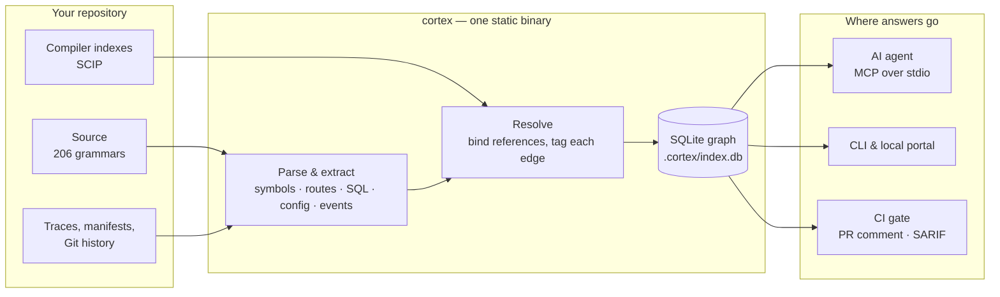

<div align="center">

<picture>
  <source media="(prefers-color-scheme: dark)" srcset="docs/assets/hero-dark.svg">
  
</picture>

<br>

[](https://github.com/satyendrakumarsingh/repocortex/releases)
[](https://github.com/satyendrakumarsingh/repocortex/actions/workflows/ci.yml)
[](#mcp-tools)
[](https://go.dev)
[](LICENSE)

**[Quickstart](#quickstart)** · **[What it answers](#what-it-answers)** · **[MCP tools](#mcp-tools)** · **[How it works](#how-it-works)** · **[Accuracy](#accuracy)** · **[Docs](#documentation)** · **[Roadmap](docs/ROADMAP.md)**

</div>

---

Your coding agent greps, reads twenty files and still misses the caller that breaks. **RepoCortex** indexes your repository into a graph of symbols, calls, routes, tables, configuration and tests, and serves it over the [Model Context Protocol](https://modelcontextprotocol.io). The agent asks one question and gets an answer that says how it knows.

<table>
<tr>
<td width="33%" valign="top">

### Proven, not guessed
Every edge carries its source: **exact** when a compiler proved it, **high** when the syntax tree did, **medium** when it was inferred. Nothing is a similarity score.

</td>
<td width="33%" valign="top">

### Local by construction
One static binary and a SQLite file in `.cortex/`. No account, no telemetry, no network calls when indexing or serving. Your code stays on your machine or your CI runner.

</td>
<td width="33%" valign="top">

### Built for agents
`get_task_context` returns the files, symbols, callers and tests a task needs in one call, and every answer states what it could not see.

</td>
</tr>
</table>

<picture>
  <source media="(prefers-color-scheme: dark)" srcset="docs/assets/demo-dark.svg">
  
</picture>

<sub>Real output from this repository. The caller is marked <code>exact (compiler)</code> because <code>scip-go</code> proved it.</sub>

## Quickstart

```bash
# 1. Install (Go 1.26+; one static binary, no CGO)
go install github.com/satyendrakumarsingh/repocortex/cmd/cortex@latest

# 2. Index your repository (writes .cortex/index.db)
cd your-project
cortex init && cortex index && cortex resolve

# 3. Connect your agent (Cursor, Claude Code, Claude Desktop, Windsurf, Antigravity)
cortex install --rules
```

Restart the agent. It now calls `get_task_context` and `impact_analysis` instead of searching blind. Check it from the terminal:

```bash
cortex context "how does authentication work?"
```

<details>
<summary><b>Other ways to install</b></summary>

<br>

| Platform | Command |
|---|---|
| macOS / Linux (Homebrew) | `brew install satyendrakumarsingh/tap/cortex` |
| macOS / Linux (script) | `curl -fsSL https://raw.githubusercontent.com/satyendrakumarsingh/repocortex/main/install.sh \| sh` |
| Windows (PowerShell) | Download [`install.ps1`](install.ps1), then `Unblock-File .\install.ps1; .\install.ps1` |
| Offline / air-gapped | Download an archive from [Releases](https://github.com/satyendrakumarsingh/repocortex/releases) and verify it against `SHA256SUMS` |

The script and Homebrew install from tagged releases. Builds exist for macOS (Apple Silicon and Intel), Linux (amd64, arm64) and Windows (amd64). The command is `cortex`; `repocortex` is an alias.

</details>

<details>
<summary><b>Upgrade to compiler-proven edges</b></summary>

<br>

Syntax-tree resolution is fast and works for 206 grammars. For Go, TypeScript, Java and others, a compiler index turns most edges into `exact`:

```bash
cortex indexers install --yes --out-dir .cortex/scip
cortex scip import .cortex/scip/go.scip
```

Indexers are pinned to a version and verified against a recorded digest before they run. Java is refused unless you pass `--allow-repo-build`, because indexing it runs the repository's own build.

</details>

## What it answers

Every question below is a CLI command and, where marked, an MCP tool your agent can call.

| You want to know | Command | MCP tool |
|---|---|---|
| What does this task touch? | `cortex context "<task>"` | `get_task_context` |
| Who calls this, and what does it call? | `cortex callers` · `cortex callees` | `find_callers` |
| What breaks if I change it? | `cortex impact --base main --head HEAD` | `impact_analysis` |
| Which tests cover it? | | `find_tests` |
| Can I rename it safely? | `cortex rename old new` | `plan_rename` |
| In what order should I make a large change? | `cortex plan-change <symbol>` | `plan_change` |
| Which HTTP routes, tables and settings does the code use? | `cortex api` · `cortex db` · `cortex config` | `find_api_endpoints` · `find_db_access` · `get_config_key` |
| Which queues and topics connect the services? | `cortex events` | |
| What did a production request actually run? | `cortex trace` | |
| Who has context on this code? | `cortex who` | |
| Does the code follow the declared architecture? | `cortex arch` | |
| What did the change do to the facts, not the text? | `cortex diff` | `minimize_diff` |
| Did the agent's change do what it was asked? | `cortex compile` → `cortex verify` | |
| How does this fit with my other repositories? | `cortex system` | |
| What can't the index see? | `cortex missed` · `cortex languages` | `detect_blindspots` · `resolution_coverage` |

<details>
<summary><b>Everything else in the CLI</b></summary>

<br>

| Area | Commands |
|---|---|
| Index lifecycle | `init` · `index` · `resolve` · `watch` · `hooks install` · `status` · `doctor` |
| Compiler facts | `indexers pins` · `indexers install` · `scip import` · `accuracy` |
| Navigation | `symbol` · `references` · `search` · `prune` · `diff-minimize` |
| Reports | `report pr` · `report sarif` · `docs` · `export` · `infra` · `deps` |
| Agents | `serve` · `agent` · `install` · `bench` |
| Portal | `ui` |

Every command takes `--project <dir>`, `--json`, `-q` and `-v`. Full reference: [docs/CLI.md](docs/CLI.md).

</details>

## MCP tools

The server exposes a deliberately small set by default: every tool's schema costs the agent context on every request. Choose a profile in `.cortex.yml` (`mcp: { profile: standard }`).

| Tool | What it returns | Profile |
|---|---|:---:|
| `get_task_context` | Files, symbols, callers and tests for a task, in one call | minimal |
| `get_project_overview` | Languages, size, entry points and index coverage | minimal |
| `search_code` | Ranked text search over indexed code | minimal |
| `find_symbol` · `get_symbol` | Definitions by name; a declaration with its signature and docs | minimal |
| `find_references` · `find_callers` | Uses and callers across files, each with how sure it is | minimal |
| `find_tests` · `impact_analysis` | Tests that reach a symbol; what a change can reach | standard |
| `plan_rename` · `plan_change` | Every site a rename edits; an ordered, test-gated change plan | standard |
| `find_api_endpoints` · `find_db_access` · `get_config_key` | Routes, table access and configuration readers | standard |
| `get_file_outline` · `minimize_diff` | A file without its bodies; a diff reduced to structure | standard |
| `resolution_coverage` · `detect_blindspots` | How much of the index is bound; what it could not see | standard |

`minimal` (the default) exposes 7 tools; `standard` and `full` expose all 18. Setup for each client: [docs/agent-integration.md](docs/agent-integration.md).

<details>
<summary><b>Manual MCP configuration</b></summary>

<br>

```json
{
  "mcpServers": {
    "cortex": { "command": "cortex", "args": ["serve", "--project", "/absolute/path/to/repo"] }
  }
}
```

Claude Code: `claude mcp add cortex -- cortex --project "$(pwd)" serve`

</details>

## How it works



### Confidence tiers

| Tier | Source | Measured precision | How to use it |
|---|---|:---:|---|
| `exact` | Compiler index (SCIP) | **100.0%** | Safe for automated refactors and blocking CI gates |
| `high` | Syntax tree with explicit imports and receiver matching | **86.8 – 99.5%** | Primary guidance for exploring and planning |
| `medium` | Inference between several candidates | **5.7 – 37.5%** | A lead to check, never acted on alone |
| `low` | Loose name matches across packages | **0.0 – 2.8%** | Hidden unless asked for |

### Language support

| Tier | Languages | What you get |
|---|---|---|
| **typed** (3) | Go, Java, TypeScript | Definitions, imports, receiver and arity matching; references can reach `high` |
| **resolved** (11) | C, C#, C++, JavaScript, Kotlin, PHP, Python, Ruby, Rust, Scala, TSX | Definitions and imports; references bind across files |
| **parsed** (192) | Everything else tree-sitter covers | Definitions and search; no cross-file references claimed |

Run `cortex languages` for the list your build supports. Compiler indexes raise any of these to `exact`.

## Accuracy

Measured on five production repositories (8,151 files, 91,548 symbols) against compiler ground truth:

| Language | `high` precision | `high` recall | F1 | Adjudicated edges |
|---|:---:|:---:|:---:|:---:|
| TypeScript | **99.5%** | 66.4% | 79.6% | 12,410 |
| Go | **98.6%** | 60.4% | 75.0% | 11,353 |
| Python | **94.2%** | 56.3% | 70.4% | 7,130 |
| Java (Spring REST) | **100.0%** | 32.7% | 49.2% | 82 |

> [!NOTE]
> Between a third and two fifths of call sites can't be bound from syntax alone. RepoCortex reports those gaps instead of returning an empty answer, and `cortex scip import` closes most of them. Run `cortex accuracy` on your own code. Method: [docs/accuracy.md](docs/accuracy.md).

## Compared with other approaches

| | RepoCortex | Vector search (RAG) | Language servers | SAST (CodeQL, Semgrep) | `grep` / `rg` |
|---|:---:|:---:|:---:|:---:|:---:|
| Call graph across many languages | ✓ | | one language | ✓ | |
| States how sure each answer is | ✓ | | | | |
| Routes, SQL, events and config in one graph | ✓ | | | partly | |
| Blast radius of a commit range | ✓ | | | | |
| Built as an MCP server for agents | ✓ | some | | | |
| Runs fully offline from one binary | ✓ | rarely | ✓ | some | ✓ |

## In CI

The [change-safety workflow](.github/workflows/cortex-gate.yml) indexes the pull request, imports compiler facts, posts a sticky PR comment with the blast radius, uploads SARIF to code scanning, and fails on architecture violations or high-severity blindspots.

```yaml
- run: go install github.com/satyendrakumarsingh/repocortex/cmd/cortex@latest
- run: cortex init && cortex index && cortex resolve
- run: cortex arch --fail-on high && cortex missed --fail-on high
- run: cortex impact --base origin/${{ github.base_ref }} --head HEAD --json > impact.json
- run: cortex report pr --impact impact.json
```

Details: [docs/operations/ci-cd-gates.md](docs/operations/ci-cd-gates.md).

## Local portal

`cortex ui` opens a read-only portal at `http://localhost:7777`: a map of the code, blast-radius explorer, routes and the tables they touch, test coverage, ownership and the agent's view of the index. It binds to loopback only and loads nothing from the network.

## Security and privacy

- **No outbound calls.** Indexing, resolution and the MCP server make no network requests. No telemetry.
- **Secrets stay out.** High-entropy strings and credential patterns are redacted before anything is indexed.
- **Repositories can't run code.** `.cortex.yml` describes what to index, never what to execute.
- **Answers are marked as evidence.** MCP responses label repository text as untrusted, to blunt prompt injection.

Threat model: [docs/security.md](docs/security.md). Report a vulnerability: [SECURITY.md](.github/SECURITY.md).

## Documentation

| | |
|---|---|
| [User guide](docs/USER_GUIDE.md) | Day-to-day use, end to end |
| [Agent integration](docs/agent-integration.md) | Cursor, Claude Code, Claude Desktop, Windsurf, Antigravity, Zed |
| [CLI reference](docs/CLI.md) | Every command and flag |
| [Architecture](docs/DESIGN_AND_ARCHITECTURE.md) | Packages, invariants and design decisions |
| [Accuracy](docs/accuracy.md) · [Performance](docs/performance.md) | How the numbers above are measured |
| [Why not vector RAG?](docs/WHY_NOT_VECTOR_RAG.md) | The case for a graph |
| [FAQ](docs/FAQ.md) · [Troubleshooting](docs/troubleshooting.md) | Common questions and fixes |
| [Roadmap](docs/ROADMAP.md) | What is missing and what is next |

## Contributing

Issues and pull requests are welcome; start with [CONTRIBUTING.md](.github/CONTRIBUTING.md) and the [Code of Conduct](.github/CODE_OF_CONDUCT.md). Ideas and questions go to [Discussions](https://github.com/satyendrakumarsingh/repocortex/discussions).

Licensed under [Apache 2.0](LICENSE).
