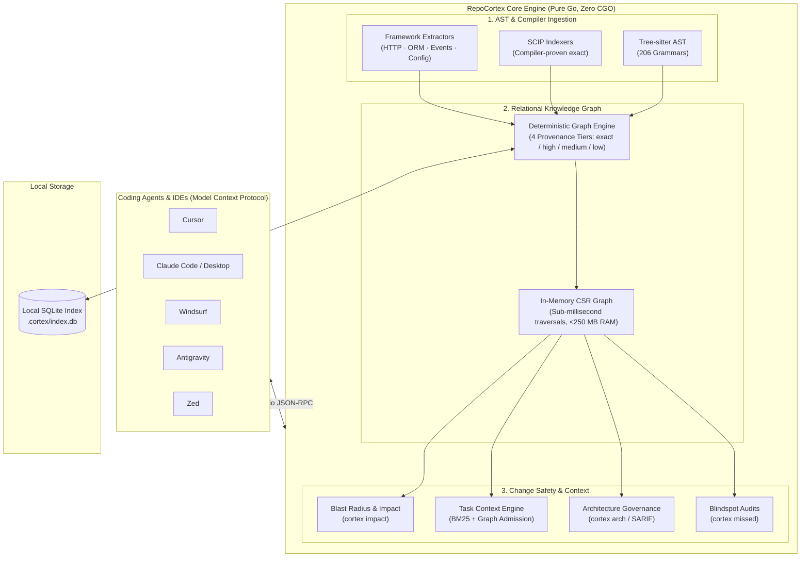

<!--
<script type="application/ld+json">
{
  "@context": "https://schema.org",
  "@type": "SoftwareApplication",
  "name": "RepoCortex",
  "alternateName": ["cortex", "repocortex", "cortex"],
  "applicationCategory": "DeveloperApplication",
  "operatingSystem": "macOS, Linux, Windows",
  "description": "Deterministic Code Intelligence & Change Safety Engine for AI Coding Agents (Cursor, Claude Code, Windsurf, Antigravity) over Model Context Protocol (MCP).",
  "url": "https://github.com/satyendrakumarsingh/repocortex",
  "downloadUrl": "https://github.com/satyendrakumarsingh/repocortex/releases",
  "softwareVersion": "0.1.0",
  "license": "https://opensource.org/licenses/Apache-2.0",
  "programmingLanguage": ["Go", "TypeScript", "Python", "Java", "C#", "Rust"],
  "keywords": "mcp-server, code-intelligence, ai-coding-agents, code-graph, blast-radius, tree-sitter, cursor, claude-code, windsurf, antigravity, static-analysis, scip"
}
</script>
-->

<div align="center">

```text
  ____                      ____            _             
 |  _ \ ___ _ __   ___     / ___|___  _ __ | |_ _____  __ 
 | |_) / _ \ '_ \ / _ \   | |   / _ \| '__|| __/ _ \ \/ / 
 |  _ <  __/ |_) | (_) |  | |__| (_) | |   | ||  __/>  <  
 |_| \_\___| .__/ \___/    \____\___/|_|    \__\___/_/\_\ 
           |_|                                            
```

### **Deterministic Code Intelligence & Change Safety for AI Coding Agents**

*Stop your AI agent from burning 40,000 tokens rediscovering your codebase.*<br>
A local-first, zero-CGO code intelligence engine that indexes your repository into a queryable knowledge graph and serves it to AI agents over the [Model Context Protocol (MCP)](https://modelcontextprotocol.io). Every fact carries its compiler- or AST-proven provenance.

---

[](https://github.com/satyendrakumarsingh/repocortex/actions/workflows/ci.yml)
[](https://scorecard.dev/viewer/?uri=github.com/satyendrakumarsingh/repocortex)
[](https://slsa.dev)
[](docs/accuracy.md)
[](https://go.dev)
[](https://github.com/satyendrakumarsingh/repocortex)
[](https://sqlite.org)
[](https://modelcontextprotocol.io)
[](llms.txt)
[](LICENSE)

<br>

**1-Click Agent Integration:**<br>
`Cursor` · `Claude Code` · `Windsurf` · `Google Antigravity` · `Claude Desktop` · `Zed`

<br>

[⚡ 60s Quickstart](#-60-second-quickstart) ·
[🧠 Why Not Vector RAG?](docs/WHY_NOT_VECTOR_RAG.md) ·
[🤖 LLM Manifest](llms.txt) ·
[🚀 Key Features](#-key-features) ·
[🏗️ Architecture](#-how-it-works) ·
[📊 Accuracy](#-accuracy--benchmarks) ·
[⚖️ Comparison](#-repocortex-vs-alternatives) ·
[❓ FAQ](#-frequently-asked-questions-faq) ·
[📖 User Guide](docs/USER_GUIDE.md)

</div>

---

> [!NOTE]
> **Why we built RepoCortex:**
> Watching an AI coding agent burn 40,000 tokens running exploratory greps across a 500k-line monorepo—only to miss an interface implementation and break production—is painful, expensive, and unnecessary.
>
> Instead of guessing through fuzzy vector similarities or shipping your proprietary source code to third-party embedding APIs, RepoCortex parses your codebase locally into a deterministic knowledge graph of AST symbols, call hierarchies, HTTP routes, SQL tables, and test coverage.
>
> **100% local. Zero CGO. Pure deterministic truth.**

```text
╭────────────────────────────────────────────────────────────────────────────────╮
│  $ cortex impact --base main..HEAD                                             │
│                                                                                │
│  ⚡ Risk: HIGH (Score: 82/100) — 14 symbols reached from 2 changed              │
│                                                                                │
│  How much of the blast radius is proven:                                       │
│  ├── 🟢 85% exact   [Compiler type-checked via SCIP]                            │
│  └── 🔵 15% high    [AST receiver & import validated]                           │
│                                                                                │
│  Impacted Execution Chain:                                                      │
│  ● PaymentGateway.ChargeToken()           internal/pay/gateway.go:42            │
│    └── CheckoutHandler.HandleOrder()      api/controllers/order.go:118          │
│        └── Kafka topic: "orders.charged"  (3 downstream microservices)          │
│                                                                                │
│  Covering Test Suite:                                                          │
│  ✓ TestOrderCheckoutFlow (via proven call edge)  tests/order_test.go:56        │
╰────────────────────────────────────────────────────────────────────────────────╯
```

---

## ⚡ 60-Second Quickstart

### 1. Install the standalone binary
```bash
# Via Go (Zero CGO, zero external build dependencies)
go install github.com/satyendrakumarsingh/repocortex/cmd/cortex@latest

# Or via curl installer (macOS / Linux, checksum-verified)
curl -fsSL https://raw.githubusercontent.com/satyendrakumarsingh/repocortex/main/install.sh | sh
```
*(CLI commands: `cortex` (primary), with `repocortex` and `cortex` aliases fully supported).*

### 2. Index your repository
```bash
cd your-project
cortex init && cortex index && cortex resolve
```
*(Creates a self-contained SQLite knowledge graph inside `.cortex/` in seconds; backwards-compatible with existing `.cortex/`).*

### 3. Connect your AI coding agent
```bash
# Auto-detects Cursor, Claude, Windsurf, or Antigravity and injects agent guidance
cortex install --rules
```
*Restart your IDE or agent. When you prompt your agent, it automatically queries `get_task_context` and `impact_analysis` instead of wasting tokens running exploratory greps.*

---

## 🧠 Mental Model: Before vs. After RepoCortex

| Capability | Without RepoCortex (Vector RAG / Grep) | With RepoCortex (Deterministic Graph) |
|---|:---:|:---:|
| **Task Discovery** | ❌ 15+ exploratory greps & file reads (~35k tokens, 30s) | ⚡ **1 call**: `get_task_context` (~800 tokens, 10ms) |
| **Refactoring Blast Radius** | ❌ Misses callers with different names; breaks at runtime | ✅ **Complete, compiler-proven blast radius** with confidence tiers |
| **Test Gap Detection** | ❌ Searches by filename matching; misses indirect tests | ✅ **Traces proven call edges** to identify covering tests (`cortex missed`) |
| **Data Privacy & IP Safety** | ⚠️ Source code chunked & sent to third-party embedding APIs | ✅ **100% local SQLite**; zero source code ever leaves your machine |
| **Resolution Accuracy** | ❌ Hallucinates edges based on textual similarity | ✅ **Compiler-backed `exact` (SCIP)** and AST-proven `high` edges |
| **CI / CD Quality Gates** | ❌ None (Ad-hoc prompt rules) | ✅ **Blocking CI gates** (`arch`, `missed`, `impact`) with SARIF 2.1.0 output |

> [!TIP]
> **Deep Dive**: Curious why semantic search and vector embeddings fail on source code? Read our technical essay:  
> [👉 Why Vector RAG Fails for Code: The Case for Deterministic Graph Intelligence](docs/WHY_NOT_VECTOR_RAG.md)

---

## 🏗️ How It Works

RepoCortex combines fast Tree-sitter AST extraction, compiler-backed SCIP indexers, and framework extractors into a unified relational graph stored in local SQLite.



### The 4 Confidence Tiers

RepoCortex never conflates a compiler fact with a regex guess. Every edge in the graph carries immutable provenance:

| Tier | Source | Measured Precision | What Your Agent Does |
|---|---|:---:|---|
| `exact` | Compiler-backed SCIP index (`scip-go`, `scip-typescript`, etc.) | **100.0%** | Safe for automated refactoring, renames, and blocking CI gates. |
| `high` | Tree-Sitter AST with explicit package imports and receiver matching | **86.8% – 99.5%** | Reliable primary guidance for code exploration and planning. |
| `medium` | Multi-candidate type inference or package-level heuristics | **5.7% – 37.5%** | Treated as investigatory leads; never acted upon without human review. |
| `low` | Loose identifier matches across unrelated packages | **0.0% – 2.8%** | Filtered by default. Exposed only when explicitly requested. |

---

## 🚀 Key Features

<table>
<tr>
<td width="50%" valign="top">

### 🧠 Deterministic Code Intelligence
* **206 Tree-sitter Grammars**: Definitions, imports, and cross-file references across 14 core languages.
* **Compiler-Backed Precision**: Integrates with [SCIP](https://github.com/scip-code/scip) for compiler-checked `exact` call graphs.
* **Arity & Receiver Disambiguation**: Resolves overloaded methods by parameter counts in Java, TypeScript, and C#.

</td>
<td width="50%" valign="top">

### 🛡️ Change Safety & Blast Radius
* **Transitive Blast Radius (`cortex impact`)**: Recursive caller traversal with hub pruning across loggers and base classes.
* **Test Gap Detection (`cortex missed`)**: Finds which execution branches lack test coverage before you merge.
* **Safe Automated Refactoring (`cortex rename`)**: Multi-file identifier updates with automated atomic rollback.

</td>
</tr>
<tr>
<td width="50%" valign="top">

### 🌐 Cross-Stack Topologies
* **HTTP / REST Endpoints**: Statically extracts route handlers across Spring, Gin, Express, FastAPI, Django, and NestJS.
* **Database Access Maps**: Maps SQL queries and ORM models (Prisma, GORM, Hibernate, SQLAlchemy) to caller methods.
* **Event Broker Queues**: Discovers producers and consumers across Kafka, RabbitMQ, SQS, SNS, and GCP Pub/Sub.

</td>
<td width="50%" valign="top">

### 🏛️ Architecture Governance & CI
* **Boundary Rules (`cortex arch`)**: Declaratively enforce architectural invariants (e.g. `domain` must never import `controller`).
* **Pull Request Gates**: Posts sticky, bounded PR comments with risk scores and uploads SARIF 2.1.0 to GitHub Code Scanning.
* **100% Offline & Private**: Zero telemetry, zero cloud dependencies. Your code never leaves your runner.

</td>
</tr>
</table>

---

## 📊 Accuracy & Benchmarks

RepoCortex publishes measured ground-truth numbers across five real-world production repositories (8,151 files, 91,548 symbols) adjudicated against compiler-backed ground truth:

| Language | `high` Precision | `high` Recall | F1 Score | Adjudicated Edges |
|---|:---:|:---:|:---:|:---:|
| **TypeScript** | **99.5%** | 66.4% | 79.6% | 12,410 |
| **Go** | **98.6%** | 60.4% | 75.0% | 11,353 |
| **Python** | **94.2%** | 56.3% | 70.4% | 7,130 |
| **Java** (Spring REST) | **100.0%** | 32.7% | 49.2% | 82 |

> **The Honest Engineering Headline**: Between one-third and two-fifths of call sites cannot be uniquely resolved by heuristic AST parsing alone. That is why RepoCortex explicitly reports **coverage gaps** rather than showing empty results, and provides a 1-command upgrade to compiler SCIP indexing (`cortex scip import`).

<details>
<summary><b>🔍 View Accuracy Methodology & Benchmark Repositories</b></summary>

Full methodology, precision/recall curves, and reproduction steps are documented in [docs/accuracy.md](docs/accuracy.md) and [docs/BENCHMARKING.md](docs/BENCHMARKING.md).

To run the accuracy evaluator against your local project:
```bash
cortex accuracy
```
</details>

---

## ⚖️ RepoCortex vs. Alternatives

| Capability | RepoCortex | Vector RAG Embeddings | Traditional LSP (gopls, tsserver) | Heavy SAST (CodeQL, Semgrep) | Text Greppers (`rg`) |
|:---|:---:|:---:|:---:|:---:|:---:|
| **Zero-Setup Polyglot Indexing** | **✅ Yes** (Pure Go) | ⚠️ Yes (Raw text) | ❌ No (Toolchain per language) | ❌ No (Complex setups) | **✅ Yes** |
| **Deterministic Call Graph** | **✅ Yes** | ❌ No (Fuzzy similarity) | ✅ Yes (Single language) | ✅ Yes | ❌ No (String match) |
| **Cross-Stack Topologies (DB/API/Events)** | **✅ Yes** | ❌ No | ❌ No | ⚠️ Partial (Security only) | ❌ No |
| **Calibrated Confidence Provenance** | **✅ Yes** (4 Tiers) | ❌ No (Float distance) | ⚠️ Implicit | ❌ No | ❌ No |
| **Transitive Blast Radius (`impact`)** | **✅ Yes** (Hub pruned) | ❌ No | ❌ No | ❌ No | ❌ No |
| **AI Agent MCP Server Native** | **✅ Yes** | ⚠️ Partial (Retrieval only) | ❌ No | ❌ No | ❌ No |
| **Atomic Multi-File Refactor Rollback**| **✅ Yes** | ❌ No | ⚠️ Partial (LSP rename) | ❌ No | ❌ No |
| **Incremental File Watch Latency** | **⚡ <50 ms** | ⏱️ Seconds to minutes | ⏱️ <100 ms | 🐢 Hours (Batch only) | ⚡ Stateless |
| **Memory Footprint (10k Files)** | **⚡ <250 MB** | 🐢 1–3 GB + Vector DB | 🐢 2–6 GB (Multiple daemons)| 🐢 4–16 GB | ⚡ <50 MB |
| **100% Air-Gapped / Local Operation** | **✅ Yes** | ⚠️ Often needs cloud API | **✅ Yes** | ⚠️ Often cloud-hosted | **✅ Yes** |
| **Single Standalone Static Binary** | **✅ Yes** (Zero CGO) | ❌ No | ❌ No | ❌ No | **✅ Yes** |

---

## 🛠️ Installation & Upgrades

<details open>
<summary><b>📦 Installation Methods</b></summary>

### macOS & Linux (Checksum-Verified Install Script)
```bash
curl -fsSL https://raw.githubusercontent.com/satyendrakumarsingh/repocortex/main/install.sh | sh
```

### Windows (PowerShell)
```powershell
Invoke-WebRequest -Uri https://raw.githubusercontent.com/satyendrakumarsingh/repocortex/main/install.ps1 -OutFile install.ps1
Unblock-File .\install.ps1
.\install.ps1
```

### Via Go 1.25+
```bash
go install github.com/satyendrakumarsingh/repocortex/cmd/cortex@latest
```

### Pre-Compiled Standalone Binaries (Air-Gapped Workstations)
Pre-built, zero-CGO binaries are available on the [Releases](https://github.com/satyendrakumarsingh/repocortex/releases) page for:
* **macOS Universal** (Apple Silicon M1-M4 & Intel x86_64)
* **Linux AMD64 & ARM64**
* **Windows AMD64**

</details>

---

## 🤖 Connecting Your Coding Agent

RepoCortex provides an embedded stdio MCP server designed specifically for coding agents.

### Automated Setup
```bash
cortex install --rules
```
This automatically registers RepoCortex in:
* **Cursor**: `~/.cursor/mcp.json`
* **Windsurf**: `~/.codeium/windsurf/mcp_config.json`
* **Claude Desktop**: Native macOS, Windows (`%APPDATA%`), and Linux config paths
* **Google Antigravity**: `~/.gemini/antigravity/mcp_config.json`
* **Claude Code**: `~/.claude.json`

And injects behavioral guidance into `.cursorrules`, `CLAUDE.md`, or `AGENTS.md` so agents query the graph instead of grepping.

### Manual Setup (Any Stdio MCP Client)
```json
{
  "mcpServers": {
    "cortex": {
      "command": "cortex",
      "args": ["serve", "--project", "/absolute/path/to/repo"]
    }
  }
}
```

<details>
<summary><b>🛠️ View Exposed MCP Tools & Profiles</b></summary>

| Tool | Purpose | Profile |
|---|---|:---:|
| `get_task_context` | Resolves relevant files, symbols, callers, and tests for a task prompt in 1 call | `minimal` (default) |
| `get_project_overview` | Languages, size, coverage, entry points | `minimal` |
| `search_code` | SQLite FTS5 BM25 search across indexed code | `minimal` |
| `find_symbol` | Exact symbol definition lookups | `minimal` |
| `find_references` | Cross-file references to a symbol | `minimal` |
| `find_callers` | Direct call edges entering a symbol | `minimal` |
| `impact_analysis` | Transitive blast radius of modifying a symbol | `standard` / `full` |
| `find_tests` | Covering test functions discovered along call paths | `standard` / `full` |
| `find_api_endpoints` | HTTP routes, method types, and route handlers | `standard` / `full` |
| `find_db_access` | Database tables and caller methods reading/writing them | `standard` / `full` |
| `detect_blindspots` | Unresolved calls, orphan tables, unmapped endpoints | `standard` / `full` |
| `plan_change` | Synthesizes an ordered refactoring blueprint with test gates | `standard` / `full` |

</details>

---

## 💻 CLI Command Reference

Every command accepts `--project <dir>`, `--json`, `-q/--quiet`, and `-v/--verbose`. Commands can be run as `cortex`, `repocortex`, or `cortex`.

<details>
<summary><b>📖 Expand Complete CLI Reference (35+ Commands)</b></summary>

### 1. Index Lifecycle
* `cortex init` — Initialize the `.cortex/` SQLite database.
* `cortex index` — Build or incrementally update the symbol index.
* `cortex resolve` — Bind references to definitions and construct the call graph.
* `cortex watch` — Start a file watcher for real-time index synchronization.
* `cortex hooks install` — Install Git pre-commit hooks for 20ms incremental updates.
* `cortex status` — Print index counts, committed revisions, and health.
* `cortex doctor` — Verify database integrity, schema migrations, and invariants.
* `cortex scip import <file.scip>` — Ingest compiler-proven facts.

### 2. Code Intelligence & Navigation
* `cortex context "<task>"` — Assemble a complete, pruned context pack for an LLM prompt.
* `cortex symbol <name>` — Find symbol definitions by exact identifier.
* `cortex callers <symbol>` / `callees <symbol>` — Upstream and downstream call edges.
* `cortex references <symbol>` — All cross-file references.
* `cortex search "<query>"` — Full-text FTS5 BM25 search.
* `cortex prune <file>` — Strip method bodies, leaving signatures and docstrings.
* `cortex diff-minimize <patch>` — Compress diffs to minimize token consumption.

### 3. Change Safety & Architecture
* `cortex impact --base <rev> --head <rev>` — Transitive blast radius analysis.
* `cortex compile "<task>"` — Generate a verifiable task contract before making changes.
* `cortex verify --contract <contract.json>` — Enforce that changes honored their contract.
* `cortex rename <old> <new> --apply` — AST-aware safe renaming with automated rollback.
* `cortex arch` — Audit architectural boundary rules and ADR compliance.
* `cortex missed` — Audit code blindspots (unresolved calls, unmapped routes).
* `cortex who <symbol>` — Context routing: find engineers with git history on affected code.

### 4. Distributed Microservice Topologies
* `cortex api` — List HTTP endpoints, routes, and handler functions.
* `cortex db` — List database tables and reader/writer methods.
* `cortex events` — Discover Kafka, RabbitMQ, SQS, and Pub/Sub event queues.
* `cortex config` — Audit configuration keys and consumer locations.
* `cortex deps` — Report declared dependencies vs actually imported packages.
* `cortex system` — Federate multiple repositories into a unified system graph.

### 5. Web Portal & Reporting
* `cortex ui` — Launch the embedded interactive visual portal at `http://localhost:7777`.
* `cortex report pr` — Generate GitHub PR markdown summaries with confidence breakdowns.
* `cortex report sarif` — Generate SARIF 2.1.0 reports for GitHub Code Scanning.

</details>

---

## 🌐 Local Web Portal

RepoCortex includes an embedded, high-performance visual dashboard that runs 100% offline with zero external web assets:

```bash
cortex ui
# Opens interactive portal at http://localhost:7777
```

* **Interactive Code Maps**: Graph, Tree, and Treemap visualizers.
* **Blast Radius Explorer**: Visually inspect affected upstream callers before editing code.
* **Architecture Matrix**: Review boundary violations and data flow compliance.
* **360° Symbol Inspector**: Jump from symbol definition to HTTP handlers, database queries, and covering unit tests.
* **Offline & Secure**: Binds exclusively to loopback (`127.0.0.1`), strictly enforces CSP, and makes zero network requests.

---

## 🚦 GitHub Actions CI / CD Integration

RepoCortex ships a turnkey change-safety gate workflow ([`.github/workflows/cortex-gate.yml`](.github/workflows/cortex-gate.yml)). Add it to your repository to enforce change safety on every Pull Request:

```yaml
name: RepoCortex Change Safety Gate

on:
  pull_request:
    types: [opened, synchronize, reopened]

jobs:
  gate:
    runs-on: ubuntu-latest
    permissions:
      contents: read
      pull-requests: write
      security-events: write

    steps:
      - uses: actions/checkout@v4
        with:
          fetch-depth: 0

      - uses: actions/setup-go@v5
        with:
          go-version: '1.25'

      - name: Install RepoCortex
        run: go install github.com/satyendrakumarsingh/repocortex/cmd/cortex@latest

      - name: Index & Resolve
        run: |
          cortex init
          cortex index
          cortex resolve

      - name: Check Architecture & Blindspots
        run: |
          cortex arch --fail-on high
          cortex missed --fail-on high

      - name: Change Impact Analysis
        run: |
          cortex impact --base origin/${{ github.base_ref }} --head HEAD --json > impact.json
          cortex report pr --impact impact.json
```

---

## 🔒 Security & Privacy Invariants

1. **Local-First & Air-Gapped**: The SQLite registry resides inside `.cortex/` (or `.cortex/`). Indexing, resolution, and MCP serving make **zero outbound network connections**.
2. **Zero Telemetry**: No tracking, no user analytics, no phone-home pings.
3. **Automated Secret Redaction**: High-entropy strings, API keys, and credential patterns are stripped before entering the index.
4. **No Code Execution via Repository Config**: `.cortex.yml` structurally forbids execution commands. A repository cannot trigger scripts on `index`.
5. **Untrusted Evidence Labelling**: MCP server responses explicitly tag repository source code as untrusted evidence to prevent prompt injection attacks against your agent.

---

## ❓ Frequently Asked Questions (FAQ)

### What is RepoCortex?
**RepoCortex** (`cortex`) is an open-source, local-first code intelligence engine and Model Context Protocol (MCP) server for AI coding agents such as Cursor, Claude Code, Windsurf, and Google Antigravity. It indexes your codebase into a deterministic relational knowledge graph (AST symbols, references, call graphs, HTTP routes, database models, and test linkages) stored in local SQLite.

### Why does RepoCortex outperform Vector RAG for source code?
Vector RAG relies on semantic distance embeddings, which measure natural language similarity rather than programmatic truth. In source code, two completely different functions often look lexically similar, while interface implementations, dynamic dispatches, or downstream callers share zero textual similarity. RepoCortex uses compiler-grade SCIP indexers and Tree-sitter AST parsers to provide proven, deterministic relationships with calibrated confidence tiers (`exact`, `high`, `medium`, `low`).

### How does RepoCortex reduce token consumption by up to 90%?
When an AI agent investigates a codebase using raw grep or file reads, it typically performs 15+ exploratory queries, consuming 35,000–50,000 tokens per task. With RepoCortex, the agent makes a single MCP call to `get_task_context(task="...")`, which traverses the call graph and returns only the directly relevant symbols, call chains, and covering unit tests in under 800 tokens.

### Which AI coding agents and IDEs work with RepoCortex?
RepoCortex natively supports any client implementing the Model Context Protocol (MCP) over stdio:
* **Cursor**: Automated 1-click injection into `~/.cursor/mcp.json` and `.cursorrules`
* **Claude Code**: Single-line registration via `claude mcp add cortex -- cortex --project <dir> serve` or as a plugin (`claude --plugin-dir <dir>`)
* **Windsurf**: Automated setup in `~/.codeium/windsurf/mcp_config.json`
* **Google Antigravity**: Supported via `~/.gemini/antigravity/mcp_config.json`
* **Claude Desktop & Zed**: Full stdio MCP server support

### Does RepoCortex send proprietary source code to external servers?
**No.** RepoCortex is 100% local-first, air-gapped, and zero-CGO. The SQLite database resides in `.cortex/index.db` directly on your disk. It makes zero outbound network calls and collects zero telemetry. Your source code never leaves your local workstation or CI runner.

### How do I use RepoCortex for change safety and blast radius analysis in CI/CD?
RepoCortex provides `cortex impact --base <branch> --head <rev>`, which recursively traces all upstream callers of modified symbols and prunes uninformative hubs (like loggers). In CI/CD, the turnkey GitHub Action ([`.github/workflows/cortex-gate.yml`](.github/workflows/cortex-gate.yml)) automatically posts bounded PR comments with risk scores and uploads standard SARIF 2.1.0 reports to GitHub Code Scanning.

---

## 📚 Documentation Directory

| Guide | Description |
|---|---|
| [📖 User Guide](docs/USER_GUIDE.md) | Comprehensive enterprise user guide and tool comparison matrix |
| [🧠 Why Not Vector RAG?](docs/WHY_NOT_VECTOR_RAG.md) | Technical essay on why deterministic graphs beat vector embeddings |
| [🏛️ Architecture & Design](docs/DESIGN_AND_ARCHITECTURE.md) | Hexagonal architecture, package boundaries, coding standards & invariants |
| [💻 CLI Reference Manual](docs/CLI.md) | Exhaustive command, flag, and option reference with outputs |
| [🤖 Agent Integration Guide](docs/agent-integration.md) | Setting up Cursor, Claude, Windsurf, Antigravity, and custom MCP clients |
| [📊 Accuracy & Ground Truth](docs/accuracy.md) | Measured precision and recall benchmarks against compiler ground truth |
| [⚡ Performance & Benchmarks](docs/performance.md) | Query latencies, memory footprint, and scaling characteristics |
| [🛡️ Security Model](docs/security.md) | Threat model, containment policies, and vulnerability reporting |
| [❓ Frequently Asked Questions](docs/FAQ.md) | In-depth technical questions and honest trade-offs |

---

## 👥 Contributing & License

Contributions are warmly welcome! Please see [CONTRIBUTING.md](CONTRIBUTING.md) and [CLAUDE.md](CLAUDE.md) for architecture guidelines.

* [Code of Conduct](CODE_OF_CONDUCT.md)
* [Security Policy](SECURITY.md)

Licensed under the **[Apache License 2.0](LICENSE)**.
