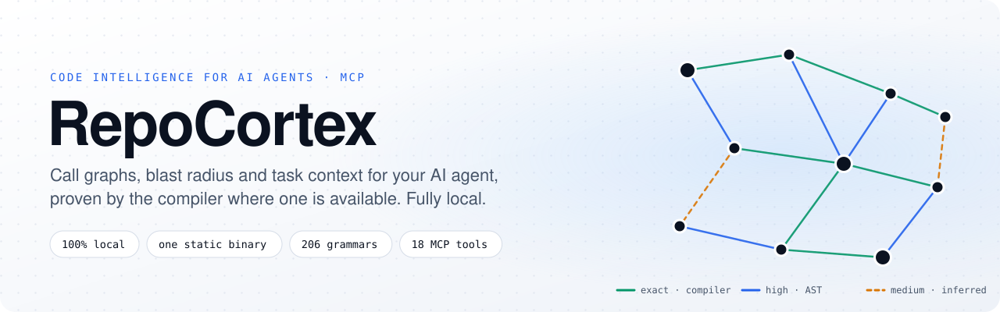
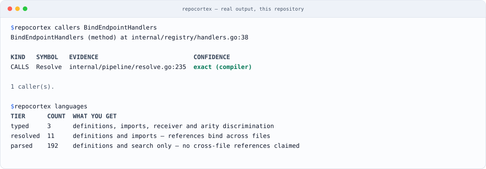
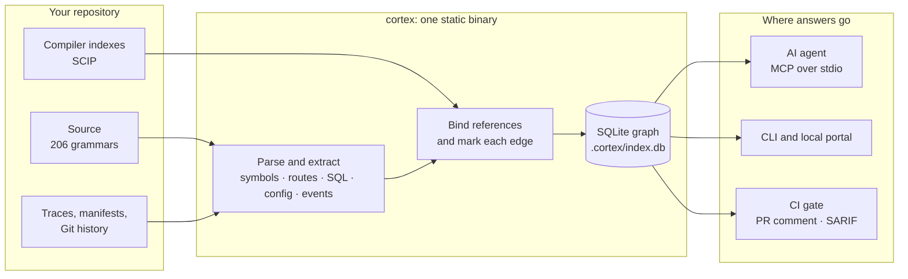
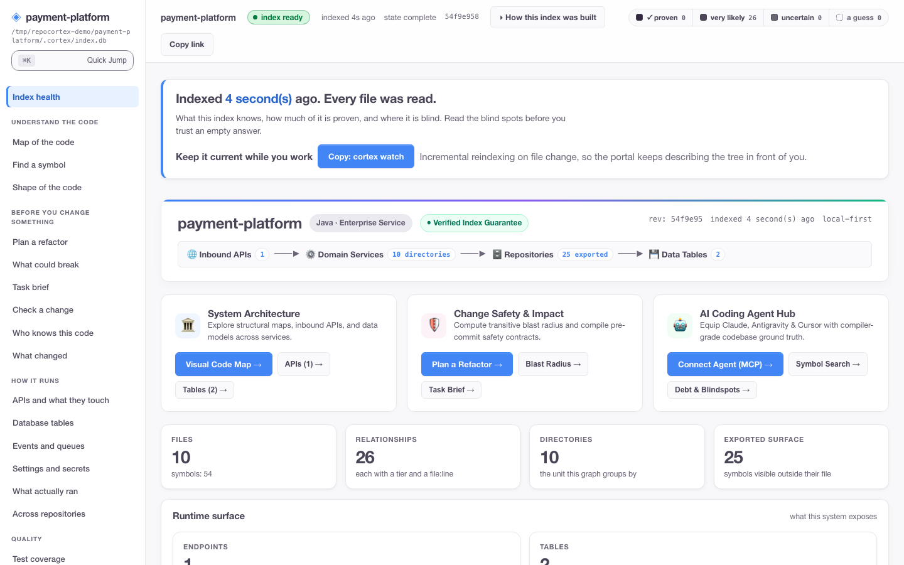

<div align="center">

<picture>
  <source media="(prefers-color-scheme: dark)" srcset="docs/assets/hero-dark.svg">
  
</picture>

# RepoCortex: a code graph MCP server for AI coding agents

[](https://github.com/satyendrakumarsingh/repocortex/actions/workflows/ci.yml)
[](#mcp-tools)
[](https://go.dev)
[](#security-and-privacy)
[](LICENSE)

**Works with** Claude Code · Codex · Cursor · Copilot · Gemini CLI · Windsurf · Antigravity · Zed · Goose · Kiro · [40+ agents](docs/guides/coding-agents.md) · any MCP client over stdio or HTTP

</div>

**Give your AI coding agent a map of your codebase, not a search box.**

RepoCortex is an open-source MCP server and CLI (`cortex`) that indexes a repository into a graph of functions, call edges, HTTP routes, SQL tables, configuration keys and tests, and serves it to your coding agent over the [Model Context Protocol](https://modelcontextprotocol.io). Instead of grepping and reading twenty files, the agent asks one question, such as *what does this task touch?* or *what breaks if I change this?*, and gets callers, tests and blast radius, each marked with how it was found and what the index could not see.

One Go binary. A SQLite file in `.cortex/`. Nothing leaves your machine.

## Contents

| Get started | Use it | Trust it | Reference |
|---|---|---|---|
| [Why RepoCortex](#why-repocortex) | [What it answers](#what-it-answers) | [How it works](#how-it-works) | [MCP tools](#mcp-tools) |
| [Who it's for](#who-its-for) | [Recipes](#recipes) | [Confidence tiers](#confidence-tiers) | [Language support](#language-support) |
| [Quickstart](#quickstart) | [How an agent uses it](#how-an-agent-uses-it) | [Accuracy](#accuracy) | [Guides and docs](#guides-and-documentation) |
| [Install options](#install-options) | [Blast radius in CI](#blast-radius-in-ci) | [Performance](#performance) | [FAQ](#faq) |
| [Connect your agent](#connect-your-agent) | [Local portal](#local-portal) | [Security and privacy](#security-and-privacy) | [Roadmap and community](#roadmap-and-community) |
| [Set up with your AI agent](#set-up-with-your-ai-agent) | [CLI output guide](docs/guides/cli-output-guide.md) | [Troubleshooting](docs/troubleshooting.md) | [Agent integration](docs/agent-integration.md) |

## Why RepoCortex

<table>
<tr>
<td width="33%" valign="top">

### Proven, not guessed
Every edge says how it was found: **exact** when a compiler proved it, **high** when the syntax tree and imports did, **medium** when it was inferred. Nothing is a similarity score.

</td>
<td width="33%" valign="top">

### Local by construction
One static binary and a SQLite file. No account, no telemetry, and no network calls while indexing or serving. Your code stays on your machine or your CI runner.

</td>
<td width="33%" valign="top">

### Built for agents
`get_task_context` returns the files, symbols, callers and tests a task needs in one call, and every answer states what it could not see.

</td>
</tr>
</table>

<picture>
  <source media="(prefers-color-scheme: dark)" srcset="docs/assets/demo-dark.svg">
  
</picture>

<div align="center"><sub>Real output from this repository. The caller is marked <code>exact (compiler)</code> because <code>scip-go</code> proved it.</sub></div>

## Who it's for

| You are | What you get |
|---|---|
| A developer using an AI agent on a real codebase | The agent finds every caller and the tests to run, instead of guessing from search results |
| A reviewer or tech lead | The blast radius and architecture violations of a pull request, in the pull request |
| A team that can't send code to a cloud index | The whole graph built and served locally or on your own CI runner |
| An engineer new to a codebase | Its routes, tables, events, owners and call paths in minutes, from one index |

## Quickstart

```bash
# Install (Go 1.26+; one static binary, no CGO)
go install github.com/satyendrakumarsingh/repocortex/cmd/cortex@latest

# Build the graph for your project (writes .cortex/index.db)
cd your-project
cortex init && cortex index && cortex resolve

# Register with the agents installed on this machine and add their guidance
cortex install --rules
```

Restart your agent. Then try the same questions it will ask:

```bash
cortex context "how does authentication work?"
cortex impact --base main --head HEAD
```

> [!NOTE]
> No versioned release is published yet, so `go install` is the supported install today. `cortex install` points each agent at *this* repository; run it again when you switch projects.

## Set up with your AI agent

Already in Claude Code, Cursor, Windsurf or another coding agent? Paste this prompt into it. The agent installs RepoCortex, builds the index for the repository you have open, and registers the server. It stops before it changes any agent configuration, so you can review it first.

```text
Set up RepoCortex for this repository. Follow the steps in order.

1. Check the toolchain: run `go version`. RepoCortex needs Go 1.26 or newer.
   If Go is missing or older, tell me what to install and stop.
2. Install the binary: run
   `go install github.com/satyendrakumarsingh/repocortex/cmd/cortex@latest`,
   then `cortex --version` to confirm it works.
3. Build the index for this repository: run `cortex init`, `cortex index`
   and `cortex resolve`. These write only to `.cortex/` in this repository.
4. Check the index: run `cortex status`. Report the file and symbol counts.
5. Test it: run `cortex context "<describe a small task in this codebase>"`
   and summarise which files and symbols it returned.
6. Preview the agent registration: run `cortex install --rules --dry-run`
   and show me every file it would change. Wait for my approval.
7. After I approve, run `cortex install --rules` and tell me to restart you.
8. Do not edit any file other than the ones `cortex` writes. Do not commit,
   push, change git configuration or install anything else.
9. End with a short summary: the version installed, the index location, and
   the one command I should run first.
```

Prefer a shorter version? Give your agent this line instead, and it will read the steps from this README:

```text
Set up RepoCortex in this repository by following the "Set up with your AI agent" section of https://github.com/satyendrakumarsingh/repocortex/blob/main/README.md
```

Troubleshooting if a step fails: [docs/troubleshooting.md](docs/troubleshooting.md).

## Install options

| Platform | Command | Available |
|---|---|---|
| Any OS with Go 1.26+ | `go install github.com/satyendrakumarsingh/repocortex/cmd/cortex@latest` | Now |
| macOS / Linux (Homebrew) | `brew install satyendrakumarsingh/tap/cortex` | With the first tagged release |
| macOS / Linux (script) | `curl -fsSL https://raw.githubusercontent.com/satyendrakumarsingh/repocortex/main/install.sh \| sh` | With the first tagged release |
| Windows (PowerShell) | Download [`install.ps1`](install.ps1), then `Unblock-File .\install.ps1; .\install.ps1` | With the first tagged release |
| Offline / air-gapped | An archive from [Releases](https://github.com/satyendrakumarsingh/repocortex/releases), checked against `SHA256SUMS` | With the first tagged release |

Builds cover macOS (Apple Silicon and Intel), Linux (amd64, arm64) and Windows (amd64). The command is `cortex`; `repocortex` is an alias.

## Connect your agent

`cortex install --rules` finds the coding agents on this machine, adds RepoCortex to each one's MCP configuration in the format that agent expects, and writes short guidance to `AGENTS.md` (and to `CLAUDE.md`, `GEMINI.md`, `.cursorrules` and similar files that already exist) so the agent asks the graph before it searches. Other servers and settings in those files are kept.

```bash
cortex install --list      # supported agents, which are detected here, and the file each uses
cortex install --rules     # write the configs and the guidance
```

| Agents | How they connect |
|---|---|
| **CLI agents:** Claude Code, Codex CLI, Copilot CLI, Gemini CLI, Qwen Code, Amp, Auggie, Cline CLI, CodeBuddy, Codebuff, Factory Droid, Junie, Kilo Code, Kimi Code, Kiro, Qoder, Tabnine, Goose, Warp | `cortex install --rules` |
| **Desktop apps and editors:** Cursor, VS Code (Copilot), Visual Studio, Windsurf, Devin Desktop, Antigravity, Claude Desktop, Zed, Continue, LM Studio, Neovim (mcphub.nvim) | `cortex install --rules` |
| **Configured in their own UI or command:** Amazon Q CLI, Cline extension, Roo Code, JetBrains AI Assistant, Eclipse, OpenCode, Crush, Jan, Trae, Qoder IDE, Raycast, Cherry Studio | `cortex install --list` prints the exact step for each |
| **No MCP:** Aider, Plandex | The CLI: `--rules` writes a `CONVENTIONS.md` block for Aider |
| **Remote MCP only:** ChatGPT, Android Studio | `cortex serve --http 127.0.0.1:7788`, with a token on every request ([details](docs/guides/coding-agents.md#remote-mcp-over-http)) |
| **Any other MCP client** | Add the server below to its configuration |

```json
{
  "mcpServers": {
    "cortex": { "command": "cortex", "args": ["--project", "/absolute/path/to/repo", "serve"] }
  }
}
```

Every agent, its config file and format, and the plan for the ones without local MCP: [docs/guides/coding-agents.md](docs/guides/coding-agents.md).

## What it answers

Every question is a CLI command, and most are also an MCP tool your agent calls directly.

| You want to know | CLI | MCP tool |
|---|---|---|
| What does this task touch? | `cortex context "<task>"` | `get_task_context` |
| Who calls this, and what does it call? | `cortex callers` · `cortex callees` | `find_callers` |
| What breaks if I change it? | `cortex impact --base main --head HEAD` | `impact_analysis` |
| Which tests reach it? | `cortex impact` (marks the tests it reaches) | `find_tests` |
| Can I rename it safely? | `cortex rename <old> <new>` | `plan_rename` |
| In what order should I make a large change? | `cortex plan-change <symbol>` | `plan_change` |
| Which HTTP routes, tables and settings does the code use? | `cortex api` · `cortex db` · `cortex config` | `find_api_endpoints` · `find_db_access` · `get_config_key` |
| What did a change do to the facts, not the text? | `cortex diff` · `cortex diff-minimize` | `minimize_diff` |
| What can't the index see? | `cortex missed` · `cortex languages` | `detect_blindspots` · `resolution_coverage` |
| Which queues and topics connect the services? | `cortex events` | CLI only |
| What did a production request actually run? | `cortex trace` | CLI only |
| Who has context on this code? | `cortex who` | CLI only |
| Does the code follow the declared architecture? | `cortex arch` | CLI only |
| Did the agent's change do what it was asked? | `cortex compile` → `cortex verify` | CLI only |
| How does this fit with my other repositories? | `cortex system` | CLI only |

Every command, its output and how to read it: **[CLI output guide](docs/guides/cli-output-guide.md)**.

## How an agent uses it

A typical task, as the agent sees it:

| Step | The agent | RepoCortex returns |
|---|---|---|
| 1 | Calls `get_task_context` with the task in plain words | The ranked files, symbols, callers and tests, with why each was included and what was left out |
| 2 | Calls `find_callers` or `impact_analysis` on the symbol it plans to change | Every known caller and what the change can reach, each marked `exact`, `high` or `medium` |
| 3 | Calls `find_tests` before editing | The tests that reach the changed code, so it runs those first |
| 4 | Makes the change, then you run `cortex verify` | Whether the change stayed inside the task it was given |

Each answer ends by saying what it could not see, so an empty list is never read as "nothing calls this".

## Recipes

<details>
<summary><b>Before a refactor: what breaks?</b></summary>

<br>

```bash
cortex callers ParseConfig
cortex impact --base main --head my-branch
cortex rename ParseConfig LoadConfig     # dry run; --apply edits only the sites it can defend
```

</details>

<details>
<summary><b>Onboarding to an unfamiliar codebase</b></summary>

<br>

```bash
cortex api        # HTTP routes and their handlers
cortex db         # tables and who reads or writes them
cortex events     # Kafka, RabbitMQ, SQS, SNS and Pub/Sub producers and consumers
cortex ui         # read-only portal at http://localhost:7777
```

</details>

<details>
<summary><b>Check what an agent did</b></summary>

<br>

```bash
cortex compile "add idempotency to payment callbacks" --json > contract.json
# ... the agent makes the change ...
cortex verify --contract contract.json
```

</details>

<details>
<summary><b>Turn on compiler-proven edges</b></summary>

<br>

Syntax-tree matching works out of the box. For Go, TypeScript, Java and other languages with a SCIP indexer, a compiler index turns most edges into `exact`:

```bash
cortex indexers install --yes --out-dir .cortex/scip
cortex scip import .cortex/scip/go.scip
```

Indexers are pinned to a version and checked against a recorded digest before they run. Java is refused unless you pass `--allow-repo-build`, because indexing it runs the repository's own build.

</details>

## MCP tools

Every tool's schema costs the agent context on every request, so the default profile is small. Set a larger one in `.cortex.yml` with `mcp: { profile: standard }`.

| Tool | What it returns | Profile |
|---|---|---|
| `get_task_context` | Files, symbols, callers and tests for a task, in one call | minimal (default) |
| `get_project_overview` | Languages, size, entry points and index coverage | minimal (default) |
| `search_code` | Ranked text search over indexed code | minimal (default) |
| `find_symbol` · `get_symbol` | Definitions by name; a declaration with its signature and docs | minimal (default) |
| `find_references` · `find_callers` | Uses and callers across files, each with how sure it is | minimal (default) |
| `find_tests` · `impact_analysis` | Tests that reach a symbol; what a change can reach | standard |
| `plan_rename` · `plan_change` | Every site a rename edits; an ordered, test-gated change plan | standard |
| `find_api_endpoints` · `find_db_access` · `get_config_key` | Routes, table access and configuration readers | standard |
| `get_file_outline` · `minimize_diff` | A file without its bodies; a diff reduced to its structure | standard |
| `resolution_coverage` · `detect_blindspots` | How much of the index is bound; what it could not see | standard |

`minimal` exposes 7 tools; `standard` and `full` expose all 18.

## How it works



## Confidence tiers

| Tier | How the edge was found | Measured precision | How to use it |
|---|---|---|---|
| `exact` | A compiler index (SCIP) proved it | 100% | Safe for automated refactors and blocking CI gates |
| `high` | Syntax tree, with explicit imports and receiver matching | 94.2–100% per language | Primary guidance for exploring and planning |
| `medium` | Inferred between several candidates | Under 50%, varies widely by repository | A lead to check, never acted on alone |
| `low` | A loose name match across packages | Under 3% | Hidden unless you ask for it |

## Language support

| Tier | Languages | What you get |
|---|---|---|
| typed (3) | Go, Java, TypeScript | Definitions, imports, receiver and arity matching; references can reach `high` |
| resolved (11) | C, C#, C++, JavaScript, Kotlin, PHP, Python, Ruby, Rust, Scala, TSX | Definitions and imports; references bind across files |
| parsed (192) | Every other language tree-sitter covers | Definitions and search; no cross-file references claimed |

Run `cortex languages` for your build. A compiler index raises any of these to `exact`.

## Accuracy

Measured against compiler indexes on real repositories, including RepoCortex itself:

| Language (repository) | `high` precision | `high` recall | F1 | Call sites checked |
|---|---|---|---|---|
| TypeScript | 99.5% | 66.4% | 79.6% | 2,330 |
| Go (RepoCortex) | 98.6% | 60.4% | 75.0% | 8,315 |
| Python | 94.2% | 56.3% | 70.4% | 3,277 |
| Java (spring-petclinic-rest) | 100.0% | 32.7% | 49.2% | 251 |

> [!NOTE]
> Between a third and two fifths of call sites can't be bound from syntax alone. RepoCortex reports those gaps instead of returning an empty answer, and `cortex scip import` closes most of them. Run `cortex accuracy` on your own code. Method and every caveat: [docs/accuracy.md](docs/accuracy.md).

## Performance

Indexed and resolved on an Apple M4 Pro, from a shallow clone:

| Repository | Language | Files indexed | Symbols | Time | Peak memory |
|---|---|---|---|---|---|
| prometheus | Go | 1,030 | 21,429 | 8.8 s | 664 MB |
| nest | TypeScript | 1,929 | 13,916 | 3.7 s | 590 MB |
| spring-boot | Java | 9,236 | 94,304 | 46.4 s | 756 MB |

After the first run, `cortex index` only re-reads changed files, and `cortex hooks install` keeps the index current on every commit. Method: [docs/performance.md](docs/performance.md).

## Compared with other approaches

| Capability | RepoCortex | Vector search (RAG) | Language servers | SAST (CodeQL, Semgrep) | `grep` / `rg` |
|---|---|---|---|---|---|
| Call graph across many languages | Yes | No | One language each | Yes | No |
| Says how sure each answer is | Yes | No | No | No | No |
| Routes, SQL, events and config in one graph | Yes | No | No | Partly | No |
| Blast radius of a commit range | Yes | No | No | No | No |
| Built as an MCP server for agents | Yes | Some | No | No | No |
| Runs fully offline from one binary | Yes | Rarely | Yes | Some | Yes |

<sub>"Partly", "some" and "rarely" are judgments about typical setups, not measurements. The longer argument: <a href="docs/WHY_NOT_VECTOR_RAG.md">why a graph instead of vector search</a>.</sub>

## Blast radius in CI

The [change-safety workflow](.github/workflows/cortex-gate.yml) indexes each pull request, imports compiler facts, posts a sticky comment with the blast radius, uploads SARIF to code scanning, and fails on architecture violations or high-severity blindspots.

```yaml
- uses: actions/checkout@v4
  with: { fetch-depth: 0 }          # impact compares against the base branch
- run: go install github.com/satyendrakumarsingh/repocortex/cmd/cortex@latest
- run: cortex init && cortex index && cortex resolve
- run: cortex arch --fail-on high && cortex missed --fail-on high
- run: cortex impact --base origin/${{ github.base_ref }} --head HEAD --json > impact.json
- run: cortex report pr --impact impact.json
```

Details: [docs/operations/ci-cd-gates.md](docs/operations/ci-cd-gates.md).

## Local portal

`cortex ui` serves a read-only portal at `http://localhost:7777`: a map of the code, the blast radius of a change, routes and the tables they touch, test coverage, owners, and what your agent sees. It binds to loopback only and loads nothing from the network.



Screen-by-screen walkthrough with screenshots: **[portal guide](docs/guides/portal-guide.md)**.

## Security and privacy

| Guarantee | What it means |
|---|---|
| No outbound calls | Indexing, binding and the MCP server make no network requests, and there is no telemetry. The only network step is the opt-in `cortex indexers install`. |
| Secrets stay out | High-entropy strings and credential patterns are redacted before anything is indexed. |
| Repositories can't run code | `.cortex.yml` describes what to index, never what to execute. |
| Answers are labelled as evidence | MCP responses mark repository text as untrusted, to blunt prompt injection. |

Threat model: [docs/security.md](docs/security.md). Report a vulnerability: [SECURITY.md](.github/SECURITY.md).

## FAQ

<details>
<summary><b>What is RepoCortex?</b></summary>

<br>An open-source MCP server and CLI that turns a repository into a code graph of symbols, calls, routes, SQL, configuration and tests for AI coding agents. The command is `cortex`; `repocortex` is an alias.
</details>

<details>
<summary><b>Which agents does it work with?</b></summary>

<br>Any MCP client, over stdio or, with `cortex serve --http`, over Streamable HTTP. `cortex install --rules` configures 30 agents for you, from Claude Code, Codex and Cursor to Zed, Goose and Kiro; see the [coding agents guide](docs/guides/coding-agents.md).
</details>

<details>
<summary><b>How is it different from vector search over code?</b></summary>

<br>Vector search returns text that looks similar. RepoCortex returns call and reference edges, each marked <code>exact</code>, <code>high</code>, <code>medium</code> or <code>low</code>, and says what it could not bind.
</details>

<details>
<summary><b>Does my code leave my machine?</b></summary>

<br>No. Indexing, binding and serving make no network requests and send no telemetry. Only <code>cortex indexers install</code>, which you run on purpose, downloads anything.
</details>

<details>
<summary><b>How accurate is it?</b></summary>

<br>Compiler-backed edges are exact. Syntax-tree <code>high</code> edges measured 94.2–100% precise across Go, TypeScript, Python and Java, with 33–66% recall. See <a href="docs/accuracy.md">docs/accuracy.md</a>.
</details>

<details>
<summary><b>Does it reduce the tokens my agent uses?</b></summary>

<br><code>get_task_context</code> returns the relevant files, symbols, callers and tests in one call, under a size budget, instead of many searches and whole-file reads. <code>cortex bench</code> measures retrieval on your own repository.
</details>

<details>
<summary><b>What if I never import a compiler index?</b></summary>

<br>Everything works from the syntax tree. Answers are <code>high</code> or <code>medium</code> instead of <code>exact</code>, and each one tells you so.
</details>

<details>
<summary><b>Why is an empty result not proof that nothing calls a function?</b></summary>

<br>Reflection, dependency injection, generated code and some dynamic calls are invisible to static analysis. Every answer states what the index could not see, so an empty list reads as "nothing found", never "nothing there".
</details>

More: [docs/FAQ.md](docs/FAQ.md).

## Guides and documentation

| Guide | What it covers |
|---|---|
| [CLI output guide](docs/guides/cli-output-guide.md) | Every command, a real run, and how to read each part of its output |
| [Portal guide](docs/guides/portal-guide.md) | Every screen of `cortex ui`, with screenshots and layout |
| [User guide](docs/USER_GUIDE.md) | Day-to-day use, end to end |
| [Coding agents](docs/guides/coding-agents.md) | All 40+ supported agents, their config files, and agents without MCP |
| [Agent integration](docs/agent-integration.md) | The Claude Code plugin, guidance and per-client details |
| [CLI reference](docs/CLI.md) | Every command and flag |
| [Architecture](docs/DESIGN_AND_ARCHITECTURE.md) | Packages, invariants and design decisions |
| [Accuracy](docs/accuracy.md) | How precision and recall are measured |
| [Performance](docs/performance.md) | Index time, memory and scaling |
| [Why not vector search?](docs/WHY_NOT_VECTOR_RAG.md) | The case for a graph |
| [Troubleshooting](docs/troubleshooting.md) | Common problems and fixes |

## Roadmap and community

| Topic | Where |
|---|---|
| Roadmap | What is missing and what is next: [docs/ROADMAP.md](docs/ROADMAP.md) |
| Questions and ideas | [GitHub Discussions](https://github.com/satyendrakumarsingh/repocortex/discussions) |
| Bugs | [Open an issue](https://github.com/satyendrakumarsingh/repocortex/issues/new/choose) |
| Contributing | [CONTRIBUTING.md](.github/CONTRIBUTING.md) and the [Code of Conduct](.github/CODE_OF_CONDUCT.md) |
| License | [Apache 2.0](LICENSE) |
