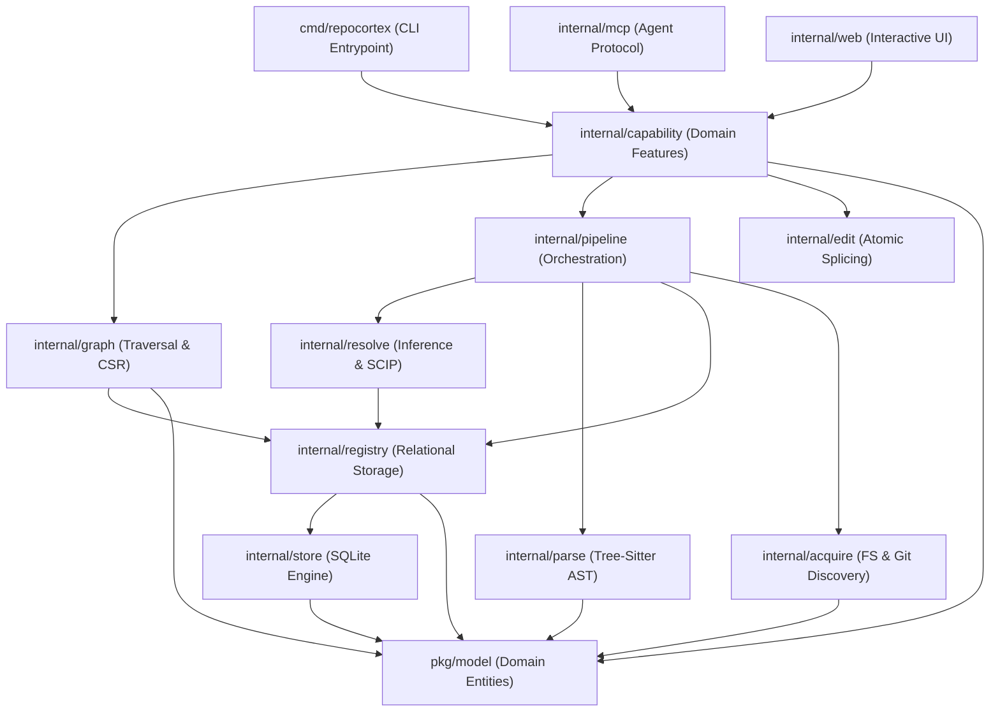

# RepoCortex: System Design, Architecture & Engineering Standards

This document establishes the architectural principles, package boundaries, coding conventions, and design patterns that govern the RepoCortex codebase. It serves as the primary technical specification for engineers maintaining and extending the platform.

---

## 1. Architectural Vision & Core Principles

RepoCortex is engineered as a **local-first, deterministic code intelligence engine and change-safety platform**. Unlike tools that rely on cloud-hosted language servers or speculative LLM embeddings, RepoCortex models software as an explicit, queryable knowledge graph stored in a zero-dependency, pure-Go SQLite database.

### The Five Invariants

Every subsystem in RepoCortex must satisfy five non-negotiable invariants:

```
+--------------------------------------------------------------------------------------------------+
|                                    REPOCORTEX ARCHITECTURAL INVARIANTS                             |
+--------------------------------------------------------------------------------------------------+
| 1. TWO-PHASE PUBLICATION : Staging runs are isolated; CommitRun performs an atomic pointer swap. |
| 2. EVIDENCE & PROVENANCE : Every edge carries exact source location and a calibrated confidence. |
| 3. BOUNDED MEMORY        : Memory is O(1) or O(page), never O(repository size).                  |
| 4. SAFE MUTATION         : Automated edits must dry-run, splice ASTs, verify, and auto-rollback.|
| 5. HONEST INCOMPLETENESS : Omissions, blindspots, and weak edges are explicitly reported.        |
+--------------------------------------------------------------------------------------------------+
```

1. **Two-Phase Atomic Publication**: Indexing operations populate staging runs (`index_runs.status = 'indexing'`). Query paths only read committed runs (`committed = 1`). A crash or cancellation mid-index leaves zero corrupt state. `CommitRun` publishes the new revision in a single SQLite transaction.
2. **Explicit Evidence & Provenance**: There are no synthetic or unverified edges. Every relationship points to an `evidence_file`, `evidence_line`, and an immutable confidence tier (`exact`, `high`, `medium`, `low`).
3. **Bounded Resident Memory**: Peak memory consumption must remain bounded regardless of codebase scale. Monolithic whole-repo data structures are strictly prohibited in the hot path. All passes must operate on bounded pages, streaming cursors, or compact indices (CSR).
4. **Safe Mutation Protocol**: Any command that mutates user source code (such as `repocortex rename`) must follow a strict transactional protocol: dry-run analysis $\to$ filesystem containment verification $\to$ exact AST identifier splicing $\to$ atomic cross-file commit $\to$ post-apply verification scan $\to$ automatic rollback on any failure.
5. **Honest Incompleteness**: RepoCortex never papers over gaps. An empty query result distinguishes between "we proved this has zero callers" and "this code has unresolvable dynamic references." Blind spots and omitted edges are surfaced transparently to agents and users.

---

## 2. Layered Package Architecture

RepoCortex follows a strict unidirectional dependency hierarchy adhering to **Clean / Hexagonal Architecture**. Dependencies flow downward from the entry points toward domain models:



### Package Taxonomy & Boundaries

| Package Path | Responsibility | Permitted Inward Dependencies | Prohibited Dependencies |
|:---|:---|:---|:---|
| `pkg/model` | Canonical domain types (`Symbol`, `Edge`, `File`, `Range`, `Confidence`, `Position`). Pure primitives. | None (Root of dependency tree). | Must **never** import any `internal/...` package or third-party database/network drivers. |
| `internal/store` | Low-level SQLite database management, WAL pragmas, connection pooling, and schema migrations (`migrations/*.sql`). | `pkg/model` | Must not depend on higher-level pipeline or analysis logic. |
| `internal/registry` | Relational persistence abstraction, atomic run lifecycle, symbol indices, and LRU candidate prefetching. | `internal/store`, `pkg/model` | Must not import `internal/parse`, `internal/resolve`, or `internal/pipeline`. |
| `internal/acquire` | Working tree discovery (`fs`) and Git metadata extraction (`git`), commit history, and blame. | `pkg/model` | Must not access the database registry. |
| `internal/parse` | Polyglot Tree-Sitter AST parsing, query compilation, tag extraction, arity extraction, and parser arena pools. | `pkg/model` | Must not access the registry or database. |
| `internal/resolve` | Multi-pass reference resolution, receiver type narrowing, inherited dispatch, and SCIP compiler import. | `internal/registry`, `pkg/model` | Must not import `internal/pipeline` or CLI logic. |
| `internal/graph` | Directed graph traversal, hub pruning, cycle detection, and high-performance in-memory Compressed Sparse Row (CSR) indexing. | `internal/store`, `internal/registry`, `pkg/model` | Must not mutate source code or execute pipeline indexing. |
| `internal/capability` | Business logic for product capabilities: `impact` (blast radius), `rename` (safe refactoring), `testgap` (coverage proof), `planchange` (change blueprint), `missed` (risk detection). | `internal/graph`, `internal/registry`, `internal/edit`, `pkg/model` | Must not import `internal/cli` or `internal/web`. |
| `internal/edit` | Surgical source code splicing, exact identifier boundary matching, hash validation, and multi-file rollback transactions. | `pkg/model`, `internal/security` | Must not import graph traversal or MCP servers. |
| `internal/mcp` | Model Context Protocol server exposing JSON-RPC tools and prompts to autonomous coding agents. | `internal/capability`, `internal/graph`, `internal/registry`, `pkg/model` | Must not expose internal database drivers directly over the wire. |
| `internal/web` | Local interactive web portal, SVG visualizers, tree views, code views, and Server-Sent Events (SSE). | `internal/capability`, `internal/graph`, `internal/registry`, `pkg/model` | Must be entirely self-contained with embedded HTML/JS/CSS assets. |
| `internal/cli` | Cobra command definitions, flag parsing, human terminal formatting, and structured JSON output. | All `internal/...` packages. | Should contain **zero** business logic; strictly delegates to `internal/capability` or `internal/pipeline`. |

---

## 3. Code Conventions & Engineering Standards

### 3.1. File Naming Conventions
- All Go files must be lowercase with words separated by underscores (`snake_case.go`).
- **Domain Files**: Named for their domain entity or capability (`candidates.go`, `incremental.go`, `leftovers.go`, `traverse.go`).
- **Adapter Files**: Named for the specific external interface they adapt (`orm_prisma.go`, `sqlite.go`, `walker.go`).
- **Test Files**: Always placed adjacent to the code they verify (`candidates_test.go`, `resolve_equivalence_test.go`).
- **Platform-Specific Files**: Suffix with the target OS (`open_unix.go`, `open_other.go`, `backend_cgo.go`).

### 3.2. Error Handling & Typing
- **Never swallow errors**: All errors must be handled, wrapped with meaningful context (`fmt.Errorf("action description: %w", err)`), or explicitly documented why they are ignored.
- **Sentinel Errors**: Package-level sentinel errors must start with `Err` (`ErrNotFound`, `ErrRunNotFound`, `ErrTargetNotFound`).
- **Domain Errors vs Presentation**: Packages in `internal/capability` and below must return typed domain errors. Human formatting and exit code mapping belong exclusively in `internal/cli`.

### 3.3. Interface Segregation (Ports & Adapters)
- Interfaces must be defined **by the consumer**, not the producer.
- Interfaces must be minimal (1 to 3 methods). For example:
  ```go
  // TextSearcher is declared in internal/capability/rename where it is used.
  type TextSearcher interface {
      SearchFiles(ctx context.Context, query string, limit int) ([]registry.FileMatch, error)
      FilesWithoutText(ctx context.Context, runID int64) ([]model.File, error)
  }
  ```
- Concrete structs (like `*registry.Registry`) implement the interface implicitly without needing a compile-time dependency from `registry` to `rename`.

---

## 4. Key Design Patterns in RepoCortex

### 4.1. The Functional Options Pattern
Extensively used across constructors to maintain clean API backwards compatibility without parameter proliferation:
```go
type ResolveOptions struct {
    PageSize        int
    CandidateBudget int
    MinConfidence   model.Confidence
    OnProgress      func(done, total int64)
    OnFlush         func(edges, outcomes int)
}
```

### 4.2. Compressed Sparse Row (CSR) In-Memory Graph Index
Graph traversals over millions of edges in SQLite suffer from repeated SQL serialization overhead. RepoCortex loads graph snapshots into a compact **Compressed Sparse Row (CSR)** structure:
- Two 32-bit offset arrays (`outOffsets`, `inOffsets`).
- Two contiguous edge slices (`outEdges`, `inEdges`), where each edge occupies 8 bytes (target node `int32`, kind enum `int8`, confidence enum `int8`).
- **Two-Pass Streaming Construction**: Pass 1 assigns contiguous node IDs and calculates degree bounds; Pass 2 streams raw SQLite rows directly into pre-sized slices. Zero intermediate heap allocations.
- Provides sub-millisecond multi-hop BFS and hub pruning across 1,000,000+ edges.

### 4.3. Keyset Pagination over Offset Pagination
In `internal/registry/references.go`, batch processing avoids `LIMIT ... OFFSET ...` because:
1. `OFFSET N` requires scanning and discarding $N$ B-tree entries on every page ($O(N^2)$ aggregate time).
2. As resolution updates rows (`resolution = 'resolved'`), the logical offset shifts underneath the cursor.
RepoCortex uses **Keyset Pagination** (`WHERE f.path > ? ORDER BY f.path LIMIT ?`), guaranteeing $O(\log N)$ page access that remains strictly stable under concurrent row updates.

### 4.4. Memory-Bounded LRU Caches with Generational Reset
`CandidateCache` in `internal/registry/candidates.go` uses an LRU linked list bounded by **candidate rows** rather than symbol names (since a single name like `String` can hold thousands of definitions). To eliminate memory leaks from string interning in long-running sessions, interning tables enforce strict capacity ceilings (`DefaultMaxInternPaths = 5,000`) and execute generational resets when saturated.

### 4.5. Atomic Multi-File Splicer with Reversible Rollback
`internal/edit` manages safe automated code transformations:
```
1. LOCATE     : Pin exact (line, col) range using AST identifier boundaries.
2. VERIFY     : Confirm expected old identifier matches source bytes exactly.
3. DRY-RUN    : Calculate full multi-file diff without disk side effects.
4. BACKUP     : Snapshot original file hashes and content in memory.
5. SPLICING   : Apply bottom-up token splicing (so earlier line/col offsets stay valid).
6. COMMIT     : Write modified files to disk with atomic sync.
7. ROLLBACK   : On any write failure or post-verification regression, immediately
                restore previous file states across all modified files in reverse order.
```

---

## 5. Security & Isolation Architecture

1. **Strict Path Containment**: All file operations are validated using `security.ValidatePath(root, relPath)` to prevent directory traversal attacks (`../`). Symlinks that escape the repository root are strictly rejected.
2. **Credential Redaction**: File reading abstractions automatically skip sensitive credentials, private keys, environment files (`.env*`, `id_rsa`, `*.pem`, `*.key`), and files exceeding size caps (`edit.DefaultMaxFileBytes = 3MB`).
3. **Pure-Go Sandboxing**: By using pure-Go transpiled SQLite and pure-Go Tree-Sitter parsers (`gotreesitter`), RepoCortex eliminates CGO dynamic linking risks, memory corruption vulnerabilities, and platform-specific glibc incompatibilities.

---

## 6. Verification & Quality Gates

Every pull request and commit must pass automated verification:
1. **Compilation & Architecture Testing**: `go test ./tests/architecture/...` enforces package import boundaries.
2. **Equivalence & Determinism Gates**: `resolve_equivalence_test.go` asserts that streaming candidate-capped resolution produces byte-for-byte identical output to a full in-memory baseline.
3. **Race Detection**: `go test -race ./...` on core concurrency paths.
4. **Zero-Warning Static Analysis**: `golangci-lint` enforces strict style, complexity, and deadcode rules.
