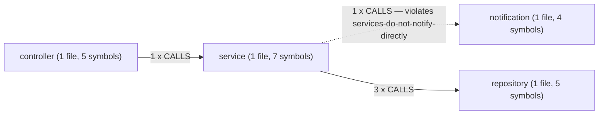

# Reading RepoCortex output: a guide to every command

This guide walks through every `cortex` command, shows what it prints, and
explains how to read it. Each output block was captured by running the command,
not written by hand.

Most examples run against `fixtures/payment-platform`, a small Spring-style
payment service that ships with this repository. To give every command
something to report, the copy used here had three commits:

1. `init` – the fixture as shipped.
2. `Add build, config, deployment and event publisher` – a `pom.xml`, an
   `application.yml`, a `Dockerfile`, a `docker-compose.yml`, a Kafka publisher
   and listener, one ADR, and a `.cortex.yml` that declares four components and
   two rules.
3. `Skip duplicate status callbacks` – a seven-line change to
   `TransactionService.updateStatus`.

A few commands need input the payment sample cannot give. For those, the
section says what was used: a second tiny repository for `system`, a
three-span trace file for `trace`, and a two-file Go module (indexed with
`scip-go`) for `scip import` and `accuracy`. The output is still real.

Absolute paths have been shortened: the projects live under `/work/`, the
`cortex` binary is shown as `/work/bin/cortex`, and the home directory as `~`. Long output is cut where you see a line
containing only `…`. No value has been changed.

## Contents

- [How to read any output](#how-to-read-any-output)
- [Pick the right command](#pick-the-right-command)
- [Set up and keep current](#set-up-and-keep-current)
- [Find and navigate](#find-and-navigate)
- [Change safely](#change-safely)
- [Across the stack](#across-the-stack)
- [Quality and governance](#quality-and-governance)
- [Agents](#agents)
- [Reports and export](#reports-and-export)
- [Portal](#portal)
- [Housekeeping](#housekeeping)
- [Recipes](#recipes)

## How to read any output

### Confidence words

Almost every line that claims a relationship ends with a confidence word, often
followed by where the claim came from, for example `high (source_code)` or
`exact (compiler)`.

| Word | What it means | What to do with it |
|---|---|---|
| `exact` | A compiler-backed index (SCIP) proved it. | Act on it. |
| `high` | Read from the syntax tree, with imports and receiver types that line up. | Act on it, but check before you delete or rename anything. |
| `medium` | Inferred from weaker signs, such as a naming convention. | Treat it as a lead. Open the file and confirm. |
| `low` | A loose name match. | Use it only to decide where to look next. |

Two rules hold everywhere:

- **An empty list is not proof.** "No callers" means "no caller RepoCortex
  could bind". Commands that can come back empty print the share of references
  that were bound, so you can judge how much to trust the silence.
- **A path is only as strong as its weakest step.** When a result follows
  several hops (`impact`, `who`, `system`), the confidence shown is the lowest
  along the path.

To turn `high` into `exact`, import a compiler index: see
[`cortex indexers`](#cortex-indexers) and [`cortex scip import`](#cortex-scip-import).

### Exit codes

Most commands exit `0` on success and `1` on error. A few use exit codes as
their answer, so CI can act on them:

| Command | 0 | 1 | 2 | 3 |
|---|---|---|---|---|
| `verify` | pass, or only leads found | at least one fact found | nothing to check against | – |
| `rename` | would apply, or applied and verified | error, or verify failed | refused, nothing written | applied, but the old name still appears |
| `system` | every member read | error | at least one member could not be read | – |
| `arch --fail-on`, `missed --fail-on` | nothing at or above the level | something at or above the level | – | – |
| `docs --check`, `licenses --check` | up to date | drifted | – | – |
| `bench --fail-on-regression` | every case passed | a case failed | – | – |

### Global flags

| Flag | Effect |
|---|---|
| `--project <dir>` | Run against another project root instead of the current directory. |
| `--json` | Print machine-readable JSON on stdout. Every query command supports it. Use it for scripts, CI and `cortex report`. |
| `-q`, `--quiet` | Silence log lines (the `time=… level=INFO` lines on stderr). Results still print. |
| `-v`, `--verbose` | More log lines on stderr. |

Logs always go to stderr and results to stdout, so `cortex --json callers X | jq`
is safe.

Example of `--json`:

```console
$ cortex --json status
{
  "project": "payment-platform",
  "index_path": "/work/payment-platform/.cortex/index.db",
  "index_status": "ready",
  "schema_version": 13,
  "index_run": 3,
  "git_revision": "eae0f8a662b912761434ed4a606c74d33f111471",
  "files": 18,
  "symbols": 105,
  "relationships": 37,
  "parse_failures": 0,
  "partial_parses": 0,
  …
}
```

## Pick the right command

| Job | Question | Command |
|---|---|---|
| **Set up and keep current** | Create the index | [`init`](#cortex-init) |
| | Parse the code | [`index`](#cortex-index) |
| | Join calls to definitions | [`resolve`](#cortex-resolve) |
| | Is the index there and fresh? | [`status`](#cortex-status) |
| | Re-index while I edit | [`watch`](#cortex-watch) |
| | Re-index on every commit | [`hooks`](#cortex-hooks) |
| | Get compiler-proven facts | [`indexers`](#cortex-indexers), [`scip import`](#cortex-scip-import) |
| **Find and navigate** | Where is X defined? | [`symbol`](#cortex-symbol) |
| | Which files mention a word? | [`search`](#cortex-search) |
| | Who calls X? | [`callers`](#cortex-callers) |
| | What does X call? | [`callees`](#cortex-callees) |
| | Everything that points at X | [`references`](#cortex-references) |
| **Change safely** | What does this commit range put at risk? | [`impact`](#cortex-impact) |
| | Steps to change X | [`plan-change`](#cortex-plan-change) |
| | Rename X everywhere it is safe to | [`rename`](#cortex-rename) |
| | Who should review a change to X? | [`who`](#cortex-who) |
| | Which facts changed between two runs? | [`diff`](#cortex-diff) |
| **Across the stack** | HTTP routes | [`api`](#cortex-api) |
| | Tables, and who reads or writes them | [`db`](#cortex-db) |
| | Config keys read but not declared | [`config`](#cortex-config) |
| | Kafka, RabbitMQ, SQS, Pub/Sub topics | [`events`](#cortex-events) |
| | Which service does a file run in? | [`infra`](#cortex-infra) |
| | Declared but unused dependencies | [`deps`](#cortex-deps) |
| | What ran in production? | [`trace`](#cortex-trace) |
| | Calls between repositories | [`system`](#cortex-system) |
| **Quality and governance** | Does the code break declared rules? | [`arch`](#cortex-arch) |
| | Where is the index blind? | [`missed`](#cortex-missed) |
| | How accurate is the index here? | [`accuracy`](#cortex-accuracy) |
| | Does context retrieval find the right code? | [`bench`](#cortex-bench) |
| | Is the setup healthy? | [`doctor`](#cortex-doctor) |
| | What can it do per language? | [`languages`](#cortex-languages) |
| **Agents** | Serve the index over MCP | [`serve`](#cortex-serve) |
| | Show what an agent needs | [`agent`](#cortex-agent) |
| | Register with installed agents | [`install`](#cortex-install) |
| | Context for a task | [`context`](#cortex-context) |
| | Turn a request into a task contract | [`compile`](#cortex-compile) |
| | Check a change against the contract | [`verify`](#cortex-verify) |
| | Signatures only, no bodies | [`prune`](#cortex-prune) |
| | Shrink a diff for an agent | [`diff-minimize`](#cortex-diff-minimize) |
| **Reports and export** | PR comment or SARIF for CI | [`report`](#cortex-report) |
| | Architecture docs | [`docs`](#cortex-docs) |
| | Graph for other tools | [`export`](#cortex-export) |
| **Portal** | Browse the index in a browser | [`ui`](#cortex-ui) |
| **Housekeeping** | Version, completion, licence file | [`version`](#cortex-version), [`completion`](#cortex-completion), [`licenses`](#cortex-licenses) |

---

## Set up and keep current

### `cortex init`

**Answers:** Creates the `.cortex/` directory and an empty index.

**Use it when:** You first use RepoCortex in a repository.

**Run:** `cortex init`

**Output:**

```console
$ cortex init
Initialized RepoCortex for "payment-platform"
  Index:          /work/payment-platform/.cortex/index.db
  Schema version: 13 (13 migration(s) applied)
  Accuracy mode:  auto

Next: cortex index
```

**How to read it:**

- `Index` is the database file. Add `.cortex/` to `.gitignore`; it is local.
- `Schema version` is the index format. Migrations run automatically.
- `Accuracy mode` is `fast`, `auto` or `exact`. `auto` uses a compiler-backed
  indexer when one is installed and allowed, and falls back to the syntax tree
  when not.
- Nothing is indexed yet. Run [`cortex index`](#cortex-index) next.

**Useful flags:** `--force` deletes and recreates an existing index.

### `cortex index`

**Answers:** Parses every supported file and stores symbols, references, routes,
SQL, config keys and deployment files.

**Use it when:** After `init`, and whenever the code has changed and no hook or
`watch` is running.

**Run:** `cortex index --full`, then later `cortex index`

**Output:**

```console
$ cortex index --full
Indexed payment-platform
  Revision:      4
  Git:           eae0f8a662b9
  Files:         11 indexed, 7 skipped (18 discovered)
  Symbols:       49
  References:    63 (unresolved until M2)
  Imports:       3
  Duration:      321ms

$ cortex index        # after editing one file
Updated payment-platform (revision 2)
  Added:     0
  Modified:  1
  Deleted:   0
  Unchanged: 17
  Symbols:   7 written
  Duration:  123ms

$ cortex index        # when nothing changed
payment-platform is up to date (18 files, revision 4, 86ms)
```

**How to read it:**

- `Revision` is the index run number. `Git` is the commit it describes.
- `Files: 11 indexed, 7 skipped` – skipped files here are YAML, Dockerfiles, the
  POM and Markdown. They are not parsed for code symbols, but their config keys,
  dependencies and deployment units are still recorded.
- `Symbols` counts definitions extracted in this run. `status` reports a larger
  number because it also counts tables, config keys, endpoints and units.
- `References … (unresolved until M2)` means references are stored but not yet
  joined to definitions. Run [`cortex resolve`](#cortex-resolve) next.
- Without `--full`, only changed files are re-parsed (`Added`, `Modified`,
  `Deleted`, `Unchanged`). The revision number does not go up.
- Progress lines (`level=INFO msg=indexing progress=…`) go to stderr. Hide them
  with `-q`.

**Useful flags:** `--full` rebuild from scratch (then run `resolve` again);
`--accuracy fast|auto|exact`; `--workers N` parse concurrency (memory grows with
it); `--digest` print the registry digest after a run, for determinism checks.

### `cortex resolve`

**Answers:** Joins each stored reference to the definition it names, which
builds the call graph and the table and config links.

**Use it when:** After every `cortex index`.

**Run:** `cortex resolve`

**Output:**

```console
$ cortex resolve
Resolved payment-platform (revision 4)
  References:  63
  Resolved:    21 (67.7% of the 31 that name something this index defines)
  Ambiguous:   10
  Unresolved:  32  (calls outside this repository)
  Edges:       21
    high:    21
  Data access: 7 statement(s), 7 bound to a declared table, 7 edges
  Config:      1 read(s), 0 bound to a declared key, 0 edges
    1 read(s) name keys no configuration file here declares — see 'cortex config'
  Deployment:  3 unit(s), 1 naming a build context, 1 edges
  Duration:    33ms
```

**How to read it:**

- `Resolved … 67.7% of the 31` is the key number. It is the share of references
  to code in this repository that were bound. Above about 80% is good for
  syntax-only indexing. Much lower means imports or receiver types are not
  being followed; check `cortex languages` for your language's tier.
- `Ambiguous` references matched several definitions and none was chosen. They
  show up as gaps in `callers` and `impact`.
- `Unresolved` references matched nothing here, mostly library calls. That is
  normal.
- `Edges` by confidence: only `high`, `medium` and `low` appear. `exact` only
  comes from [`scip import`](#cortex-scip-import).
- `Data access`, `Config`, `Deployment` show how many SQL statements, config
  reads and deployment units were linked. A config line like the one above is
  a real finding; follow it with [`cortex config`](#cortex-config).
- After an incremental `index`, `Edges` can read `0`. That counts new edges
  written in this pass, not the total.

**Useful flags:** `--min-confidence high|medium|low` drops weaker bindings;
`--no-scip` skips auto-import of an `index.scip` found in the project root or
`.cortex/`.

### `cortex status`

**Answers:** Is there an index, and what does it hold?

**Use it when:** Before trusting any answer, or when an agent says "no index".

**Run:** `cortex status`

**Output:**

```console
$ cortex status
Project:        payment-platform
Index:          READY
Schema:         v13
Revision:       eae0f8a662b912761434ed4a606c74d33f111471
Files:          18
Symbols:        105
Relationships:  37
Last indexed:   2026-11-11T21:18:44+05:30
Index size:     496.0 KiB
Accuracy mode:  auto
MCP profile:    minimal
Capabilities:   code
```

In a directory with no index:

```console
$ cortex status
Project:        empty
Index:          ABSENT
Accuracy mode:  auto
MCP profile:    minimal
Capabilities:   code

Run 'cortex init' to create the index.
```

**How to read it:**

- `Index` is `READY` when a committed run exists and `ABSENT` when there is no
  index. If you see anything else, run `cortex doctor --verify-index`.
- `Revision` is the full commit SHA the index describes. Compare it with
  `git rev-parse HEAD`. If they differ, the index is stale.
- `Symbols` and `Relationships` include tables, config keys, endpoints and
  deployment units, so they are larger than the numbers `index` prints.
- `MCP profile` is the tool set `serve` exposes (`minimal`, `standard`, `full`),
  set by `mcp.profile` in `.cortex.yml`.
- `Last indexed` is the last full run. Incremental updates do not move it.

**Exit codes:** `0` even when the index is absent. Use `--json` and check
`index_status` in scripts.

### `cortex watch`

**Answers:** Keeps the index current as you save files.

**Use it when:** You are editing and an agent is querying the index at the same
time.

**Run:** `cortex watch`, edit a file, then press Ctrl-C.

**Output:**

```console
$ cortex watch
Watching payment-platform (revision 3). Press Ctrl-C to stop.
```

On stderr, one line per update:

```text
time=2026-11-11T21:16:56.792+05:30 level=INFO msg="index updated" added=0 modified=1 deleted=0 symbols=9 took=83ms
```

**How to read it:**

- Each save produces one `index updated` line. `took` should stay well under a
  second for a single file.
- No line after a save means the file is not indexed (excluded, generated, or
  an unsupported type).
- `watch` only re-parses. If cross-file answers look stale, run
  `cortex resolve`.

**Useful flags:** `--debounce 300ms` quiet period before reacting to a burst of
saves.

### `cortex hooks`

**Answers:** Installs, checks or removes a Git post-commit hook that re-indexes
after every commit.

**Use it when:** You want the index to follow your commits without thinking
about it.

**Run:** `cortex hooks status`, `cortex hooks install`, `cortex hooks uninstall`

**Output:**

```console
$ cortex hooks status
post-commit: not installed
The index is only as current as the last 'cortex index'.
Install it with: cortex hooks install

$ cortex hooks install
Installed post-commit hook
  /work/payment-platform/.git/hooks/post-commit
  Runs: /work/bin/cortex index && /work/bin/cortex resolve  (detached, never fails a commit)

$ cortex hooks status
post-commit: installed  (/work/payment-platform/.git/hooks/post-commit)
The index is rebuilt after every commit on this machine.

$ cortex hooks uninstall
Removed RepoCortex's block. Anything else in that hook is untouched.
```

**How to read it:**

- `Runs:` shows the exact binary path baked into the hook. If you move or
  upgrade the binary, run `install` again.
- The hook runs in the background and cannot block or fail a commit. If the
  index lags, check `cortex status`.
- An existing hook is appended to, not replaced. `uninstall` removes only the
  RepoCortex block.

**Useful flags:** `hooks install --binary <path>` sets which `cortex` the hook
calls.

### `cortex indexers`

**Answers:** Which compiler-backed indexers (scip-go, scip-java,
scip-typescript, scip-python) this project needs, and installs them on request.

**Use it when:** You want `exact` answers instead of `high`.

**Run:** `cortex indexers list`, `cortex indexers pins`, `cortex indexers install`

**Output:**

```console
$ cortex indexers list
Accuracy mode: auto
Toolchain:     java: openjdk version "25.0.2" 2026-01-20 LTS, mvn: present

LANGUAGE  INDEXER    STATUS   PATH
java      scip-java  blocked  .

scip-java: indexing Java runs the repository's own Maven or Gradle build, which executes arbitrary code from the repository; re-run with the explicit build opt-in, or set accuracy.indexers.runner to docker to run it in a container

$ cortex indexers pins
scip-go	v0.2.7	go-install	github.com/scip-code/scip-go/cmd/scip-go@v0.2.7	-
scip-java	0.12.2	docker	sourcegraph/scip-java@sha256:a05564b9c9951660fc7069b431f1a18f4575b570b7ce09a14936729832c1fc8d	sha256:a05564b9c9951660fc7069b431f1a18f4575b570b7ce09a14936729832c1fc8d
scip-python	0.6.6	npm	@sourcegraph/scip-python@0.6.6	be8e0a1ec180423c60e9f2c2672c208f49a35ab690ac0f8f1259e4223dbd6e42
scip-typescript	0.3.14	npm	@sourcegraph/scip-typescript@0.3.14	92a88678bcc021e7ff2afd0ab2684c1094344796840e582578aa4595020cc3f5

$ cortex indexers install

  scip-java        skipped: indexing Java runs the repository's own Maven or Gradle build, which executes arbitrary code from the repository; re-run with the explicit build opt-in, or set accuracy.indexers.runner to docker to run it in a container
```

**How to read it:**

- `list` changes nothing. `STATUS` is the thing to read: `blocked` means a safety
  rule stops it (Java runs the repo's own build), `missing` means it is not
  installed, and a ready status means `index` will use it.
- `pins` is one tab-separated line per indexer: name, version, install channel,
  exact reference, digest. A `-` digest means the channel checks itself (Go's
  checksum database). The output depends only on the binary, so it works as a
  CI cache key.
- `install` asks before each install unless you pass `--yes` or your user
  config allows it. Every download is checked against the pinned digest.

**Useful flags:** `install --yes`; `install --allow-repo-build` (Java; runs code
from the repository); `install --out-dir <dir>` keep the `.scip` files.

### `cortex scip import`

**Answers:** Loads a compiler-built `.scip` file and upgrades matching edges to
`exact`.

**Use it when:** CI or a local `scip-*` tool has already produced an index.

**Run:** In a two-file Go module (`main.go` calls `store.Add` and
`store.Balance`), after `cortex index && cortex resolve` and
`scip-go --output index.scip`:

```console
$ cortex scip import index.scip
scip-go 0.2.7: 2 document(s), 2 matched
symbols: 7 matched, 11 with no counterpart in the index
edges:   4 new, 4 upgraded from heuristic, 1 already known
calls:   4 compiler reference(s) sit on a parsed call line and became CALLS at 'exact'
         19 reference(s) point outside the indexed repository
         2 reference(s) the indexer attributed to a file rather than a definition were skipped
duration: 6ms
```

After the import, `callers` reports the compiler as the source:

```console
$ cortex callers Add
Add (method) at store/store.go:7

KIND   SYMBOL  EVIDENCE    CONFIDENCE
CALLS  credit  main.go:10  exact (compiler)

1 caller(s).
```

**How to read it:**

- First line: the tool that wrote the file and how many of its documents
  matched indexed files. **If `matched` is 0**, the paths inside the `.scip`
  file do not line up with the repository; pass `--path-prefix`.
- `symbols … with no counterpart` is normally large. The compiler sees locals
  and fields that RepoCortex does not index. Only a very low match rate is a
  problem, and the command says so when it happens.
- `edges`: `new` were not known before, `upgraded` were `high` and are now
  `exact`, `already known` were already `exact`.
- `calls … became CALLS at 'exact'` is the number that matters for `callers`,
  `impact` and `rename`. A call is promoted only when the parser saw a call on
  the same line and the compiler names exactly one target there.
- Run `index`, then `resolve`, then `scip import`, in that order.

**Useful flags:** `--path-prefix <dir>` for indexes built in a container;
`--max-bytes N` size cap.

---

## Find and navigate

### `cortex symbol`

**Answers:** Where is a name defined?

**Use it when:** You know the exact name of a class, method or function.

**Run:** `cortex symbol TransactionService`

**Output:**

```console
$ cortex symbol TransactionService
KIND    NAME                LOCATION                                                  CONFIDENCE
class   TransactionService  src/main/java/com/pay/service/TransactionService.java:6   high (source_code)
method  TransactionService  src/main/java/com/pay/service/TransactionService.java:12  high (source_code)

2 definition(s) named "TransactionService".
```

**How to read it:**

- One row per definition. Constructors share their class name, so expect two
  rows for most Java classes.
- `CONFIDENCE` here is about the extraction of the definition, not about any
  relationship.
- Matching is exact and case-sensitive. For partial names, use
  [`search`](#cortex-search). A miss prints an error and exits `1`.

**Useful flags:** `--kind class|method|function|…`; `-n, --limit N`.

### `cortex search`

**Answers:** Which indexed files contain these words?

**Use it when:** You know a word but not the symbol name.

**Run:** `cortex search callback`

**Output:**

```console
$ cortex search callback
src/main/java/com/pay/controller/CallbackController.java
src/test/java/com/pay/controller/CallbackControllerTest.java

2 file(s) matching "callback".
```

**How to read it:**

- One file per line, best match first.
- Identifiers are split into parts, so `callback` matches `CallbackController`.
- Binary, generated, oversized and excluded files are never searched. Missing
  from here does not mean missing from the repository.
- Next step: `cortex symbol <Name>` for a definition, or open the file.

**Useful flags:** `-n, --limit N` (default 20).

### `cortex callers`

**Answers:** What calls this symbol?

**Use it when:** Before you change a function's signature or behaviour.

**Run:** `cortex callers updateStatus`

**Output:**

```console
$ cortex callers updateStatus
updateStatus (method) at src/main/java/com/pay/service/TransactionService.java:18

KIND   SYMBOL          EVIDENCE                                                     CONFIDENCE
CALLS  handleCallback  src/main/java/com/pay/controller/CallbackController.java:23  high (source_code)

1 caller(s).
```

**How to read it:**

- The first line says which definition was used. If several share the name, a
  list follows the table; choose one with `--path`.
- `EVIDENCE` is the file and line of the call itself. Open it to confirm.
- `CONFIDENCE` is per edge. See [Confidence words](#confidence-words).
- Calls from tests appear only if the test's receiver resolved. Here the two
  test calls to `updateStatus` were not bound (see `missed`), so they are absent.
- When the list is empty, the command prints the bound share for the whole
  index instead. Read it before concluding a symbol is unused.

**Useful flags:** `--path <substring>`; `--min-confidence high`; `-n, --limit N`.

**Exit codes:** `1` when no symbol has that name.

### `cortex callees`

**Answers:** What does this symbol call?

**Use it when:** You want to know what a function depends on.

**Run:** `cortex callees updateStatus`

**Output:**

```console
$ cortex callees updateStatus
updateStatus (method) at src/main/java/com/pay/service/TransactionService.java:18

KIND   SYMBOL               EVIDENCE                                                  CONFIDENCE
CALLS  findById             src/main/java/com/pay/service/TransactionService.java:19  high (source_code)
CALLS  repository           src/main/java/com/pay/service/TransactionService.java:19  high (source_code)
CALLS  isDuplicate          src/main/java/com/pay/service/TransactionService.java:20  high (source_code)
CALLS  setStatus            src/main/java/com/pay/service/TransactionService.java:23  high (source_code)
CALLS  repository           src/main/java/com/pay/service/TransactionService.java:24  high (source_code)
CALLS  save                 src/main/java/com/pay/service/TransactionService.java:24  high (source_code)
CALLS  notificationService  src/main/java/com/pay/service/TransactionService.java:25  high (source_code)
CALLS  send                 src/main/java/com/pay/service/TransactionService.java:25  high (source_code)

8 callee(s).
```

**How to read it:**

- One row per call site, so a target called twice appears twice.
- Field reads used as a call receiver (`repository`, `notificationService`) are
  listed as `CALLS` too. Skip them; the method on the next row is the real call.
- Library calls (`status.equals`) are not listed. They count as unresolved.

**Useful flags:** `--path`, `--min-confidence`, `-n, --limit`.

### `cortex references`

**Answers:** Everything that points at a symbol: calls, imports,
implementations, extensions.

**Use it when:** `callers` is too narrow, for example for an interface or type.

**Run:** `cortex references updateStatus` and `cortex references TransactionRepository --path TransactionRepository.java`

**Output:**

```console
$ cortex references updateStatus
updateStatus (method) at src/main/java/com/pay/service/TransactionService.java:18

KIND   SYMBOL          EVIDENCE                                                     CONFIDENCE
CALLS  handleCallback  src/main/java/com/pay/controller/CallbackController.java:23  high (source_code)

1 reference(s).

$ cortex references TransactionRepository --path TransactionRepository.java
TransactionRepository (class) at src/main/java/com/pay/repository/TransactionRepository.java:3

No references found.

68% of the 31 reference(s) that name something this index defines are bound to a definition; 10 remain too ambiguous to choose between. A further 32 reference(s) matched no definition here at all — mostly calls into libraries, which an index of this repository cannot bind. An empty result is a lower bound, not proof that nothing uses this symbol.

2 definitions share the name "TransactionRepository"; this answered for the first.
Pass --path to choose another:
  src/main/java/com/pay/repository/TransactionRepository.java:3 (class)
  src/main/java/com/pay/repository/TransactionRepository.java:8 (method)
```

**How to read it:**

- `KIND` can be `CALLS`, `IMPORTS`, `IMPLEMENTS`, `EXTENDS` or `REFERENCES`.
- The empty result above is the case the closing paragraph warns about.
  `TransactionService` uses `TransactionRepository` as a field type, but
  type-position uses in Java were not recorded as references in this run.
  Do not delete a class on an empty `references` result.
- `--path` takes a substring. When two definitions live in the same file (class
  and constructor), the substring cannot tell them apart.

**Useful flags:** `--path`, `--min-confidence`, `-n, --limit`.

---

## Change safely

### `cortex impact`

**Answers:** What does a range of commits put at risk?

**Use it when:** Reviewing a branch or PR, or gating CI.

**Run:** `cortex impact --base HEAD~1 --head HEAD`

**Output:**

```console
$ cortex impact --base HEAD~1 --head HEAD
Blast radius of HEAD~1..HEAD

1 file changed; 7 changed symbols found in the index, 7 analysed.
1 symbol at risk through recorded references, plus 0 reachable only through dispatch.
Riskiest change: src/main/java/com/pay/service/TransactionService.java:TransactionService — risk moderate (score 45, certainty low).
  This is the MAXIMUM over the changed symbols, never a total: two risks of 40 do not make an 80.

CHANGED FILES

  src/main/java/com/pay/service/TransactionService.java

CHANGED SYMBOLS ANALYSED

  CHANGE    KIND    SYMBOL               LOCATION                                               AT RISK
  modified  class   TransactionService   src/main/java/com/pay/service/TransactionService.java  0
  modified  field   repository           src/main/java/com/pay/service/TransactionService.java  3
  modified  field   notificationService  src/main/java/com/pay/service/TransactionService.java  2
  modified  method  TransactionService   src/main/java/com/pay/service/TransactionService.java  0
  modified  method  updateStatus         src/main/java/com/pay/service/TransactionService.java  1
  modified  method  isDuplicate          src/main/java/com/pay/service/TransactionService.java  2
  modified  method  findTransaction      src/main/java/com/pay/service/TransactionService.java  0

WHAT DEPENDS ON THE CHANGED CODE (1)

  HOPS  SYMBOL          LOCATION                                                  CONFIDENCE  TEST
  1     handleCallback  src/main/java/com/pay/controller/CallbackController.java  high        

  CONFIDENCE is the MINIMUM along the path, not of the last hop: a path through one weak edge is a weak claim however strong its other edges are.

WHAT THIS DOES NOT SAY

  - 68% of the 31 reference(s) that name something this index defines are bound to a definition; 10 remain too ambiguous to choose between. …
  - This result is a LOWER BOUND, not a complete answer. …
  …
```

**How to read it:**

- **Header.** `1 file changed; 7 changed symbols`: every symbol defined in a
  changed file is treated as changed. The `Riskiest change` line gives the
  single worst score (0–100) and a `certainty`. `certainty low` means the score
  rests on edges that are not compiler-proven.
- **CHANGED SYMBOLS ANALYSED.** `AT RISK` is how many symbols depend on each
  one. A large number on a symbol you did not mean to touch is a reason to look
  again.
- **WHAT DEPENDS ON THE CHANGED CODE.** These are the callers to check. `HOPS`
  is distance from the change. `TEST` names a test that covers the caller;
  an empty cell, as here, means no covering test was found.
- **WHAT THIS DOES NOT SAY.** Always read the first bullet: it is the bound
  share. If it is low, the list above is short because the index is blind, not
  because the change is safe.
- If the index was built at neither end of the range, the output says
  `STALE INDEX`. Re-index first.
- Next: `cortex who <symbol>` for reviewers, `cortex --json impact … > impact.json`
  for [`report pr`](#cortex-report).

**Useful flags:** `--base` (required), `--head` (default `HEAD`), `--depth N`,
`--min-confidence` (default `medium`), `--limit N`.

### `cortex plan-change`

**Answers:** An ordered plan for changing one symbol, with its callers and
checks.

**Use it when:** Before a refactor, or to hand a clear plan to an agent.

**Run:** `cortex plan-change updateStatus`

**Output:**

```console
$ cortex plan-change updateStatus
RepoCortex Change Plan for updateStatus (method)
Location:      src/main/java/com/pay/service/TransactionService.java:18
Risk Level:    MODERATE (Score: 25/100)
Blast Radius:  1 direct caller(s), 1 total reached

Preconditions:
  [ ] Target symbol exists and index resolution is current.
  [ ] Existing test suite passes cleanly before code modifications.

Execution Sequence:
  Step 1: Modify target declaration and implementation for updateStatus (method) [src/main/java/com/pay/service/TransactionService.java]
  Step 2: Update direct caller handleCallback in src/main/java/com/pay/controller/CallbackController.java to match new contract [src/main/java/com/pay/controller/CallbackController.java]

Postconditions:
  [ ] All 1 direct caller(s) updated to new signature or contract.
  [ ] All affected test suites pass without regression.
```

**How to read it:**

- `Risk Level` and `Score` are for this one symbol. They are on a different
  scale from `impact`, which scores a whole commit range, so do not compare the
  two numbers.
- `Execution Sequence` lists one step per direct caller, in order. Callers it
  could not bind are not listed. Run `cortex search <name>` to catch them.
- Covering tests appear as extra steps when a test edge exists. None appear
  here because the test calls were not bound.

**Useful flags:** `--min-confidence` (default `medium`).

### `cortex rename`

**Answers:** Renames a symbol at its definition and every bound reference, and
refuses if any site is not safe.

**Use it when:** You want a mechanical rename you can trust, with a dry run
first.

**Run:** `cortex rename updateStatus applyStatus` (dry run), then with
`--floor high`. Finally `--apply` in the Go sample.

**Output:**

```console
$ cortex rename updateStatus applyStatus
Rename updateStatus -> applyStatus  (src/main/java/com/pay/service/TransactionService.java:updateStatus, src/main/java/com/pay/service/TransactionService.java:18)
REFUSED: nothing was written. Every site must be exact or better, unambiguous on its line, and unchanged since indexing.
  High sites need a compiler-backed index to become exact ('cortex indexers install', then 'cortex scip import'), or an explicit --floor high (measured 86.8-96.1% precise).

SITES
  high  src/main/java/com/pay/controller/CallbackController.java:23  CALLS
  high  src/main/java/com/pay/service/TransactionService.java:18     DEFINITION

REFUSED SITES
  high    src/main/java/com/pay/controller/CallbackController.java:23  confidence high is below exact
  high    src/main/java/com/pay/service/TransactionService.java:18  confidence high is below exact

NOT COMPLETE: RepoCortex renames the definition and the references it resolved, nothing else, …
```

```console
$ cortex rename updateStatus applyStatus --floor high
Rename updateStatus -> applyStatus  (…)
WARNING --floor high: `high` bindings measure 86.8-96.1% precision against compiler indexes (docs/accuracy.md); at 90%, a rename touching thirty sites gets three wrong. Read every high site below, then build and test.
DRY RUN: nothing was written. Re-run with --apply to make these edits.
  The old name also appears outside the sites (LEFTOVER OCCURRENCES); --apply would exit 3 unless they are resolved first.

SITES
  high  src/main/java/com/pay/controller/CallbackController.java:23  CALLS
  high  src/main/java/com/pay/service/TransactionService.java:18     DEFINITION

LEFTOVER OCCURRENCES (2 line(s) still name updateStatus; showing 2)
  References RepoCortex could not bind, or comments and strings. Nothing here was changed; review each by hand.
  src/test/java/com/pay/controller/CallbackControllerTest.java:8  verify(transactionService).updateStatus("txn-1", "COMPLETED");
  src/test/java/com/pay/service/TransactionServiceTest.java:7  service.updateStatus("txn-1", "COMPLETED");
…
```

```console
$ cortex rename credit creditAccount --floor high --apply     # Go sample
WARNING --floor high: …
Rename credit -> creditAccount  (main.go:credit, main.go:9)
APPLIED to 1 file(s).

SITES
  high   main.go:9   DEFINITION
  exact  main.go:15  CALLS

VERIFY: PASS  (contract: /work/ledger-go/.cortex/rename-contract.json)
  [UNKNOWN] The repository declares no architecture, so there was no rule for this change to break. …
  [UNKNOWN] The contract names no covering test, so for the 1 changed scope symbol(s) there is nothing to check coverage against. …
  Checked against the pre-rename index; run 'cortex index' to refresh it.
…
```

**How to read it:**

- The first line names the definition being renamed. Check it is the one you
  meant; use `--path` if not.
- `SITES` lists every place that will change, with its confidence and kind.
- `REFUSED` means nothing was written. `REFUSED SITES` says why for each site:
  confidence too low, file changed since indexing, name not unique on the line.
- `LEFTOVER OCCURRENCES` lists lines that still contain the old name after the
  rename: unbound calls (here, two tests), comments and strings. Fix these by
  hand or `--apply` exits `3`.
- After `--apply`, a `VERIFY:` block checks the change against a generated task
  contract. `[UNKNOWN]` lines are gaps, not failures.
- Note: the definition site itself stays `high` even after a SCIP import, so the
  default `--floor exact` refuses every rename in practice. Use `--floor high`
  and read each site.

**Useful flags:** `--apply`; `--floor exact|high`; `--path`; `--max-sites N`.

**Exit codes:** `0` would apply or applied and verified; `1` error or verify
failed; `2` refused; `3` applied but leftovers remain or verify could not run.

### `cortex who`

**Answers:** Who has recently touched the code a change to this symbol reaches?

**Use it when:** Choosing reviewers, or finding someone to ask.

**Run:** `cortex who updateStatus`

**Output:**

```console
$ cortex who updateStatus
updateStatus  src/main/java/com/pay/service/TransactionService.java:18
src/main/java/com/pay/service/TransactionService.java:updateStatus

A change here reaches 2 symbols across 2 files (1 direct, 0 indirect, 0 through dispatch).

WHO HAS CONTEXT ON THIS CODE

  SHARE  REACHED  FILES  COMMITS  LAST TOUCH  HAS TOUCHED IT
  100%   2 of 2   2      2        2026-11-11  guide <a@b>

  guide <a@b> — has touched 2 of 2 reached symbols (100%), across 2 files, in 2 commits
    eae0f8a6  2026-11-11  Skip duplicate status callbacks
      src/main/java/com/pay/service/TransactionService.java
    33bc5c9c  2026-11-11  init
      src/main/java/com/pay/controller/CallbackController.java, src/main/java/com/pay/service/TransactionService.java

WHAT THIS DOES NOT SAY

  - Git records who changed a file, not who owns it, …
  - Attribution is per FILE, not per line: …
  - The whole history was read (3 commits from HEAD), so nobody is missing because of the window.
  - 1 git identity appear in this report. …
  - The blast radius was walked with a medium confidence floor, so every share here is a share of that narrower radius.
```

**How to read it:**

- The summary line gives the size of the reached code (symbols and files).
- In the table, `SHARE` is the part of the reached code a person has touched.
  Sort order is by share. `LAST TOUCH` tells you whether their knowledge is
  recent.
- Under each person, the commits that earned the share, newest first.
- The bottom list states the limits: per-file attribution, history window, one
  person may appear under two emails. Read it as "who to ask", not "who is
  responsible".

**Useful flags:** `--depth N`, `--commits N` (history window), `--limit N`,
`--min-confidence`.

### `cortex diff`

**Answers:** Which facts changed between two index runs: symbols, edges,
endpoints, table readers and writers.

**Use it when:** You want a semantic diff, not a line diff, for example
between a release and now.

**Run:** The base run lives in a copy of the index taken at commit `b407474`;
the head run is the current index.

```console
$ cortex diff --from-index ../base-index.db --from b407474 --to eae0f8a
diff b4074746b182a763ac350782c6557ebf2b4ed523..eae0f8a662b912761434ed4a606c74d33f111471 (runs 2..3)
  base: status=ready accuracy=auto digest=6c0f8a7a0b46
  head: status=ready accuracy=auto digest=16b98160bf1a

SYMBOLS
  moved    src/main/java/com/pay/service/TransactionService.java:TransactionService (class)  line 6 -> 6 (+0)
  moved    src/main/java/com/pay/service/TransactionService.java:findTransaction (method)  line 25 -> 32 (+7)
  added    src/main/java/com/pay/service/TransactionService.java:isDuplicate (method)  line 28
  moved    src/main/java/com/pay/service/TransactionService.java:updateStatus (method)  line 18 -> 18 (+0)

EDGES
  added      src/main/java/com/pay/service/TransactionService.java:isDuplicate (method) -[CALLS]-> src/main/java/com/pay/model/Transaction.java:getStatus (method)  high/source_code at src/main/java/com/pay/service/TransactionService.java:29:29
  added      src/main/java/com/pay/service/TransactionService.java:updateStatus (method) -[CALLS]-> src/main/java/com/pay/service/TransactionService.java:isDuplicate (method)  high/source_code at src/main/java/com/pay/service/TransactionService.java:20:12

COULD NOT COMPARE
  - 7 files did not parse cleanly in one of the runs; changes inside them are marked uncertain
    unreliable: .cortex.yml
    unreliable: Dockerfile
    unreliable: README.md
    unreliable: docker-compose.yml
    unreliable: docs/adr/0001-record-status-changes-as-events.md
    unreliable: pom.xml
    unreliable: src/main/resources/application.yml
```

A ref that matches no run:

```console
$ cortex diff --from 1 --to 3
error: no indexed run matches "1": nothing in /work/payment-platform/.cortex/index.db was indexed at that ref.
No run carries that id and no recorded commit SHA starts with it. Index the commit you meant ('git checkout <sha> && cortex index') and diff the run it produces.
runs recorded in /work/payment-platform/.cortex/index.db:
  run 3  rev eae0f8a662b912761434ed4a606c74d33f111471  status ready  (committed)
```

**How to read it:**

- **Header.** The two commits, the run ids, and a `digest` per side. Equal
  digests mean identical content; if a diff still lists changes with equal
  digests, the output says `INCONSISTENT` and should not be trusted.
- **SYMBOLS.** `added`, `removed`, `moved` (line shift; `+0` means the span
  changed but the start line did not), `orphaned`.
- **EDGES.** `added`, `removed`, or `regraded` (confidence changed), each with
  the evidence line.
- Endpoint and table sections appear when a route's handler or a table's
  readers or writers changed.
- **COULD NOT COMPARE.** Files in this list may hide changes. Here they are
  non-code files, which are not parsed for symbols.
- One index file keeps one committed run. To compare two commits, keep a copy
  of the older index (or build one at that commit) and pass it with
  `--from-index`. Use `index --full` for the newer side; incremental updates do
  not create a new run.

**Useful flags:** `--from`, `--to`, `--from-index`, `--to-index`,
`--max-per-section N`.

---

## Across the stack

### `cortex api`

**Answers:** Which HTTP routes does this service expose, and which handler
serves each?

**Use it when:** Mapping a service, or before changing a handler.

**Run:** `cortex api`

**Output:**

```console
$ cortex api
METHOD & PATH           HANDLER         DECLARED AT
POST /payment/callback  handleCallback  src/main/java/com/pay/controller/CallbackController.java:21

1 endpoint(s). Discovery covers spring, go-http, go-router, fastapi, flask, django, express, nest.
```

**How to read it:**

- One row per route. Class-level prefixes (`@RequestMapping("/payment")`) are
  joined to the method path.
- The last line lists the frameworks that are recognised. If yours is missing,
  or routes are defined in OpenAPI, GraphQL or gRPC files, an empty result says
  nothing about your service.
- Django routes are `medium` confidence because the `include()` prefix is not
  visible from one file.
- Next: `cortex callees <handler>` to follow the request.

### `cortex db`

**Answers:** Which tables does the code read or write, and how often?

**Use it when:** Before changing a table or column.

**Run:** `cortex db`, then `cortex db table transactions` and `cortex db table transaction_events`

**Output:**

```console
$ cortex db
TABLE               READS  WRITES  DECLARED HERE
transactions        1      1       yes
transaction_events  0      1       yes

2 table(s).

$ cortex db table transactions
transactions (declared in this repository)

WRITTEN BY (1)
  save (src/main/java/com/pay/repository/TransactionRepository.java)  src/main/java/com/pay/repository/TransactionRepository.java:20  high (UPDATE (literal SQL))

READ BY (1)
  findById (src/main/java/com/pay/repository/TransactionRepository.java)  src/main/java/com/pay/repository/TransactionRepository.java:14  high (SELECT (literal SQL))

$ cortex db table transaction_events
transaction_events (declared in this repository)

WRITTEN BY (1)
  save (src/main/java/com/pay/repository/TransactionRepository.java)  src/main/java/com/pay/repository/TransactionRepository.java:23  high (INSERT (literal SQL))

READ BY (0)
  nothing found
```

**How to read it:**

- `READS` and `WRITES` count statements, not call sites. `DECLARED HERE = no`
  means a table this repository uses but does not create, usually owned by
  another service.
- In `db table`, each line is: the function, its file, the SQL line, then the
  confidence and the SQL verb. `literal SQL` means the statement was read from a
  string; ORM access shows its own label.
- A table written but never read here (like `transaction_events`) is normal for
  audit tables. A table read but never written here usually belongs to another
  service; check with [`system`](#cortex-system).

### `cortex config`

**Answers:** Which config keys are read but never declared, and which are
declared but never read?

**Use it when:** A service fails at start-up, or before deleting config.

**Run:** `cortex config`, then `cortex config --all`

**Output:**

```console
$ cortex config
READ BUT NOT DECLARED (1) — a service that needs these and finds nothing fails at start-up
  payment.events.topic-prefix  1 reader(s)  

35 key(s) total: 34 declared and never read, 5 labelled sensitive by name.
Pass --all for the full inventory.

$ cortex config --all
READ BUT NOT DECLARED (1) — a service that needs these and finds nothing fails at start-up
  payment.events.topic-prefix  1 reader(s)  

KEY                                                    READERS  DECLARED AT                            SENSITIVE
payment.events.topic-prefix                            1        (not declared)                         
PAYMENT_CALLBACK_SECRET                                0        docker-compose.yml:7                   sensitive (by name)
POSTGRES_PASSWORD                                      0        docker-compose.yml:16                  sensitive (by name)
SPRING_DATASOURCE_URL                                  0        docker-compose.yml:8                   
architecture                                           0        .cortex.yml:1                          
…
payment.callback.secret                                0        src/main/resources/application.yml:3   sensitive (by name)
…
spring.datasource.url                                  0        src/main/resources/application.yml:10  

35 key(s). No configuration VALUE was read to produce this report.
```

**How to read it:**

- **READ BUT NOT DECLARED** is the urgent list. Here `@Value("${payment.events.topic-prefix}")`
  reads a key no file declares, so the service will fail to start unless the
  environment supplies it.
- **Declared and never read** is mostly noise on real projects: parent YAML
  keys, Compose keys and even `.cortex.yml` are counted. Use it as a list to
  scan, not to delete from.
- `SENSITIVE` is decided from the key name only. Values are never read.
- Kubernetes, Helm, Terraform and CI files are not read here; use
  [`infra`](#cortex-infra) for those.

**Useful flags:** `--all`.

### `cortex events`

**Answers:** Which message topics exist, and who publishes and consumes each?

**Use it when:** Changing an event payload or a listener.

**Run:** `cortex events`, then `cortex events topic payment.status-changed`

**Output:**

```console
$ cortex events
Supported event brokers: Kafka, RabbitMQ, AWS SQS/SNS, GCP Pub/Sub

BROKER  TOPIC                   PRODUCERS  CONSUMERS  FQN
kafka   payment.status-changed  1          1          event:kafka:payment.status-changed

1 event topic(s) discovered.

$ cortex events topic payment.status-changed
Topic:  payment.status-changed
Broker: kafka
FQN:    event:kafka:payment.status-changed

Producers (1):
  FUNCTION       LOCATION                                                    CONFIDENCE  DETAIL
  statusChanged  src/main/java/com/pay/events/PaymentEventPublisher.java:16  high        kafka publish

Consumers (1):
  FUNCTION         LOCATION                                           CONFIDENCE  DETAIL
  onStatusChanged  src/main/java/com/pay/events/AuditListener.java:6  high        kafka consume
```

**How to read it:**

- A topic with producers and no consumers here may be consumed by another
  repository. A topic with consumers and no producers is either fed from
  elsewhere or dead.
- Topics are matched from literal names. A topic name built at run time (for
  example from the unread `topic-prefix` key) is not seen.
- `FQN` is the graph id; use it with `export` or `jq`.

### `cortex infra`

**Answers:** Which services, ports and config keys do the Dockerfiles, Compose,
Kubernetes, Helm and Terraform files declare? Which service does a file run in?

**Use it when:** You need to know what restarts when you change code or a key.

**Run:** `cortex infra`, `cortex infra --for <file>`, `cortex infra --key <NAME>`

**Output:**

```console
$ cortex infra
2 manifest(s), 3 unit(s), 4 configuration key(s) (3 sensitive by name or source).

Dockerfile  [dockerfile]
  stage1  stage  eclipse-temurin:21-jre  ports 8080  env 1 (1 sensitive)  line 1

docker-compose.yml  [compose]
  payments  service  ports 8080->8080  env 2 (1 sensitive)  built from .  line 2
  db        service  postgres:16  ports 5432->5432  env 1 (1 sensitive)   line 11

No configuration VALUE was read to produce this report: key names, their source and their location only.
Read from the index. Try --for <path> for the service a file runs in, or --key <NAME> for what changing a key restarts.

$ cortex infra --for src/main/java/com/pay/service/TransactionService.java
src/main/java/com/pay/service/TransactionService.java runs in:

  payments  service  (built from source)  build context   docker-compose.yml:2

$ cortex infra --key PAYMENT_CALLBACK_SECRET
Changing PAYMENT_CALLBACK_SECRET restarts 2 unit(s):

  stage1    stage    Dockerfile:1
  payments  service  docker-compose.yml:2

Supplied as: image, literal
This key is a credential by name or by source. Its VALUE was never read and is not stored in the index.
```

**How to read it:**

- Grouped by manifest file. Each unit line shows name, type, image, ports, how
  many env keys (and how many look sensitive), build context and line.
- An unnamed Dockerfile stage is shown as `stage1`, `stage2`, and so on.
- `--for` answers "which deployment runs this file", via the Compose build
  context.
- `--key` answers "what restarts if I change this key", and how it is supplied.
- A manifest that failed to parse is listed with the reason. Helm templates are
  reported as unrendered rather than guessed.

**Useful flags:** `--for <path>`, `--key <NAME>`, `--keys`, `--format compose|kubernetes|…`,
`--disk` (scan files directly, no index needed).

### `cortex deps`

**Answers:** Which declared dependencies are never imported?

**Use it when:** Cleaning up a manifest, or checking what a scanner should look at.

**Run:** `cortex deps`, then `cortex deps --all`

**Output:**

```console
$ cortex deps --all
DECLARED BUT NOT IMPORTED (4)
  org.apache.commons:commons-lang3                  3.17.0  runtime  pom.xml:22
  org.postgresql:postgresql                         42.7.4  runtime  pom.xml:17
  org.springframework.boot:spring-boot-starter-web  3.3.4   runtime  pom.xml:7
  org.springframework.kafka:spring-kafka            3.2.4   runtime  pom.xml:12

  Check before removing: a package can be loaded by reflection, required by a build plugin, or imported under a name that differs from its distribution name.

DEPENDENCY                                        VERSION  ECOSYSTEM  SCOPE    IMPORTED BY
org.apache.commons:commons-lang3                  3.17.0   maven      runtime  nothing
org.postgresql:postgresql                         42.7.4   maven      runtime  nothing
org.springframework.boot:spring-boot-starter-web  3.3.4    maven      runtime  nothing
org.springframework.kafka:spring-kafka            3.2.4    maven      runtime  nothing

4 dependency(ies). No vulnerability data is reported — see --help.
```

**How to read it:**

- Without `--all`, only the first block prints.
- `IMPORTED BY nothing` is a prompt to check, not a verdict. In this sample all
  four show `nothing` because the fixture's Java files have no Spring imports,
  and because Maven coordinates rarely match Java package names. Drivers like
  `postgresql` are loaded by name at run time and are never imported.
- Manifests read: `go.mod`, `package.json`, `pom.xml`, `build.gradle`,
  `requirements.txt`, `pyproject.toml`, `Cargo.toml`. Lock files are not read.
- There is no vulnerability data. Feed the versions to a real scanner.

**Useful flags:** `--all`.

### `cortex trace`

**Answers:** Which indexed endpoints and symbols did a recorded trace actually
reach?

**Use it when:** Deciding whether code is dead, or checking that a test run
exercised a route.

**Run:** Against a three-span OpenTelemetry JSON file written for this guide:
one `POST /payment/callback` server span with `http.route`, one child span with
`code.function=updateStatus`, and one span named `handle`.

**Output:**

```console
$ cortex trace ../trace.json
otlp-json: 3 span(s) across 1 trace(s), service(s): payments

EXERCISED (1)
  ENTITY                  KIND      CALLS  ERRORS  P95   MATCHED BY
  POST /payment/callback  endpoint  1      0       45ms  route

2 span operation(s) matched nothing indexed (e.g. TransactionService.updateStatus, handle).
That means the correlation is weak here, not that the code is absent: most services do not set OpenTelemetry's code.* attributes, and without them a span name is all there is to match on.
```

**How to read it:**

- First line: detected format (`otlp-json` or Jaeger JSON), span count, traces,
  services.
- **EXERCISED** lists each indexed entity a span reached, with call count,
  error count and 95th-percentile duration. `MATCHED BY` says how:
  `code-attribute` (an OpenTelemetry `code.function` or `code.namespace`
  attribute) is strongest, `route` (`http.route`) and `table`
  (`db.sql.table`) are strong, `name` (span name equals a unique symbol name)
  is weak.
- The closing lines list spans that matched nothing. Here even the span with
  `code.function=updateStatus` did not match, so a short list means "could not
  match", not "did not run".
- A `NEVER REACHED` section, when present, lists indexed endpoints no span
  reached. That is true of this export only; check a wider time window before
  calling one dead.
- Spans are not stored in the index.

### `cortex system`

**Answers:** Which HTTP calls cross between repositories, and which tables do
several repositories share?

**Use it when:** You change an endpoint and need to know which other services
call it.

**Run:** With a second tiny repository, `checkout-web`, whose
`src/paymentClient.ts` calls `fetch("/payment/callback", {method: "POST"})` and
`fetch("/receipts")`, each indexed on its own:

```console
$ cortex system --member payments=payment-platform/.cortex/index.db --member web=checkout-web/.cortex/index.db
SYSTEM: 2 member repositories, 2 readable
  MEMBER    REVISION    INDEXED  ENDPOINTS  OUTBOUND  TABLES
  payments  eae0f8a662  0h ago   1          0         2
  web       f569a654f4  0h ago   0          2         0

CROSS-REPOSITORY EDGES (1)

  [high] web -> payments
    reportCallback  src/paymentClient.ts:2
    calls POST /payment/callback  via fetch
    answered by POST /payment/callback  src/main/java/com/pay/controller/CallbackController.java:21
    handler handleCallback  src/main/java/com/pay/controller/CallbackController.java
      ~ outbound call              high   literal target read from source text (fetch)
      ~ route match                high   literal path match — a heuristic across two repositories, never compiler-proven
      ~ endpoint exposes handler   high   recorded EXPOSES edge in payments
      = high (the weakest leg; literal_path)

SHARED TABLES (0)
  No table is named by more than one member.

COULD NOT JOIN
  outbound calls matching no known endpoint: 1
    web  GET /receipts  src/paymentClient.ts:9  — no endpoint in any other member of this system declares that route
  outbound calls matching more than one endpoint: 0
  endpoints no member of this system calls: 0

WHAT THIS IS NOT
  Route matching is a HEURISTIC. …
  …
```

**How to read it:**

- **Member table first.** Every member must show as readable. Check `INDEXED`:
  an old index describes a system that no longer exists.
- **CROSS-REPOSITORY EDGES.** Each edge shows the calling function, the route,
  the answering endpoint and handler, then one line per step with its
  confidence. The `=` line is the lowest of those steps, and that is the edge's
  confidence. It is never `exact`.
- **SHARED TABLES.** Tables named in more than one member. Matching is by name
  only.
- **COULD NOT JOIN.** Calls to routes no member declares (a missing member, or
  an external API), calls that match several members, and endpoints nobody in
  the list calls.
- Outbound calls are recognised for `fetch`, `axios` and Go `net/http`. Java
  `RestTemplate`, Python `requests` and generated clients are not.

**Useful flags:** `--member name=path/to/index.db` (repeat), `--members estate.yml`,
`--stale-after 168h`.

**Exit codes:** `0` all members read; `2` at least one member was missing or
unreadable, so the report is incomplete.

---

## Quality and governance

### `cortex arch`

**Answers:** Does the call and data graph break the architecture rules declared
in `.cortex.yml`?

**Use it when:** In CI, and when reviewing a change that crosses layers.

**Run:** `cortex arch`, `cortex arch --crossings`, `cortex arch --fail-on medium`, `cortex arch adr`

The `.cortex.yml` used declares `controller`, `service`, `repository` and
`notification` components and two rules: controllers must not depend on
repositories (high), and services must not call notification code directly
(medium).

**Output:**

```console
$ cortex arch --crossings
VIOLATIONS (1)
  SEVERITY  RULE                             CROSSING                                        EVIDENCE                                                  CONFIDENCE
  medium    services-do-not-notify-directly  service -> notification (updateStatus -> send)  src/main/java/com/pay/service/TransactionService.java:25  high

  NOT CHECKED
    only routes of at most 8 hops over EXPOSES, CALLS, REFERENCES, READS and WRITES were followed; a call dispatched through an interface to an implementation that touches a classified table is not found

COMPONENT DEPENDENCIES (3)
  service -> notification  1 edge(s)  weakest high  ← violates a rule
  controller -> service    1 edge(s)  weakest high
  service -> repository    3 edge(s)  weakest high

COMPONENTS
  controller    5 symbol(s)  1 file(s)
  notification  4 symbol(s)  1 file(s)
  repository    5 symbol(s)  1 file(s)
  service       7 symbol(s)  1 file(s)

5 relationship(s) crossed a component boundary.
84 symbol(s) belong to no declared component and were not checked. A forbidden dependency routed through one of them would not appear above.

Confidence is the confidence of the RELATIONSHIP, not of the rule. A violation on a low-confidence edge is a lead; one on a compiler-proven edge is a fact.

$ cortex arch adr 1
ADR   STATUS    TITLE                                  FILE
0001  accepted  Record status changes as audit events  docs/adr/0001-record-status-changes-as-events.md

Support needs a history of every status change on a transaction.
```

With no `architecture:` block, `cortex arch` prints `No architecture declared.`
and how to add one.

**How to read it:**

- **VIOLATIONS.** One row per forbidden crossing: severity, rule id, the two
  components and the symbols, the evidence line, and the edge's confidence.
  `exact` is a fact; `high` and below are leads to confirm.
- **NOT CHECKED.** Paths the check does not follow. Read it before treating a
  clean result as proof.
- **COMPONENT DEPENDENCIES** (with `--crossings`). Every component-to-component
  link, its edge count, and its weakest edge.
- **COMPONENTS.** A component with 0 files means its globs match nothing and
  every rule on it is silently inactive.
- `… belong to no declared component` is the unchecked part of the codebase. A
  large number means the component globs are too narrow.
- `arch adr` lists records from `docs/adr/` and similar folders; with a number
  or substring it shows one. It does not check whether the decision is still
  followed.

**Useful flags:** `--crossings`, `--fail-on high|medium|low`,
`--min-confidence`.

**Exit codes:** with `--fail-on`, `1` when a violation at or above that
severity exists (the `--fail-on medium` run above exited `1`), otherwise `0`.

### `cortex missed`

**Answers:** Where is the index blind: unbound calls, untested hot spots,
routes without handlers, orphan tables, undeclared config, files that did not
parse?

**Use it when:** Before trusting an empty answer, and in CI.

**Run:** `cortex missed`, `cortex missed --kind missing_config`

**Output:**

```console
$ cortex missed
RepoCortex Blindspot Report (Run 4)
Total Blindspots: 43

• missing_config: 1
• unresolved_call: 42

Top Actionable Findings:
[medium] request (src/main/java/com/pay/controller/CallbackController.java:23): Call to "request" could not be bound to any definition
  -> Remediation: Verify import paths or install SCIP indexer for full external library binding.
[medium] getTransactionId (src/main/java/com/pay/controller/CallbackController.java:23): Call to CallbackRequest.getTransactionId could not be bound
  -> Remediation: Verify import paths or install SCIP indexer for full external library binding.
…
[medium] txn (src/main/java/com/pay/service/TransactionService.java:29): Call to "txn" could not be bound to any definition
  -> Remediation: Verify import paths or install SCIP indexer for full external library binding.
... and 23 more items (use --json or --limit to inspect all)

$ cortex missed --kind missing_config
RepoCortex Blindspot Report (Run 3)
Total Blindspots: 1

• missing_config: 1

Top Actionable Findings:
[high] payment.events.topic-prefix (src/main/java/com/pay/events/PaymentEventPublisher.java:8): Config key "payment.events.topic-prefix" is read in code 1 time(s) but not declared in any config file
  -> Remediation: Add default value to .env.example or application configuration schema to prevent runtime start-up failure.
```

**How to read it:**

- The bullet list counts findings by kind. Kinds: `unresolved_call`,
  `untested_critical`, `unmapped_endpoint`, `orphan_table`, `missing_config`,
  `unparsed_file`.
- Each finding: `[severity] target (file:line): what is wrong`, then a fix.
- `unresolved_call` is usually the largest group and mostly library calls or
  receivers (`request`, `txn`). Use it as a measure of blindness, not a to-do
  list.
- `high` findings (here, the undeclared config key) are the ones to act on.
- `Total Blindspots` counts only what is shown under the current `--limit` per
  kind, so it changes when you change `--limit`. Use `--json` for the full set.

**Useful flags:** `--kind <kind>`, `--limit N` per kind (default 50),
`--fail-on high|medium|low`.

**Exit codes:** with `--fail-on`, `1` when a finding at or above that severity
exists.

### `cortex accuracy`

**Answers:** How often are this repository's `high`, `medium` and `low` call
edges right, and how many calls do they miss, compared with a compiler index?

**Use it when:** You want to know how far to trust `high` on your own code.

**Run:** On the payment sample (no compiler index), then on the Go sample after
`scip import`.

**Output:**

```console
$ cortex accuracy                 # payment sample, no SCIP import
RESOLUTION ACCURACY
Not measured. No call site in this index could be adjudicated: it holds no
compiler facts, or none of them landed on a line the parser saw a call on.
Nothing here — including every language listed below — has been checked
against a compiler. Run 'cortex scip import <index.scip>' first.

LANGUAGES
  LANGUAGE  FILES  CALL SITES  CALLS EDGES  COMPILER FACTS  ADJUDICATED  STATUS
  java      10     26          21           0               0            NOT MEASURED — no SCIP index imported for it
```

```console
$ cortex accuracy                 # Go sample, after scip import
RESOLUTION ACCURACY
  Recall is computed ONLY over call sites: …

  ! Only 4 call site(s) were adjudicated. The percentages are arithmetic on a
    small sample and will move materially with a few call sites.

GO
  TIER    SITES  RIGHT  WRONG  PRECISION  RECALL  F1
  high    4      4      0      100.0%     100.0%  100.0%
  medium  0      0      0      —          0.0%    0.0%
  low     0      0      0      —          0.0%    0.0%
  all     4      4      0      100.0%     100.0%  100.0%
  missed  0      —      —      —          —       —
  4 adjudicated call site(s); 0 produced no edge at all.

HOW TO READ IT
  …
  Filtering --min-confidence high keeps 100.0% of the calls at 100.0% precision;
  taking every tier keeps 100.0% at 100.0%.

COVERAGE
  Adjudicated 4 of 4 parsed call site(s) (100.0%). …

LANGUAGES
  LANGUAGE  FILES  CALL SITES  CALLS EDGES  COMPILER FACTS  ADJUDICATED  STATUS
  go        2      4           4            8               4            measured

WHAT THIS IS NOT
  …
```

**How to read it:**

- `NOT MEASURED` means no compiler index was imported for that language. It is
  not a zero and not a pass.
- Per tier: `PRECISION` is how often an edge at that confidence is right.
  `RECALL` is how many call sites with a known target that tier found. `F1`
  combines them.
- `missed` is call sites where RepoCortex produced no edge at all.
- The `!` line warns when the sample is small. Four call sites, as here, is too
  few to quote.
- The `HOW TO READ IT` line about `--min-confidence high` tells you whether
  filtering to `high` loses many calls.
- `doctor --resolution-precision` reports a related precision-only number per
  edge; see [`doctor`](#cortex-doctor).

**Exit codes:** `0`. The exit code does not depend on the numbers; gate on
`--json` fields instead.

### `cortex bench`

**Answers:** Does `context` return the code a human says a task needs, and
leave out what it should not?

**Use it when:** Tuning `.cortex.yml`, or guarding context quality in CI.

**Run:** `cortex bench ../cases.yml` with two cases:

```yaml
- id: idempotent-callback
  task: Add idempotency to payment callback processing
  expect: [CallbackController, TransactionService, TransactionRepository, transactions]
  forbid: [MarketingReport]
  max_tokens: 4000
- id: audit-events
  task: Add a retention job for transaction status audit events
  expect: [transaction_events, AuditListener]
  forbid: [MarketingReport]
```

**Output:**

```console
$ cortex bench ../cases.yml
CASE                 RESULT  RECALL  TOKENS  MISSING
audit-events         pass    100%    1872    —
idempotent-callback  pass    100%    2741    —

2/2 passed, mean recall 100%.
```

**How to read it:**

- `RESULT` is `pass` when every `expect` item is present, no `forbid` item is
  present, and the pack fits `max_tokens`.
- `RECALL` is the share of `expect` items found. `MISSING` names the ones that
  were not.
- `TOKENS` is the pack size. Watch it across runs; a jump means ranking
  changed.
- It measures what the context contained, not whether an agent finished the
  task.

**Useful flags:** `--fail-on-regression`.

**Exit codes:** with `--fail-on-regression`, `1` when any case fails.

### `cortex doctor`

**Answers:** Is the environment healthy and is the index internally
consistent?

**Use it when:** Something looks wrong, or as a CI step after indexing.

**Run:** `cortex doctor --verify-index`, `cortex doctor --resolution-precision`

**Output:**

```console
$ cortex doctor --verify-index
[ok  ]  go runtime                go1.26.11 darwin/amd64
[ok  ]  sqlite                    3.53.3
[ok  ]  fts5                      ENABLE_FTS5 present
[ok  ]  user config               using defaults (no user config)
[ok  ]  repo config               none
[ok  ]  index                     /work/payment-platform/.cortex/index.db
[ok  ]  dangling edges            none
[ok  ]  orphaned symbols          none
[ok  ]  unproven exact edges      none
[ok  ]  cross-run edges           none
[ok  ]  uncommitted visible runs  none
[ok  ]  duplicate declarations    none
[ok  ]  unreferenceable symbols   none
[ok  ]  implausible table names   none
[ok  ]  implausible config keys   none
[ok  ]  orphaned resolutions      none
```

```console
$ cortex doctor --resolution-precision      # Go sample, after scip import
…
RESOLUTION PRECISION
  ! Only 4 edge(s) were judged. The percentages are arithmetic on a small
    sample and will move materially with a few edges.

  TIER    VERDICT  JUDGED  AGREE  DISAGREE  PRECISION
  high    act on   4       4      0         100.0%
  medium  show     0       0      0         —
  low     ignore   0       0      0         —
  all     —        4       4      0         100.0%

HOW TO READ IT
  Act on `high`, show `medium`, ignore `low`.
  …
```

**How to read it:**

- Each line is `[status] check detail`. Anything other than `ok` needs action;
  the detail says what.
- `repo config` shows whether `.cortex.yml` was found. It can only change
  indexing settings, never what runs.
- `--verify-index` adds graph checks. `unproven exact edges` must always be
  `none`: an `exact` edge without compiler evidence would be a bug.
- `--resolution-precision` prints, per confidence level, how many edges agreed
  with the compiler, with a suggested `VERDICT` for each level.

**Useful flags:** `--verify-index`, `--resolution-precision`.

**Exit codes:** The precision numbers never change the exit code. Use `--json`
(the `resolution_precision` field) to gate on them.

### `cortex languages`

**Answers:** What can RepoCortex do for each language?

**Use it when:** Before judging results on a language you have not used it
with.

**Run:** `cortex languages`

**Output:**

```console
$ cortex languages
TIER      COUNT  WHAT YOU GET
typed     3      definitions, imports, receiver and arity discrimination — references can reach 'high'
resolved  11     definitions and imports — references bind across files
parsed    192    definitions and search only — no cross-file references claimed
total     206    

typed:    [go java typescript]
resolved: [c c_sharp cpp javascript kotlin php python ruby rust scala tsx]

(192 parsed-tier languages not listed; pass --verbose)
```

**How to read it:**

- `typed`: the best results without a compiler index. Calls can be `high`.
- `resolved`: calls bind across files but with less certainty.
- `parsed`: definitions and search only. `callers`, `impact` and `arch` will
  return little or nothing for these languages, by design.
- Add `--verbose` to list the parsed tier.

---

## Agents

### `cortex serve`

**Answers:** Runs the MCP server on stdin and stdout so an AI agent can query
the index.

**Use it when:** An agent launches it; you rarely run it by hand.

**Run:** `cortex serve --list-tools`, then one real MCP exchange piped to
`cortex serve`: `initialize`, then `tools/call` for `find_callers` with
`{"name": "updateStatus"}`.

**Output:**

```console
$ cortex serve --list-tools
MCP profile "minimal" exposes 7 tool(s):
  get_project_overview
  search_code
  find_symbol
  get_symbol
  find_references
  find_callers
  get_task_context
```

The text of the `find_callers` tool result:

```text
=== SYSTEM METADATA ===
1 caller(s) of updateStatus (src/main/java/com/pay/service/TransactionService.java:18).
index_revision: 3  status: ready
note: 42 references repository-wide are unresolved or ambiguous, so this list may be incomplete.
provenance: This compares commits only. Staged, unstaged and untracked changes are invisible to the index and are NOT reflected here — a matching commit does not mean the working tree matches.
verdict: strong (high=1)
next_step: No result fell below high confidence. Act on these, but verify before deleting anything.

=== INFERRED ===
- calls handleCallback  src/main/java/com/pay/controller/CallbackController.java:23  [confidence=high source=source_code]  (receiver type matches)
```

On stderr at start-up:

```text
time=… level=INFO msg="serving MCP on stdio" project=payment-platform profile=minimal tools=7
```

**How to read it:**

- `--list-tools` shows what the agent will see. To add `impact_analysis` and
  `find_tests`, set `mcp.profile: standard` (or `full`) in `.cortex.yml`.
- Each tool result starts with a metadata block: the count, index revision,
  a `note` on how much is unbound, a `verdict` (strong or weak, with counts per
  confidence), and a `next_step` for the agent.
- The text is split into labelled sections. `SYSTEM METADATA` is RepoCortex's
  own report. `INFERRED` holds results it derived from the graph.
  `SOURCE EVIDENCE` holds verbatim repository content and comes with a note to
  treat it as data, not instructions. `DEVELOPER RULES` carries rules from
  the repository's configuration.
- The index does not see uncommitted edits; the metadata says so on every call.

**Useful flags:** `--list-tools`.

### `cortex agent`

**Answers:** Prints the MCP registration line and the guidance text an agent
needs, and checks what is already wired up.

**Use it when:** Connecting an agent by hand.

**Run:** `cortex agent --check`, then `cortex agent`

**Output:**

```console
$ cortex agent --check
[ok  ]  index             revision 3 — 18 files, 105 symbols, 37 relationships
[ok  ]  resolution        68% of the 31 references that name something this index defines are bound (32 matched nothing here)
[ok  ]  mcp tools         profile "minimal" exposes 7: get_project_overview, search_code, find_symbol, get_symbol, find_references, find_callers, get_task_context
                            means: impact_analysis and find_tests are not exposed on this profile; the guidance falls back to find_callers
                            do:    set mcp.profile: standard in .cortex.yml (or .cortex.yml) to add them
[warn]  mcp registration  not in this repository's .mcp.json
                            means: no project-scope registration; a user- or local-scope one is not visible from here
                            do:    cortex agent, and run the 'claude mcp add' line it prints
[warn]  guidance          not found in CLAUDE.md or AGENTS.md
                            means: the agent has the tools but no rule telling it when to use them, so it will keep grepping
                            do:    cortex agent --guidance >> CLAUDE.md
[warn]  plugin manifest   .claude-plugin/plugin.json absent
                            means: this repository cannot be installed as a Claude Code plugin; the one-line registration still works
                            do:    not required — see docs/agent-integration.md
```

```console
$ cortex agent
RepoCortex agent integration for "payment-platform"

1. Register the MCP server.

   Claude Code, one line:

     claude mcp add cortex -- cortex --project /work/payment-platform serve
   …
   Any other MCP client, over stdio:

     command  cortex
     args     --project /work/payment-platform serve
     transport stdio

   Profile "minimal" exposes 7 tool(s): …

2. Give the agent the guidance below — …

     cortex agent --guidance >> CLAUDE.md

3. Confirm it landed:

     cortex agent --check

<!-- cortex:guidance -->
## RepoCortex

RepoCortex serves a resolved index of this repository over MCP. For questions
about code that already exists, prefer it to grep and to opening files.

- Before changing code, call `get_task_context` with the task in plain English.
…
<!-- /cortex:guidance -->
```

**How to read it:**

- `--check` prints one line per piece: `ok` or `warn`, then `means:` (why it
  matters) and `do:` (the exact fix). `warn` is the normal starting state, not a
  failure.
- `cortex agent` prints three numbered steps. Step 1 is the registration
  command, step 2 the guidance block (between the `cortex:guidance` markers),
  step 3 the check.
- The command changes nothing. `--write <path>` writes the guidance to a new
  file and refuses to overwrite one unless you add `--force`.

**Useful flags:** `--check`, `--guidance`, `--write <path>`, `--force`.

**Exit codes:** `--check` exits `0` unless something is actually broken.

### `cortex install`

**Answers:** Writes the MCP registration into the config of every agent client
it finds on this machine.

**Use it when:** You want one command to connect all your agents.

**Run:** `cortex install --dry-run`, and `cortex install --list` to see every supported agent

**Output:**

```console
$ cortex install --dry-run
would update  Antigravity                  ~/.gemini/config/mcp_config.json
would update  Claude Code                  ~/.claude.json
would update  Claude Desktop               ~/Library/Application Support/Claude/claude_desktop_config.json
would update  Codex CLI                    ~/.codex/config.toml
would create  Copilot CLI                  ~/.copilot/mcp-config.json
would create  Cursor                       ~/.cursor/mcp.json
would create  VS Code (Copilot)            ~/Library/Application Support/Code/User/mcp.json

Nothing was written. Run without --dry-run to apply.
```

**How to read it:**

- One line per agent detected on this machine: `would update` (its config file
  exists and gains one entry), `would create` (the file is made). Without
  `--dry-run` the same lines read `updated`, `created` or `unchanged`.
- A `manual` line means the file could not be merged safely, usually JSON with
  comments. The file is left untouched and the line says what to do.
- Every other server and setting in those files is kept. Each agent gets the
  shape its own documentation specifies (`mcpServers`, `servers`,
  `context_servers`, a Codex TOML table, a Goose YAML extension, and so on).
- `cortex install --list` shows all supported agents, which are detected here,
  the exact file each one uses, and the manual step for agents that are
  configured through their own command or settings screen.
- Agents without detection are skipped; `--create` writes them anyway.

**Useful flags:** `--dry-run`, `--list`, `--create` (write configs for agents
not detected), `--rules` (add guidance to `AGENTS.md` and to any agent
instruction file the project already has).

### `cortex context`

**Answers:** Which files, symbols, tables, config and tests a plain-English
task touches, ranked and sized for an agent.

**Use it when:** Starting a task, or checking why an agent was given what it
was given.

**Run:** `cortex context "Add idempotency to payment callback processing" --show-excluded`

**Output:** (rows and the `WHY` column are shortened, so the columns were
re-aligned; every row after the first five ends with the same "source
withheld" note.)

```console
$ cortex context "Add idempotency to payment callback processing" --show-excluded
Task: Add idempotency to payment callback processing
Understood as: Concepts: callback, idempotency, payment, processing, add; action: add. Anchored on 15 symbols named by the task (PAYMENT_CALLBACK_SECRET, services.payments.environment.PAYMENT_CALLBACK_SECRET, POST /payment/callback, payment.callback, payment.callback.secret, …); expanded to 42 reachable symbols in the call graph

KIND             NAME                     LOCATION                                                        WHY
class            CallbackController       src/main/java/com/pay/controller/CallbackController.java:11     named by the task (matches "callback" and "payment"); relevant members: CallbackController, POST /payment/callback, handleCallback, +1 more; …
configuration    PAYMENT_CALLBACK_SECRET  Dockerfile:4                                                    named by the task (matches "callback" and "payment")
…
test             CallbackControllerTest   src/test/java/com/pay/controller/CallbackControllerTest.java:3  named by the task (matches "callback"); …
class            TransactionService       src/main/java/com/pay/service/TransactionService.java:6         1 hop from what the task names, through the call graph (path confidence high); relevant members: updateStatus, isDuplicate, notificationService, +2 more; …
test             TransactionServiceTest   src/test/java/com/pay/service/TransactionServiceTest.java:3     regression coverage for TransactionService, matched by test naming convention — no call edge between them was resolved; …
class            TransactionRepository    src/main/java/com/pay/repository/TransactionRepository.java:3   2 hops from what the task names, through the call graph (path confidence high); relevant members: findById, save, jdbc; writes transaction_events, writes transactions; …
table            transactions             src/main/resources/db/migration/V1__create_transactions.sql:1   persistence touched by TransactionRepository (writes); …
table            transaction_events       src/main/resources/db/migration/V1__create_transactions.sql:13  persistence touched by TransactionRepository (writes); …
class            NotificationService      src/main/java/com/pay/notification/NotificationService.java:3   2 hops from what the task names, through the call graph (path confidence high); relevant members: send, client; …
…

26 item(s), roughly 2741 tokens.

Graph expansion was bounded: depth limit 3 reached, and 8 node(s) at the limit were not expanded. Symbols beyond that boundary are not represented in this pack.

Source was allocated by relevance, not evenly: 1 item of 26 items carry an excerpt inside a ~1920-character source budget, and 21 items named without it. Each of those says why in its own reason; the paths and lines above fetch the rest.

Excluded (1):
  MarketingReport  matches "payment" textually (only 1 task term; 2 terms required without a structural connection), but no dependency path connects it to anything the task names, it covers no included code, and it shares no table with the flow
```

**How to read it:**

- **Understood as** shows the words it took from the task and the symbols it
  started from. If the starting symbols are wrong, reword the task with real
  names.
- **Each row** is one item. `WHY` says how it earned its place: `named by the
  task` (word match), `N hops … through the call graph` (followed from a named
  item, with the path's confidence), `persistence touched by …` (a table), or a
  test matched by naming convention.
- The order is the ranking. The top items are the ones to read first.
- **Footer.** Item count and token estimate; whether graph expansion hit its
  depth limit; how the source budget was split.
- **Excluded** (with `--show-excluded`) lists what was considered and dropped,
  with the reason. Here the unrelated marketing class was dropped correctly.
- Config keys that share a task word (`payment.*`) can crowd out code. Use
  `--max-symbols` or a more specific task.

**Useful flags:** `--show-excluded`, `--max-files N`, `--max-symbols N`,
`--max-lines N`.

### `cortex compile`

**Answers:** Turns a one-line request into a task contract: scope, out of
scope, constraints, risks and unknowns, each with evidence.

**Use it when:** Before handing a task to an agent, and to produce the input
for `verify`.

**Run:** `cortex compile "Add idempotency to payment callback processing"`

**Output:** (long `source withheld` notes are cut with `…`.)

```console
$ cortex compile "Add idempotency to payment callback processing"
# Task Contract

## Intent

Add idempotency to payment callback processing

## Interpretation

Concepts: callback, idempotency, payment, processing, add; action: add. Anchored on 15 symbols named by the task (…); expanded to 42 reachable symbols in the call graph

## Goal

Add idempotency to payment callback processing.

## Scope

- `CallbackController` in `src/main/java/com/pay/controller/CallbackController.java` (class) — named by the task (matches "callback" and "payment"); …
- `PAYMENT_CALLBACK_SECRET` in `Dockerfile` (configuration) — named by the task (matches "callback" and "payment")
…
- `payment.notify` in `src/main/resources/application.yml` (configuration) — named by the task (matches "payment"); …

## Out of scope

- `MarketingReport` in `unrelated/marketing/MarketingReport.java` — matches "payment" textually (…), but no dependency path connects it to anything the task names, …

## Constraints

- Behaviour here is configuration-driven; a new setting needs a default that preserves the current behaviour of deployments that do not set it.
  - evidence: PAYMENT_CALLBACK_SECRET (Dockerfile), PAYMENT_CALLBACK_SECRET (docker-compose.yml), payment (src/main/resources/application.yml) and 6 more
- Declared architecture rule "controllers-do-not-touch-the-database": controller must not depend on repository. Controllers must go through a service.
  - evidence: architecture rule controllers-do-not-touch-the-database (severity high) in the declared component model; scope in component controller; CallbackController (src/main/java/com/pay/controller/CallbackController.java)

## Acceptance

- [ ] Every entry under Scope is either changed, or left unchanged for a stated reason.
- [ ] No file outside Scope is modified without saying why it had to be.

## Risks

- **medium** The scope is wide enough that a change applied in one place and forgotten in another is the likely failure; work through the scope list explicitly rather than from memory.
  - evidence: 12 scope entries across 6 file(s)

## Unknowns

- The impact analysis could not resolve "CallbackController" in the index, …
- The analysis found no test covering the scope symbols it examined, …
- Scope was capped at 12 entries and 14 further ranked candidate(s) were dropped; if the work turns out to reach past this list, the cap hid where.
…
```

**How to read it:**

- **Scope** is what the change may touch. **Out of scope** is what it must not
  touch; `verify` treats an edit there as a fact.
- **Constraints** come from declared rules, config and code, each with an
  `evidence` line. No evidence, no constraint.
- **Risks** are graded and cited.
- **Unknowns** are the gaps. Read them. Here the scope cap pushed
  `TransactionService` out of the 12-entry scope in favour of config keys, so a
  change there will show as "neither in scope nor out of scope" in `verify`.
  Raise `--max-scope` when that happens.
- Save it with `cortex --json compile "…" > contract.json` for `verify`.

**Useful flags:** `--max-scope N`.

### `cortex verify`

**Answers:** Did a change stay inside its task contract, respect the declared
rules, reach every flagged caller, and keep its tests?

**Use it when:** After an agent or a person finishes a task, and in CI.

**Run:**

```console
$ cortex --json compile "Add idempotency to payment callback processing" > contract.json
$ cortex verify --contract contract.json --changed src/main/java/com/pay/service/TransactionService.java
VERIFY: ADVISORY

[LEAD] src/main/java/com/pay/service/TransactionService.java violates architecture rule services-do-not-notify-directly: updateStatus (service) calls send (notification).
  evidence: src/main/java/com/pay/service/TransactionService.java:25 — updateStatus CALLS send, high confidence; rule services-do-not-notify-directly, verdict forbidden
  receiver type matches

UNKNOWN
  1 changed file(s) appear in neither Scope nor Out of scope; the contract took no position on them, so this check has nothing to say about whether they belonged in the change.
  The contract carries no blast radius, so this check cannot say whether a caller was missed. Compile with an impact source to make this question answerable.
```

Adding an edit to an out-of-scope file:

```console
$ cortex verify --contract contract.json --changed src/main/java/com/pay/service/TransactionService.java,unrelated/marketing/MarketingReport.java
VERIFY: FAIL

[FACT] unrelated/marketing/MarketingReport.java was edited, and the contract listed it as out of scope.
  evidence: contract out-of-scope entry for MarketingReport (unrelated/marketing/MarketingReport.java)
  matches "payment" textually (…)
[LEAD] src/main/java/com/pay/service/TransactionService.java violates architecture rule services-do-not-notify-directly: …
…
```

**How to read it:**

- First line is the verdict: `PASS`, `ADVISORY` (only leads), `FAIL` (at least
  one fact) or `UNVERIFIED` (nothing to check against).
- `[FACT]` rests on something certain: the contract itself or an `exact` edge.
  Act on it.
- `[LEAD]` rests on a `high`, `medium` or `low` edge. Confirm it by reading the
  evidence line.
- `UNKNOWN` lists questions the check could not answer, and why.

**Useful flags:** `--contract` (required), `--changed a,b,c` or
`--changed-from file` (`-` for stdin), `--fail-on-leads`, `--min-confidence`.

**Exit codes:** `0` pass or advisory; `1` fail; `2` unverified. With
`--fail-on-leads`, advisory also exits non-zero.

### `cortex prune`

**Answers:** The file with method bodies removed, keeping signatures, types and
doc comments.

**Use it when:** Giving an agent the shape of a large file without its bodies.

**Run:** `cortex prune src/main/java/com/pay/service/TransactionService.java`

**Output:**

```console
$ cortex prune src/main/java/com/pay/service/TransactionService.java
package com.pay.service;

import com.pay.repository.TransactionRepository;
import com.pay.notification.NotificationService;

@Service
public class TransactionService {

    private final TransactionRepository repository;
    private final NotificationService notificationService;

    public TransactionService(TransactionRepository repository,
                              NotificationService notificationService) { /* ... */ }

    public void updateStatus(String transactionId, String status) { /* ... */ }

    private boolean isDuplicate(Transaction txn, String status) { /* ... */ }

    public Transaction findTransaction(String transactionId) { /* ... */ }
}
```

**How to read it:**

- Everything outside function bodies is kept as written. Each body becomes the
  placeholder.
- It reads the file from disk, not the index, so it works on uncommitted edits.

**Useful flags:** `--placeholder "<text>"`, `--no-docstrings`.

### `cortex diff-minimize`

**Answers:** A shorter version of a unified diff, with the enclosing scope of
each hunk and long unchanged runs collapsed.

**Use it when:** Passing a diff to an agent with a tight token budget.

**Run:** `git diff HEAD~1 > change.diff && cortex diff-minimize change.diff`

**Output:**

```console
$ cortex diff-minimize ../change.diff
Compressed diff: 911 -> 561 bytes (38.4% token reduction, ~141 tokens)

--- src/main/java/com/pay/service/TransactionService.java (+7 -0) ---
@@ public class TransactionService { @@
 
... (1 unchanged lines) ...
         Transaction txn = repository.findById(transactionId);
+        if (isDuplicate(txn, status)) {
+            return;
+        }
         txn.setStatus(status);
... (3 unchanged lines) ...
 
+    private boolean isDuplicate(Transaction txn, String status) {
+        return status.equals(txn.getStatus());
+    }
+
     public Transaction findTransaction(String transactionId) {
... (1 unchanged lines) ...
     }
```

**How to read it:**

- The header gives sizes before and after, and an approximate token count.
- One block per file with `(+added -removed)`. The `@@ … @@` line names the
  enclosing class or function.
- `... (N unchanged lines) ...` replaces context the agent does not need.
- It also reads stdin: `git diff | cortex diff-minimize`.

---

## Reports and export

### `cortex report`

**Answers:** Turns the `--json` output of `impact`, `arch` and `missed` into a
pull-request comment (`report pr`) or a SARIF file (`report sarif`).

**Use it when:** In CI, to post results on a PR or to a code-scanning view.

**Run:**

```console
$ cortex --json arch   > arch.json
$ cortex --json missed > missed.json
$ cortex --json impact --base HEAD~1 --head HEAD > impact.json
$ cortex report pr --impact impact.json --arch arch.json --missed missed.json
```

**Output:**

```markdown
<!-- cortex:pr-report -->
## RepoCortex change-safety report

| Check | Result |
|---|---|
| Blast radius | **moderate** risk (score 45): 1 symbols reached from 7 changed symbols; 0% exact, 100% high, 0% medium |
| Architecture | 1 rule violations, 0 data-rule violations, worst medium |
| Blindspots | 43 (1 high) |

### How much of the blast radius is proven

| Confidence | Symbols | Share |
|---|---|---|
| exact (compiler-proven) | 0 | 0% |
| high | 1 | 100% |
| medium | 0 | 0% |
…
### Blast radius

| Symbol | File | Depth | Confidence |
|---|---|---|---|
| handleCallback | src/main/java/com/pay/controller/CallbackController.java | 1 | high |

#### Could not determine

- **unresolved\_references**: 42 reference\(s\) in this run were never bound to a definition: …

### Architecture

| Rule | Severity | From → To | Location | Confidence |
|---|---|---|---|---|
| services-do-not-notify-directly | medium | service → notification | src/main/java/com/pay/service/TransactionService.java:25 | high |

### Blindspots

| Severity | Kind | Target | Location |
|---|---|---|---|
| medium | unresolved\_call | request | src/main/java/com/pay/controller/CallbackController.java:23 |
…
_…and 23 more._
```

```console
$ cortex report sarif --arch arch.json --missed missed.json --out cortex.sarif
```

The SARIF file holds one run with rules such as
`cortex/arch/services-do-not-notify-directly`,
`cortex/blindspot/missing_config` and `cortex/blindspot/unresolved_call`, and
one result per finding (44 here).

**How to read it:**

- The first line, `<!-- cortex:pr-report -->`, is a marker so CI can update the
  same comment instead of posting a new one.
- The summary table has one row per input. An input you did not pass shows as
  "not run", never as zero.
- "How much of the blast radius is proven" is the share of reached symbols at
  each confidence. 0% `exact` means nothing in it was checked by a compiler.
- Tables are capped at `--max-rows`; the rest are counted.
- In SARIF, architecture violations and blindspots become code-scanning
  alerts. `--path-prefix` fixes paths when the index was built from a
  subdirectory.

**Useful flags:** `pr --out comment.md`, `pr --max-rows N`,
`sarif --out file`, `sarif --path-prefix <dir>`.

### `cortex docs`

**Answers:** Writes `ARCHITECTURE.md` and `CAPABILITIES.md` from the index,
with Mermaid diagrams and a citation for every claim.

**Use it when:** You want architecture docs that stay true, checked in CI.

**Run:** `cortex docs` (prints to stdout)

**Output:**

````markdown
# Architecture

Derived from the RepoCortex index. Every node and every arrow below is a fact recorded by an indexer, and every one cites the file and line it came from — nothing here is prose about the code.
…
Index run 3: 18 files, 105 symbols, 37 edges — of which 1 EXPOSES, 3 table read/write, 0 IMPLEMENTS/EXTENDS. 1 endpoints and 2 tables are declared.

## Components

The repository declares 4 components and 2 rules in `.cortex.yml`.

| Component | Files | Symbols | Declared include patterns |
| --- | ---: | ---: | --- |
| service | 1 | 7 | src/main/java/com/pay/service/** |
| controller | 1 | 5 | src/main/java/com/pay/controller/** |
| repository | 1 | 5 | src/main/java/com/pay/repository/** |
| notification | 1 | 4 | src/main/java/com/pay/notification/** |
…

…
## Endpoint flows
…
### POST /payment/callback
…
## Inheritance
…
This index contains no IMPLEMENTS or EXTENDS edges. …

---

Nothing was omitted: every section fitted inside its cap.
# Candidate business capabilities
…
| Capability | Endpoints | Tables | Depends on | Files | Symbols |
| --- | ---: | ---: | ---: | ---: | ---: |
| controller | 1 | 0 | 1 | 1 | 5 |
| repository | 0 | 2 | 0 | 1 | 5 |
| service | 0 | 0 | 2 | 1 | 7 |
| notification | 0 | 0 | 0 | 1 | 4 |
…
````

**How to read it:**

- **Components** come from `.cortex.yml`. A component with 0 files has wrong
  globs.
- **Component dependencies**: dashed arrows violate a rule. The evidence table
  under it cites one line per dependency.
- **Endpoint flows**: one diagram per route, from route to handler to calls to
  tables, up to a fixed depth. A `Bounded:` note says what was cut.
- **Inheritance**: empty without a compiler index or a typed language that
  records `IMPLEMENTS`/`EXTENDS`.
- The last line of `ARCHITECTURE.md` says whether any section was cut.
- **CAPABILITIES.md** groups the same facts by component: endpoints, tables,
  dependencies.
- Output is byte-for-byte repeatable, so you can commit it.

**Useful flags:** `--out <dir>`, `--check` (compare with the files in `--out`),
`--max-endpoints N`, `--max-depth N`.

**Exit codes:** with `--check`, non-zero when the committed files have drifted.

### `cortex export`

**Answers:** Writes the graph in DOT, GraphML, JSON, CSV or SVG.

**Use it when:** You want to draw, query or diff the graph in another tool.

**Run:** `cortex export --format csv`, `--format dot --min-confidence high`, `--format json`

**Output:**

```console
$ cortex export --format csv
source,target,kind,confidence
event:kafka:payment.status-changed,src/main/java/com/pay/events/PaymentEventPublisher.java:kafkaTemplate,CALLS,high
src/main/java/com/pay/controller/CallbackController.java#POST /payment/callback,src/main/java/com/pay/controller/CallbackController.java:handleCallback,EXPOSES,high
src/main/java/com/pay/controller/CallbackController.java:handleCallback,src/main/java/com/pay/service/TransactionService.java:updateStatus,CALLS,high
src/main/java/com/pay/events/AuditListener.java:onStatusChanged,event:kafka:payment.status-changed,CONSUMES,high
src/main/java/com/pay/events/PaymentEventPublisher.java:statusChanged,event:kafka:payment.status-changed,PUBLISHES,high
…
src/main/java/com/pay/repository/TransactionRepository.java:save,table:transactions,WRITES,high
…
unit:docker-compose.yml#payments,src/main/java/com/pay/controller/CallbackController.java#POST /payment/callback,CONTAINS,medium
unit:docker-compose.yml#payments,unit:docker-compose.yml#db,DEPENDS_ON,high
```

On stderr:

```text
index_revision: 3  built at commit eae0f8a
note: 12 symbol(s) share a fully-qualified name with another; their node ids carry a '@<path>' (and, if that still ties, '#L<line>') suffix so no symbol is dropped and no edge is re-parented
note: csv export is lossy — edge list only: nodes with no edges are omitted, node kind is not carried, edge weight is not carried, and a cell starting with =, +, -, or @ is prefixed with a quote to block spreadsheet formula injection
```

```console
$ cortex export --format dot --min-confidence high
digraph cortex {
  graph [rankdir=LR];
  node [shape=box, fontname="Helvetica"];
  "config:PAYMENT_CALLBACK_SECRET@Dockerfile" [kind="configuration"];
  …
  "src/main/java/com/pay/controller/CallbackController.java:handleCallback" [kind="method"];
  …
```

The JSON form has `"directed": true`, a `nodes` array (`id`, `kind`) and an
`edges` array (`source`, `target`, `kind`, `confidence`, `weight`).

**How to read it:**

- Node ids: `path:Name` for code, `table:<name>`, `config:<key>`,
  `event:<broker>:<topic>`, `unit:<file>#<service>`, `dep:<coordinate>`. A
  `@<path>` or `#L<line>` suffix separates symbols that share a name.
- Edge kinds include `CALLS`, `EXPOSES`, `READS`, `WRITES`, `PUBLISHES`,
  `CONSUMES`, `CONFIGURED_BY`, `CONTAINS`, `DEPENDS_ON`.
- Notes on stderr say what the chosen format cannot hold, and how many edges
  were dropped by `--min-confidence`. Stdout stays clean for pipes.
- Render DOT with `cortex export --format dot | dot -Tsvg -o graph.svg`, or use
  `--format svg` with no Graphviz.

**Useful flags:** `--format csv|dot|graphml|json|svg`, `--out <file>`,
`--min-confidence`.

---

## Portal

### `cortex ui`

**Answers:** Serves a local, read-only web portal over the index.

**Use it when:** You want to browse the map, blast radius, tables, config,
architecture and accuracy screens instead of reading terminal output.

**Run:** `cortex ui --print-url`, then `cortex ui --port 7791`

**Output:**

```console
$ cortex ui --print-url
http://127.0.0.1:7777/

$ cortex ui --port 7791
RepoCortex portal: http://127.0.0.1:7791/
  index      /work/payment-platform/.cortex/index.db (opened read-only; this portal never writes)
  binding    loopback only — not reachable from other machines.
             Requests whose Host header is not a loopback address are refused, so a
             page on the internet cannot use your browser to read this index.

Press Ctrl-C to stop.
```

**How to read it:**

- Open the URL. The first screen is index health; read it before anything else.
- `binding loopback only` is the safe default. A request with a non-loopback
  `Host` header gets `403`.
- In the graphs, solid lines with a tick are `exact`, dashed lines are weaker,
  and the weakest are hidden by default with a count of what was hidden.

**Useful flags:** `--port N` (`0` picks a free port), `--print-url`,
`--allow-refresh` (adds one button that rebuilds the index), `--host`
(binding elsewhere exposes your code structure to the network), `--max-nodes N`.

---

## Housekeeping

### `cortex version`

**Answers:** Which build is this?

**Use it when:** Reporting a bug, or comparing CI and local builds.

```console
$ cortex version
cortex dev (commit none, built unknown, darwin/amd64)
```

**How to read it:** A release build shows a version, commit and build date. A
local `go build` shows `dev`, `none` and `unknown`, as here. `cortex --version`
prints the short form.

### `cortex completion`

**Answers:** A shell completion script for bash, zsh, fish or PowerShell.

**Use it when:** Setting up your shell.

```console
$ cortex completion zsh | head -4
#compdef cortex
compdef _cortex cortex

# zsh completion for cortex                               -*- shell-script -*-
```

**How to read it:** It is a script, not a report. Follow
`cortex completion <shell> --help` for where to save it.

### `cortex licenses`

**Answers:** Regenerates `THIRD_PARTY.md` from the Go module graph.

**Use it when:** Maintaining RepoCortex itself. It is not meant for the
repositories you index.

```console
$ cortex licenses --check      # run inside the Java sample
error: go list -m: exit status 1
```

**How to read it:** It runs `go list -m`, so it only works inside a Go module
(RepoCortex's own repository). With `--check` it exits non-zero when the
committed file is out of date, which is how CI uses it.

---

## Recipes

### 1. Onboard to a new codebase

1. `cortex init && cortex index && cortex resolve` – build the index
   ([init](#cortex-init), [index](#cortex-index), [resolve](#cortex-resolve)).
   Note the bound share in the `resolve` output.
2. `cortex languages` – check your languages are `typed` or `resolved`.
3. `cortex api` and `cortex db` – the entry points and the data.
4. `cortex infra` and `cortex events` – how it is deployed and what it
   publishes.
5. `cortex docs --out docs/generated` – a map to read, if components are
   declared; otherwise `cortex ui`.
6. `cortex missed` – where the index is blind, so you know which answers to
   double-check.

### 2. Refactor a function safely

1. `cortex callers <fn>` and `cortex references <fn>` – who depends on it.
   If the list is empty, read the bound share before believing it.
2. `cortex plan-change <fn>` – an ordered list of callers to update.
3. `cortex who <fn>` – someone to ask before you start.
4. For a rename: `cortex rename <old> <new> --floor high`, read every site and
   every leftover line, then add `--apply`.
5. After committing: `cortex index && cortex resolve`, then
   `cortex impact --base HEAD~1` to confirm the reach is what you expected.

### 3. Review a pull request

1. `cortex index && cortex resolve` on the PR branch.
2. `cortex impact --base origin/main --head HEAD` – callers at risk, and whether
   each has a test.
3. `cortex arch --crossings` – any new rule violations or new component links.
4. `cortex diff --from-index <main-index.db> --from <main-sha>` – which facts
   changed (new edges, moved endpoints, new table writers).
5. `cortex who <changed symbol>` – who else should look.

### 4. Gate CI

1. `cortex index && cortex resolve` (optionally `cortex scip import index.scip`
   from your build).
2. `cortex doctor --verify-index` – fail on a broken index.
3. `cortex --json arch --fail-on high > arch.json`
4. `cortex --json missed --fail-on high > missed.json`
5. `cortex --json impact --base origin/main --head HEAD > impact.json`
6. `cortex report pr --impact impact.json --arch arch.json --missed missed.json --out comment.md`
   and `cortex report sarif --arch arch.json --missed missed.json --out cortex.sarif`
   ([report](#cortex-report)).
7. Optional: `cortex docs --check --out docs/generated` and
   `cortex bench cases.yml --fail-on-regression`.

### 5. Give an agent context

1. `cortex agent --check` – see what is missing.
2. `cortex install --dry-run`, then `cortex install`, or run the
   `claude mcp add …` line from `cortex agent`.
3. `cortex agent --guidance >> CLAUDE.md` (or `AGENTS.md`) so the agent knows
   when to use the tools.
4. Set `mcp.profile: standard` in `.cortex.yml` if you want `impact_analysis`
   and `find_tests`; confirm with `cortex serve --list-tools`.
5. Per task: `cortex --json compile "<task>" > contract.json`, give the agent
   the contract (or let it call `get_task_context`), then check its work with
   `cortex verify --contract contract.json --changed $(git diff --name-only | paste -sd, -)`.
6. Keep the index current while it works: `cortex watch` or
   `cortex hooks install`.
