# The RepoCortex portal: a guide

`repocortex ui` serves a local web portal over your RepoCortex index. It is a
reading tool. It shows what the index holds, how sure the index is about each
fact, and what the index cannot see. It never edits your code or your index.

The portal asks the index the same questions an agent does, through the same
tools. It has no data routes of its own. Every figure on every page is a call
to the tool endpoint under `/api/v1`, so a page and an agent cannot disagree.

Every screenshot in this guide is a real capture of the portal running against
the sample service in `fixtures/payment-platform` (10 files, about 55
definitions, one HTTP endpoint, two database tables). Your numbers will differ.

Contents

- [Start the portal](#start-the-portal)
- [The layout](#the-layout)
- [How to read an answer](#how-to-read-an-answer)
- [Pages](#pages)
  - [Home](#home), [Explore](#explore), [Change](#change),
    [Health](#health), [Agents](#agents)
  - [Search results](#search-results)
  - [A symbol](#a-symbol), [a file](#a-file), [a route](#a-route),
    [a table](#a-table)
- [How the portal is designed to behave](#how-the-portal-is-designed-to-behave)
- [Troubleshooting](#troubleshooting)

---

## Start the portal

The portal reads an existing index, so build one first:

```sh
repocortex init
repocortex index
repocortex ui
```

`repocortex ui` prints the address and stays in the foreground. Press Ctrl-C to
stop it.

```text
RepoCortex portal: http://127.0.0.1:7777/
  index      /work/payment-platform/.repocortex/index.db (opened read-only; this portal never writes)
  binding    loopback only — not reachable from other machines.
             Requests whose Host header is not a loopback address are refused, so a
             page on the internet cannot use your browser to read this index.

Press Ctrl-C to stop.
```

Open the address in a browser. Everything is served from the binary: there is
no npm, no build step and no CDN, so it works offline.

| Flag | Effect |
|---|---|
| `--port N` | Port to listen on. `0` picks a free one. Default `7777`. |
| `--host ADDR` | Loopback address to bind: `127.0.0.1`, `::1` or `localhost`. Any other address is refused. |
| `--print-url` | Print the URL that would be served and exit, without listening. |
| `--project PATH` | Global flag. The repository whose index to serve. |
| `--json` | Global flag. Print the URL, address and index path as JSON instead of the banner. |

`--max-nodes` is accepted but does nothing. It belonged to a screen of the
previous portal that no longer exists. `--allow-refresh` was removed (see
[Troubleshooting](#troubleshooting)). The `--next` flag is no longer needed:
the redesigned portal is the only one.

---

## The layout

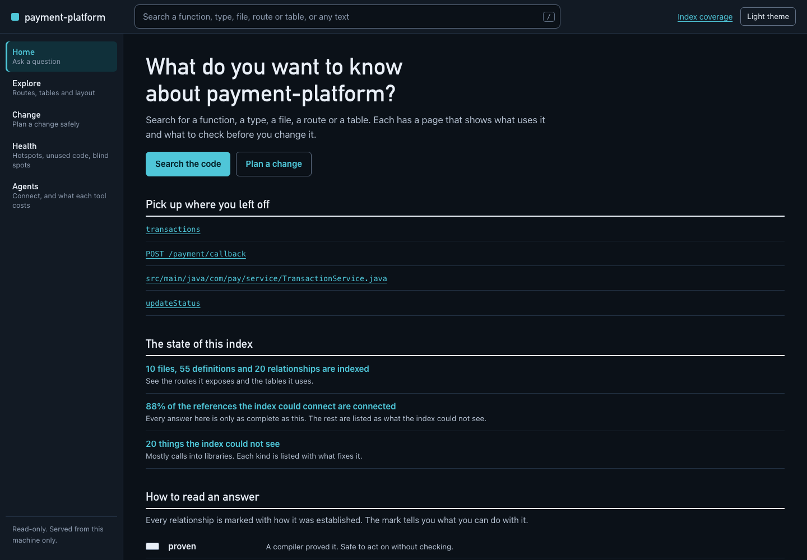

- **Header.** The project name, a search box and two controls on the right: an
  "Index coverage" link (it opens the [Health](#health) page) and a Light or
  Dark theme toggle. The search box searches functions, types, files, routes,
  tables and text. Press `/` to jump to it.
- **Sidebar.** Five sections: [Home](#home), [Explore](#explore),
  [Change](#change), [Health](#health) and [Agents](#agents). The foot of the
  sidebar says "Read-only. Served from this machine only."
- **Pages.** Every function, type, file, route and table has its own page,
  reached from search or from a link on another page.

| Address | Page |
|---|---|
| `#/` | Home |
| `#/explore` | Explore |
| `#/change` | Change. `?base=` and `?symbol=` fill in the two forms. |
| `#/health` | Health |
| `#/agents` | Agents |
| `#/search?q=` | Search results |
| `#/s/<name>?path=&tab=` | A symbol |
| `#/f/<path>` | A file |
| `#/r/<signature>` | A route |
| `#/t/<name>` | A table |

---

## How to read an answer

Every relationship on every page is marked with how it was established. The
mark tells you what to do with it.

| Mark | Meaning |
|---|---|
| proven | A compiler proved it. Safe to act on without checking. |
| very likely | Bound from the syntax tree and imports. It is rarely wrong. |
| uncertain | One of several candidates. Check it before relying on it. |
| a guess | A name match only. Do not act on it alone. |

Beside each answer there are two boxes.

- **What this answer cannot see.** The gaps the index reported for this answer,
  for example calls into libraries. An empty list still means nothing was
  found, never that nothing exists. Notes beyond the first are folded behind
  "Show N more notes".
- **Ask your agent the same thing.** The exact `repocortex tool call ...`
  command that returns this answer, with a Copy button. Run it in a shell, or
  have an agent call the same tool.

Lists of relationships have an "Everything" and a "Very likely or better"
switch, so you can hide the weaker rows.

---

## Pages

### Home

The first page. It asks "What do you want to know about <project>?" and offers
two buttons: Search the code and Plan a change. Below that:

- **The state of this index.** Files, definitions and relationships indexed;
  how many of the references the index could connect are connected; and how
  many things it could not see.
- **How to read an answer.** The four marks above.
- **Start from a task.** Links to Plan a change safely, Find your way around and
  Connect your coding agent.

### Explore

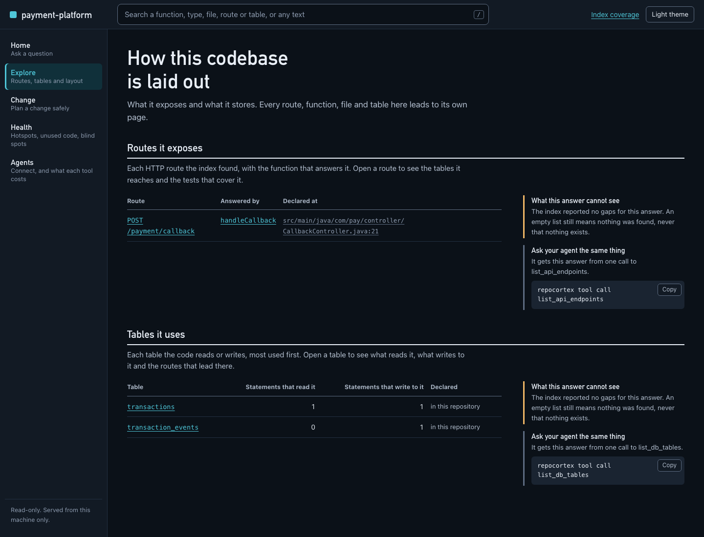

How the codebase is laid out.

- **Routes it exposes.** Each HTTP route the index found, the function that
  answers it, and where it is declared. Open a route to see the tables it
  reaches and the tests that cover it.
- **Tables it uses.** Each table the code reads or writes, with the number of
  statements that read it and write to it. Open a table to see what reads it,
  what writes to it and the routes that lead there.

### Change

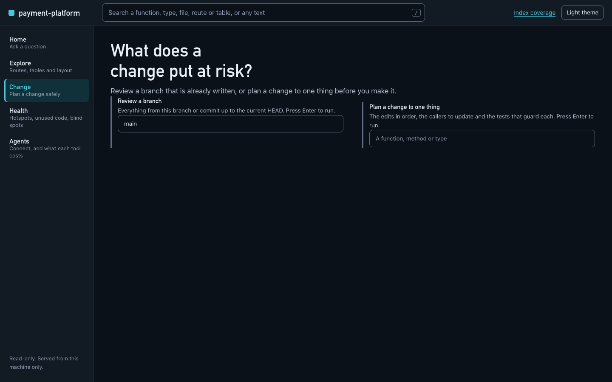

What a change puts at risk. There are two forms. Press Enter to run either.

- **Review a branch.** Enter a branch or commit. The page reviews everything
  from there up to the current HEAD.
- **Plan a change to one thing.** Enter a function, method or type.

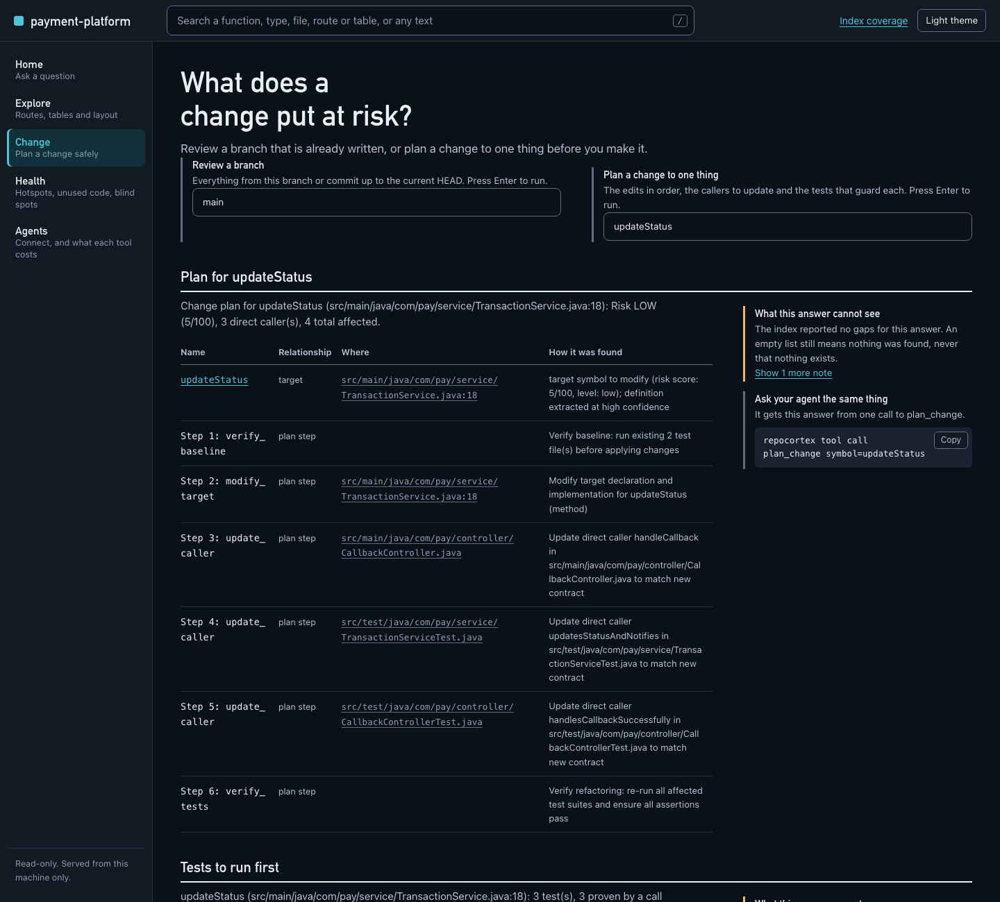

A plan lists the edits in order (verify the baseline, modify the target, update
each caller, verify the tests) and then the tests to run first. Each test shows
how it reaches the target and how sure the index is.

### Health

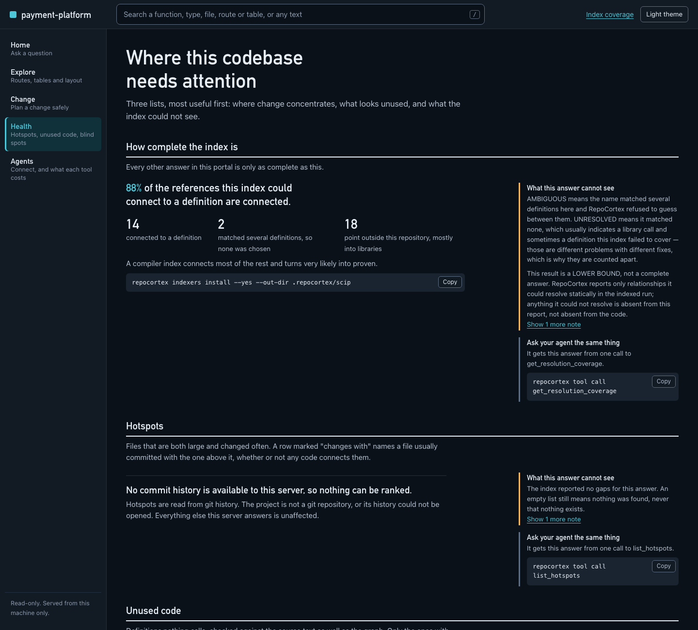

Where the codebase needs attention. Three lists, most useful first: where change concentrates, what looks unused,
and what the index could not see.

- **How complete the index is.** The share of references connected to a
  definition, and why the rest are not: several definitions matched, or the
  target is outside the repository. Every other answer in the portal is only as
  complete as this one.
- **Hotspots.** Files that are both large and changed often. This needs git
  history. Without it the page says that nothing can be ranked.
- **Unused code.** Definitions nothing calls, checked against the source text as
  well as the graph.
- **What the index could not see.** Each kind of gap, such as calls it could not
  connect, with what fixes it.

### Agents

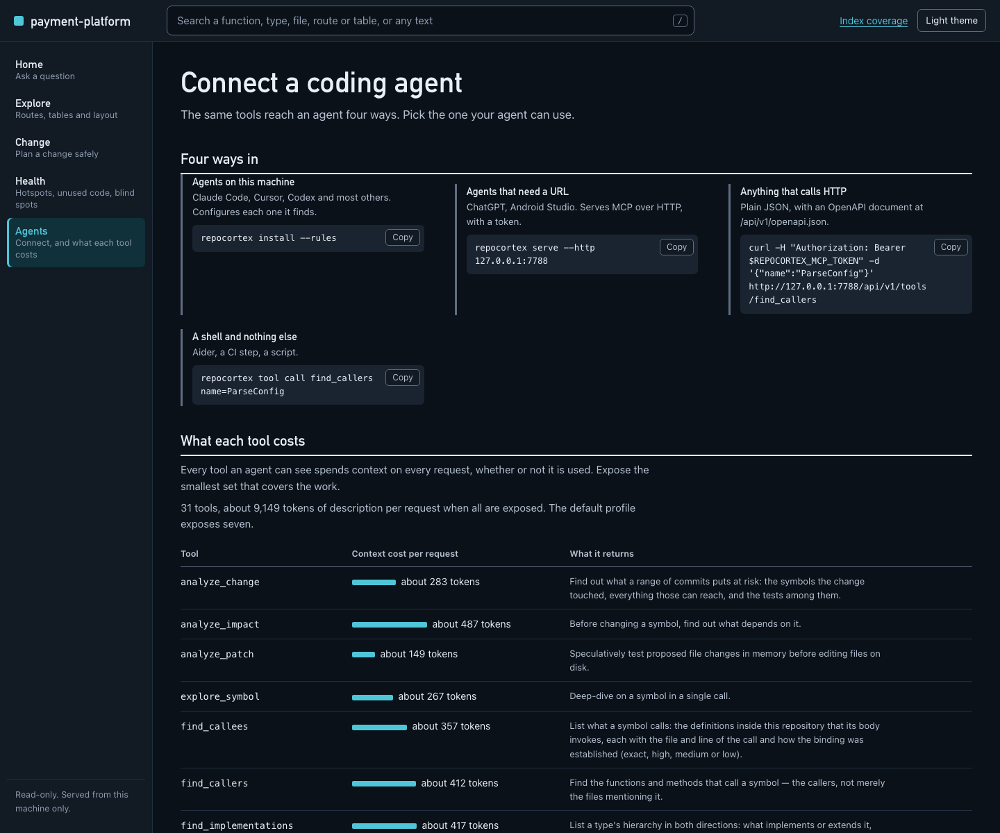

- **Four ways in.** The command for agents on this machine
  (`repocortex install --rules`), for agents that need a URL
  (`repocortex serve --http`), for anything that calls HTTP, and for a shell.
  Each has a Copy button.
- **What each tool costs.** Every tool an agent can see spends context on each
  request. The page lists each tool with the tokens its description costs and
  what it returns, and says how many the default profile exposes.

### Search results

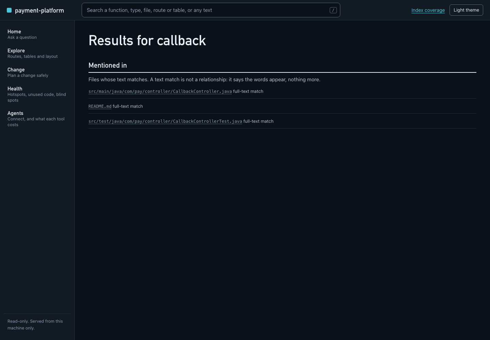

The header search box opens `#/search?q=`. It lists matching definitions, files,
routes and tables, and files whose text matches. A text match says the words
appear. It is not a relationship.

### A symbol

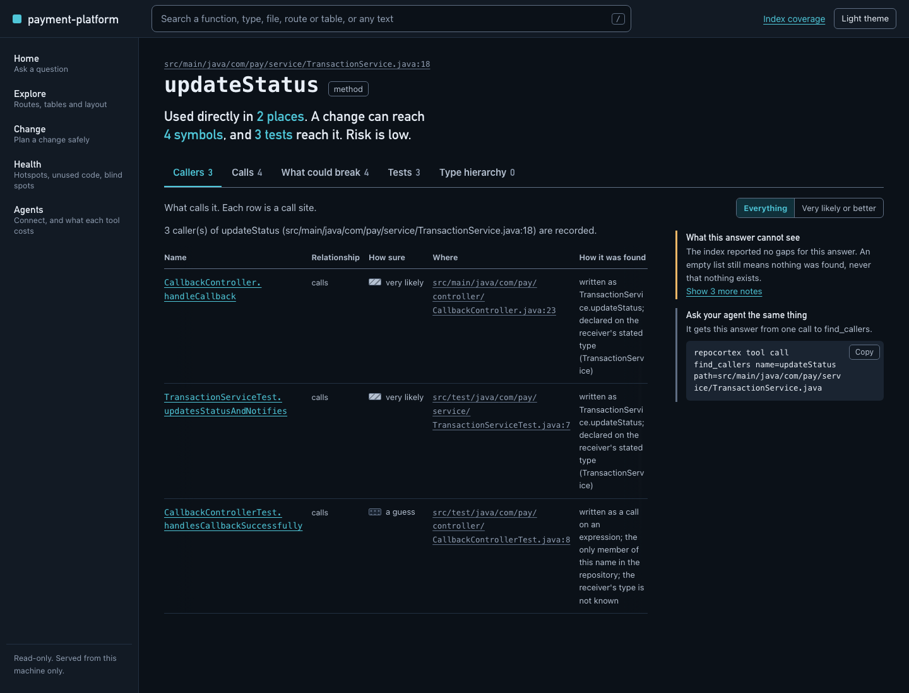

One page per function, method or type. It opens with a sentence that sums up
the symbol: how many places use it directly, what a change can reach, and the
risk.

When the index cannot vouch for those numbers, the sentence says so in its
wording ("at least 45 places", "Risk is moderate or higher") and one line under
it says why in plain words, for example "Not every use is recorded, so these
are the least the numbers could be." **Why** unfolds the index's own
explanation, and each tab's "What this answer cannot see" box lists every
reason in full.

The tabs, with their counts:

- **Callers.** What calls it. Each row is a call site.
- **Calls.** What it calls, inside this repository.
- **What could break.** Everything a change to it can reach, nearest first.
- **Tests.** The tests that reach it. Run the ones found through a call first.
- **Type hierarchy.** What implements or extends it, and what it extends.

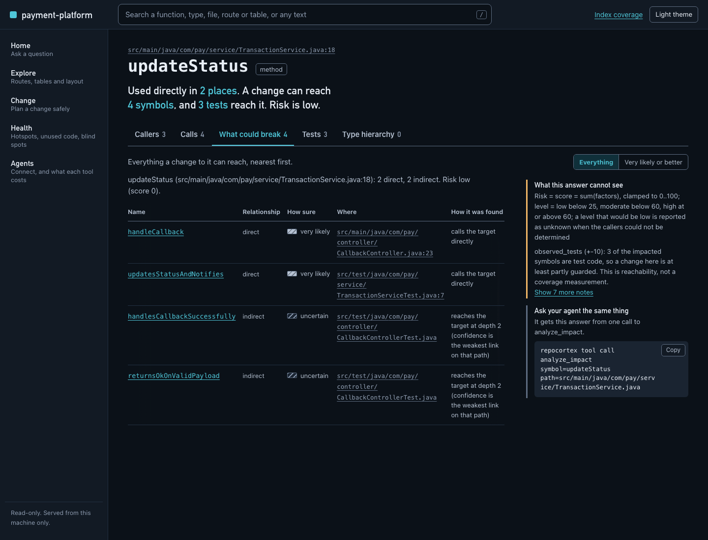

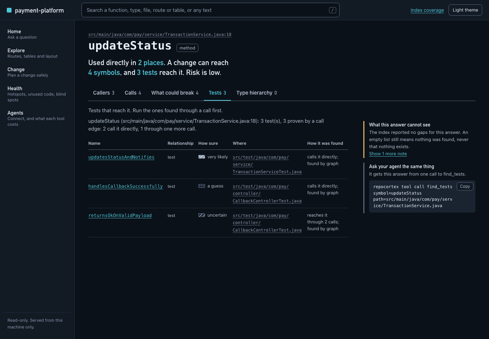

### A file

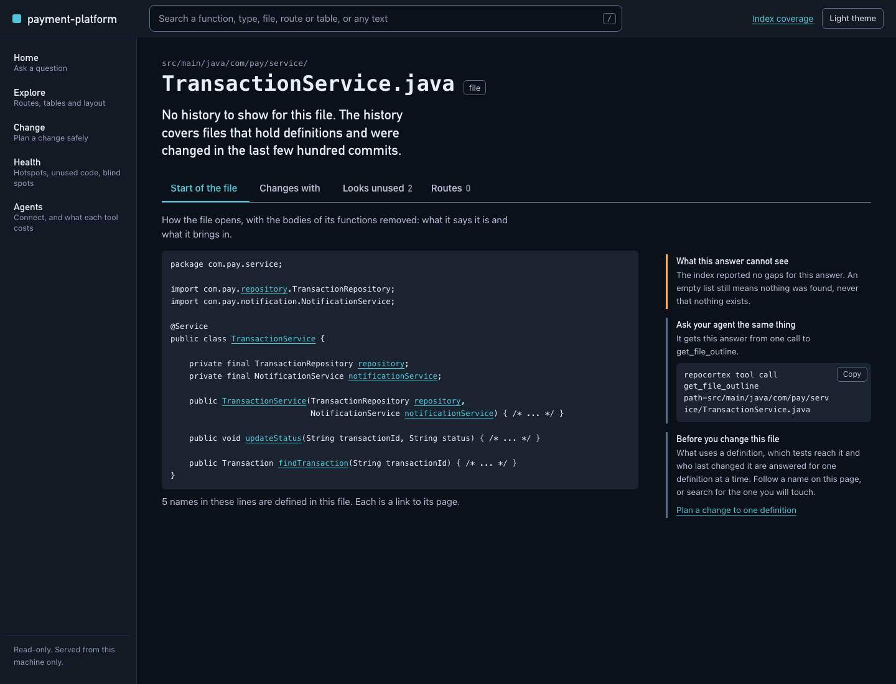

The first tab shows how the file opens, with the bodies of its functions
removed. Names defined in the file are links to their pages. The other tabs are
Changes with (files usually committed with this one), Looks unused and Routes.
The file page links to "Plan a change to one definition".

### A route

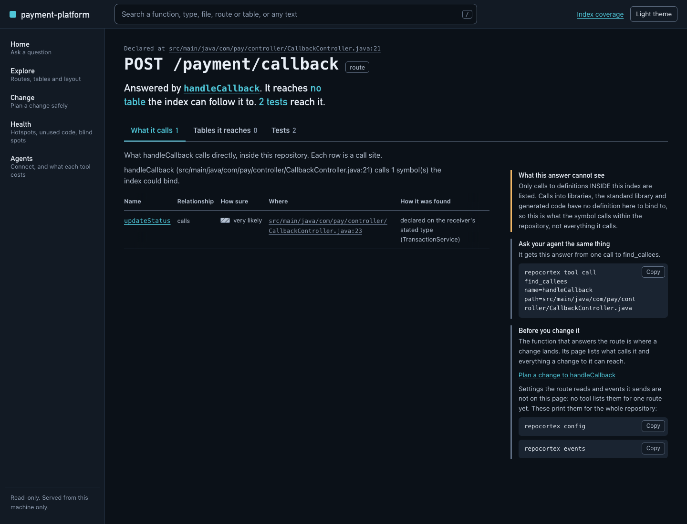

The sentence at the top names the function that answers the route, the tables
it reaches and the tests that reach it. The tabs are What it calls, Tables it
reaches and Tests. Settings the route reads and events it sends are not on this
page. The page shows `repocortex config` and `repocortex events`, which print
them for the whole repository.

### A table

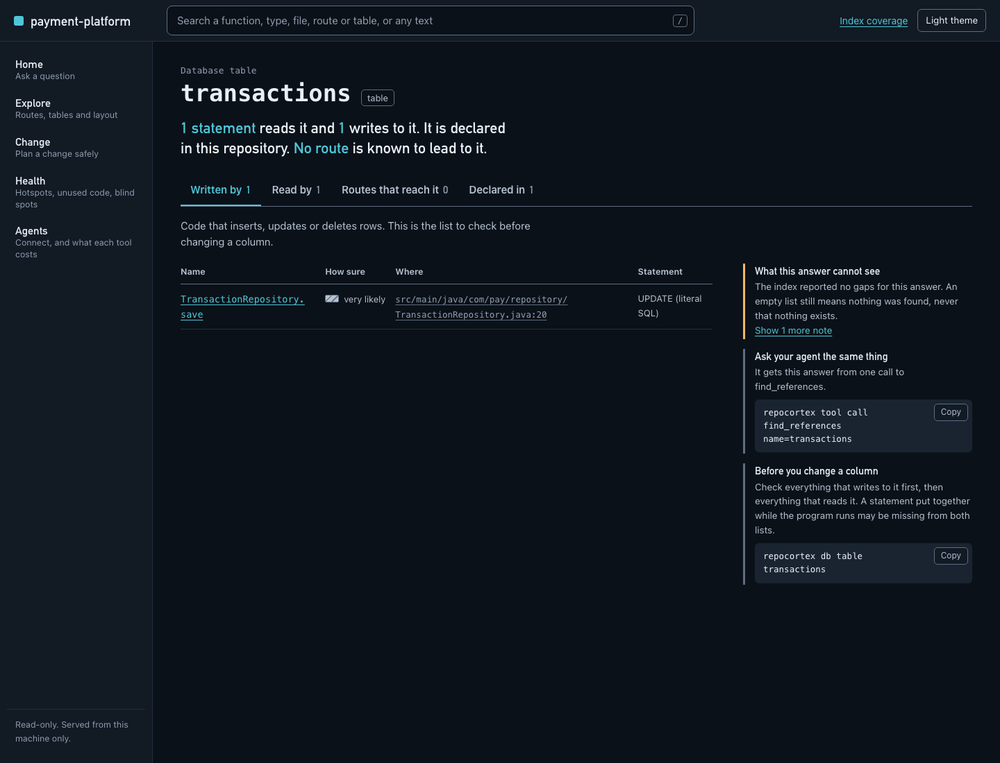

The tabs are Written by, Read by, Routes that reach it and Declared in. Check
what writes to a table first, then what reads it, before you change a column.
A statement put together while the program runs may be missing from both lists.

---

## How the portal is designed to behave

- **Read-only.** The portal opens the index read-only. The tools it calls are
  read-only. It serves no route that writes. To refresh the index, run
  `repocortex index` or keep `repocortex watch` running.
- **Loopback only.** It binds to `127.0.0.1`. `--host` accepts a loopback
  address and nothing else. It refuses any request whose Host header is not a
  loopback name, so a page on the internet cannot point your browser at
  `localhost:7777` and read the structure of your code.
- **Same origin only.** Cross-origin requests are refused.
- **Strict Content-Security-Policy.** The page can load nothing from another
  origin. All assets are embedded in the binary.
- **No data of its own.** Every figure comes from a tool call to `/api/v1`, the
  same tools an MCP agent calls.

---

## Troubleshooting

**The page says there is no index.** Run `repocortex init` and
`repocortex index` in the repository, or pass `--project` to point at one.

**The port is in use.** Choose another with `--port N`, or use `--port 0` to let
the system pick a free one. The banner prints the address it chose.

**`--host` is refused.** The portal has no login and shows the structure of your
codebase, so it is served on loopback addresses only (`127.0.0.1`, `::1` or
`localhost`). To reach it from another machine, use an SSH tunnel to the
loopback port, or serve the tools to agents with `repocortex serve --http`,
which uses tokens.

**`--allow-refresh` returns an error.** It was removed. The portal has no route
that writes. Run `repocortex index` to rebuild the index, or `repocortex watch`
to keep it current.

**A list is empty or short.** Read "What this answer cannot see" beside it. An
empty list means nothing was found in the index, not that nothing exists. The
Health page shows how complete the index is.
