# The RepoCortex portal: a screen-by-screen guide

`repocortex ui` serves a local web portal over your RepoCortex index. It is a
reading tool. It shows what the index holds, how sure the index is about each
fact, and what the index cannot see. It never edits your code or your index.

Every screenshot in this guide is a real capture of the portal running against
the sample service in `fixtures/payment-platform` (10 files, 54 symbols, one
HTTP endpoint, two database tables). Your numbers will differ.

Contents

- [Start the portal](#start-the-portal)
- [The layout](#the-layout)
- [Reading conventions used on every screen](#reading-conventions-used-on-every-screen)
- [Screens](#screens)
  - [Index health](#index-health-soverview)
  - Understand the code: [Map of the code](#map-of-the-code-sgraph),
    [Find a symbol](#find-a-symbol-ssearch),
    [Shape of the code](#shape-of-the-code-smetrics)
  - Before you change something: [Plan a refactor](#plan-a-refactor-splanchange),
    [What could break](#what-could-break-sblast),
    [Task brief](#task-brief-scontract),
    [Check a change](#check-a-change-sverify),
    [Who knows this code](#who-knows-this-code-sownership),
    [What changed](#what-changed-sdiff)
  - How it runs: [APIs and what they touch](#apis-and-what-they-touch-scrossstack),
    [Database tables](#database-tables-stables),
    [Events and queues](#events-and-queues-sevents),
    [Settings and secrets](#settings-and-secrets-sconfig),
    [What actually ran](#what-actually-ran-strace),
    [Across repositories](#across-repositories-sestate)
  - Quality: [Test coverage](#test-coverage-stests),
    [Code blindspots](#code-blindspots-smissed),
    [Architecture rules](#architecture-rules-sgovernance),
    [Dependencies](#dependencies-sdeps),
    [How accurate is this index](#how-accurate-is-this-index-saccuracy)
  - For your AI agent: [Connect an agent](#connect-an-agent-sagent),
    [Retrieval quality](#retrieval-quality-sretrieval)
- [How the portal is designed to behave](#how-the-portal-is-designed-to-behave)
- [Troubleshooting](#troubleshooting)

---

## Start the portal

The portal reads an existing index, so build one first:

```sh
repocortex init
repocortex index
repocortex resolve
repocortex ui
```

`repocortex ui` prints the address and stays in the foreground. Press Ctrl-C to
stop it.

```text
RepoCortex portal: http://127.0.0.1:7777/
  index      /path/to/repo/.repocortex/index.db (opened read-only; this portal never writes)
  binding    loopback only — not reachable from other machines.
```

| Flag | What it does |
|---|---|
| `--port N` | Port to listen on. Default `7777`. `0` picks a free port and prints it. |
| `--allow-refresh` | Adds a "Refresh index" button to the index bar. This is the only way the portal can write anything: it adds one POST route that rebuilds the index. Off by default. |
| `--host ADDR` | Address to bind. Default `127.0.0.1`. Anything else exposes the structure of your code to the network, and the command says so. |
| `--max-nodes N` | Most symbol nodes in one map response. Default `1500`. Anything left out is counted on screen. |
| `--print-url` | Print the address and exit without starting. |
| `--project DIR` | Serve the index of another project root (a global flag). |

What the portal guarantees:

- **Read-only.** The index is opened read-only and only GET routes exist.
  Without `--allow-refresh` no route that writes is registered at all. With
  it, a refresh still needs a header a cross-site page cannot set, and a
  request from a non-loopback origin is refused.
- **Loopback only.** It binds to `127.0.0.1` and refuses any request whose
  `Host` header is not a loopback address. A web page on the internet cannot
  use your browser to read your index.
- **Offline.** All assets are inside the `repocortex` binary. There is no npm, no
  CDN, and the page's content policy blocks loading anything from another
  origin.

## The layout

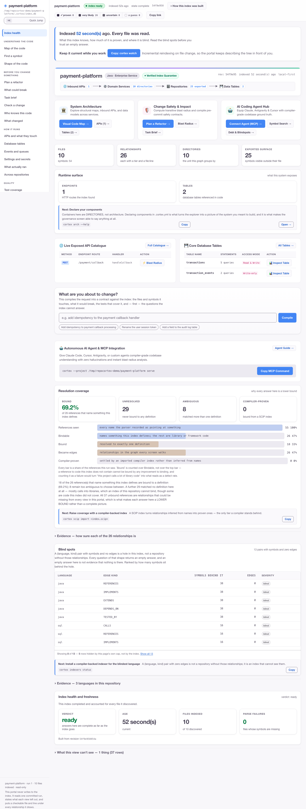

Every screen shares the same frame:

```text
+------------------+---------------------------------------------------------------+
| RAIL             | INDEX BAR (sticky)                                            |
|  project name    |  project | index ready | indexed 2 min ago | state | sha      |
|  index path      |  [How this index was built]  [proven|very likely|uncertain|a  |
|  [Cmd-K Quick    |   guess]  [Copy link]                                         |
|   Jump]          +---------------------------------------------------------------+
|                  | ANSWER LINE                                                   |
|  Index health    |  One sentence with the key numbers in bold.                   |
|  UNDERSTAND...   |  A supporting sentence.                                       |
|   Map of the code|  Next step: [Copy: repocortex <command>]  why it helps            |
|   ...            +---------------------------------------------------------------+
|  BEFORE YOU...   | CONTROLS  (input, depth, filters — only where the screen      |
|  HOW IT RUNS     |            takes a question)                                  |
|  QUALITY         +---------------------------------------------------------------+
|  FOR YOUR AI...  | SUMMARY CARDS   [ n ] [ n ] [ n ] [ n ]                       |
|                  +---------------------------------------------------------------+
|                  | TABLES AND CARDS: rows, each with a confidence word and a     |
|                  |   file:line you can copy                                      |
|                  | > Evidence — ... (fold, closed)                               |
|                  | > What this view can't see — ... (fold, closed)               |
|  FOOTER          |                                                               |
|  read-only ·     |                                                               |
|  localhost       |                                                               |
|  [What do these  |                                                               |
|   words mean?]   |                                                               |
|  [Theme: system] |                                                               |
+------------------+---------------------------------------------------------------+
```

- **Rail.** The project name, the path of the index file being read, a Quick
  Jump button, and the screens grouped by the question you are asking. Index
  health sits alone at the top because its verdict qualifies every other
  screen. Below 1000 pixels wide the rail becomes one row that scrolls
  sideways.
- **Index bar.** Sticky at the top of every screen. It shows the run verdict
  (`index ready`, or a warning colour when the run is partial, stale or has
  parse failures), the age of the index, its state, the git revision it read,
  and any parse failures. Click the verdict to jump to the freshness card on
  Index health. "How this index was built" opens a panel under the bar with
  the exact finish time, the revision, and whether a commit hook keeps the
  index current. The four confidence chips and Copy link sit on the right.
- **Answer line.** The first thing on every screen: one sentence that answers
  the screen's question, with the numbers in bold. When the server suggests a
  next step, it appears as a button that copies the command.
- **Folds.** Evidence, caveats and long lists sit in `details` folds below the
  answer. They start closed.
- **Footer.** At the bottom of the rail: the project, the run number, the
  number of files indexed, and "read-only". The "What do these words mean?"
  button opens a short glossary, and the theme button sits below it.

## Reading conventions used on every screen

### The answer line

Each screen opens with one sentence that answers its question, for example
"3 things could be affected if you change findById: 2 directly, 1 further
along the walk." No heading sits above it. If the screen needs input first, the
sentence says what to type. If the data fails to load, the sentence changes to
"<screen> could not load." and an error card below says why.

### Confidence words and colours

Every relationship carries a confidence level. The portal shows it as a word,
never as a bare id:

| Word on screen | Id in the API and CLI | Meaning |
|---|---|---|
| proven (with a tick) | `exact` | a compiler proved it |
| very likely | `high` | measured 87–96% right |
| uncertain | `medium` | measured 6–38% right |
| a guess | `low` | measured under 3% right |
| unmeasured (with a `?`) | unknown | no measurement recorded |

Confidence is drawn as ink density on one neutral hue, not as a traffic-light
colour. The darker the ink, the stronger the proof. Proven is the darkest and
carries a tick. A guess is the faintest. Unmeasured uses a muted purple and a
question mark. On the map, proven and very likely edges are solid lines,
uncertain edges are dashed, and guesses are dotted. Because the levels differ
by lightness, they survive colour blindness and greyscale printing. Hover a
badge to see the measurement behind the word.

Green, amber and red are kept for status (pass, warning, failure) and never
mean confidence.

### The standard of proof

The four chips in the index bar are both the legend and a filter. Click one to
set the weakest level a screen will show; that chip and every stronger one
become pressed. The default is "uncertain and better", so guesses are hidden
until you ask for them. The choice is saved in the URL as `?floor=` and
applies to every screen. Once Index health has loaded in the tab, the chips
also show how many relationships sit at each level.

When something is hidden by this setting, the screen says how many, in its
"What this view can't see" fold.

### "What this view can't see"

Screens that list rows end with a fold named "What this view can't see". It
counts what was left out and why: rows below the chosen standard of proof,
rows past a page limit, calls that could not be bound. Each reason has a
count, and where a count is not recorded it says "how many is not recorded"
rather than showing zero. Where something can be fixed, the fold shows the
command. When nothing was left out it says so in one sentence.

Several screens also carry a fold such as "What this screen never does, and
what it cannot see". Read these before you trust an empty answer.

### Deep links and Copy link

Everything about a screen lives in the URL: the screen (`?s=blast`), the
symbol (`&sym=findById`), the depth, the standard of proof, the page, the map
view and its selection. Opening that URL in a fresh tab restores the same
screen. Copy link in the index bar copies the current URL, and the button
changes to "Link copied" for a moment.

Useful keys:

| Key | Screen | Example |
|---|---|---|
| `s` | screen id | `?s=tables` |
| `sym`, `depth` | What could break, Who knows this code, Test coverage | `?s=blast&sym=findById&depth=3` |
| `q` | Find a symbol | `?s=search&q=CallbackController` |
| `intent` | Task brief | `?s=contract&intent=Add+idempotency+to+payment+callback+processing` |
| `intent`, `changed` | Check a change | `?s=verify&intent=...&changed=src/a.java,src/b.java` |
| `csdepth`, `off`, `limit` | APIs and what they touch | `?s=crossstack&csdepth=4` |
| `dfrom`, `dto` | What changed | `?s=diff&dfrom=3&dto=4` |
| `open=1` | any | unfolds every fold (see below) |

An unknown `?s=` value falls back to Index health rather than a blank page.
Old links of the form `/#graph` still work. Back and Forward move between
screens.

### `?open=1`

Add `&open=1` to any URL and every fold on the page opens. This is meant for
screenshots, reviews and agents that read the page. It is not remembered: the
next visit without it starts with folds closed again.

### Keyboard

- Every rail entry is a real button, so Tab reaches them in order. A "Skip to
  content" link is the first stop.
- Cmd-K (Ctrl-K on Windows and Linux) opens Quick Jump, a palette for going to
  any screen by name. Esc closes it.
- On Map of the code, `/` jumps to the search box from anywhere on the screen.
  With the canvas focused: arrow keys pan (hold Shift to move further), `+`
  and `-` zoom, `0` fits the drawing, Tab and Shift-Tab walk the nodes, and
  Enter opens the selected node.
- Search boxes with suggestions accept Up, Down, Enter and Esc.

### Theme

The theme button in the rail footer cycles Theme: system, Theme: light,
Theme: dark. The choice is kept in your browser and survives a reload. "system"
follows your operating system's setting.

### The glossary

"What do these words mean?" opens one-sentence definitions of the few terms
the portal cannot avoid: index, symbol, relationship, package, endpoint, hop,
lower bound, degraded, blast radius and compiler-backed. The same definitions
appear when you hover those words where they are underlined.

---

## Screens

The same template is used for each screen. "Data comes from" names the API
route the screen calls (all are GET, on the same port) and the CLI command
that gives the same answer in a terminal.

### Index health (`?s=overview`)

**Answers:** How fresh and how complete is this index, and where is it blind?
**Data comes from:** `/api/overview` (with `/api/indexstate` for the build
panel). CLI: `repocortex status` and `repocortex doctor`.

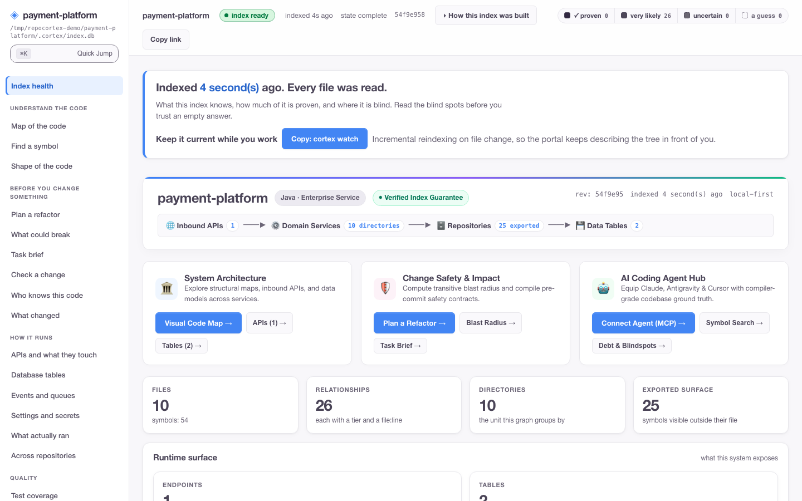

**Layout skeleton:**

```text
[ANSWER  Indexed 27 seconds ago. Every file was read.  [Copy: repocortex watch]]
[System banner: inbound APIs -> services -> repositories -> tables]
[Entry cards: architecture | change safety | agents]
[FILES] [RELATIONSHIPS] [DIRECTORIES] [EXPORTED SURFACE]
[Runtime surface: endpoints, tables, next step]
[API list]                [Table list]
[What are you about to change?  (task box -> Task brief)]
[Resolution coverage: bound | unresolved | ambiguous | compiler-proven + bars]
> Evidence — how sure each relationship is
[Blind spots: language x edge kind with symbols but no edges]
[Index health and freshness: verdict | age | files indexed | parse failures]
> What this view can't see
```

**How to read it:**

- **Answer line.** Good: "Every file was read." Worrying: a partial run, parse
  failures, or an age over a day. The button under it is the next step the
  server suggests: `repocortex watch` when all is well, `repocortex index` when the
  index is partial or stale.
- **Summary cards.** Files, relationships, directories (or components, if you
  declared an architecture) and exported symbols. These are the totals every
  other screen counts against.
- **Runtime surface.** Endpoints and tables the index found, with links to
  APIs and what they touch and Database tables.
- **What are you about to change?** Type a task and press Compile to go
  straight to a Task brief.
- **Resolution coverage.** How many references were bound to exactly one
  definition, how many were ambiguous, how many stayed unbound, and how many
  are compiler-proven. A low bound share means every answer on every screen
  is a lower bound. The note under the bars says which command raises it.
- **Blind spots.** Each row is a language and a relationship kind that has
  symbols but zero edges. That is a gap in what the index can see, not proof
  that your code has no such relationships. Read this before trusting an
  empty answer elsewhere.
- **Index health and freshness.** The verdict (`ready`, or a warning), age,
  files indexed against files discovered, and parse failures.
- **Where to go next:** Map of the code for structure, What could break before
  a change, How accurate is this index if most edges are unmeasured.

### Map of the code (`?s=graph`)

**Answers:** Which parts of the code talk to each other, and how sure is each
link?
**Data comes from:** `/api/graph` (and `/api/source` for the Code view). CLI:
`repocortex export --format svg|json|dot|graphml|csv`.

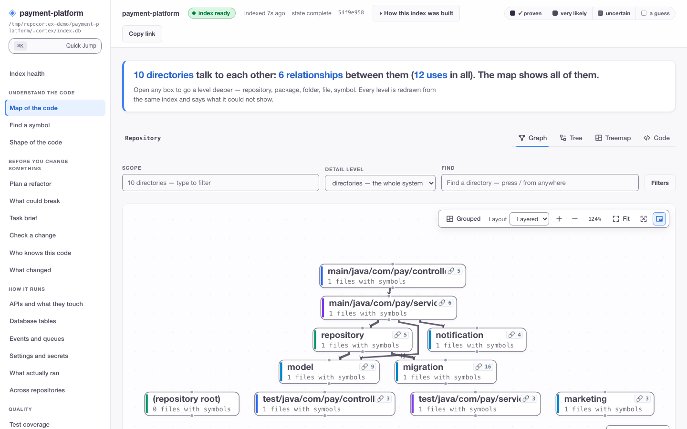

**Layout skeleton:**

```text
[ANSWER  10 directories talk to each other: 6 relationships ...]
[Breadcrumb: Repository]                 [Graph | Tree | Treemap | Code]
[SCOPE ...] [DETAIL LEVEL ...] [FIND ... press /] [Filters]
+--------------------------------------------------------------+
| [Grouped] Layout [Layered v] [+] [-] 124% [Fit] [minimap]    |
|   boxes = groups, arrows = relationships, line style = proof |
+--------------------------------------------------------------+
[Scope banner: what was chosen and why]
[Every relationship on the map, with its evidence  (table)]
> What this view can't see
```

**How to read it:**

- **Answer line.** How many groups and relationships are drawn, and whether
  the map shows all of them.
- **View tabs.** Graph is the drawing. Tree lists what is inside each group.
  Treemap sizes groups by a measure you choose. Code shows a file with line
  numbers. All four share the same address, so a link keeps the view.
- **Toolbar.** Scope narrows to one group. Detail level goes from the whole
  system down to directories, files and symbols. Find (or `/`) searches the
  drawn names. Filters holds grouping, language, edge kinds, the standard of
  proof and focus depth; the button shows how many are changed from the
  default, so a narrowed map never looks like the whole one.
- **Canvas.** Click a box to select it, open it to go a level deeper. Line
  style tells you the confidence of each edge (solid, dashed, dotted). A
  number on a box is how many relationships it has.
- **Scope banner.** If you did not choose a scope, it says which one was
  chosen and by what rule, instead of drawing an empty canvas.
- **Relationship table.** A full text version of the drawing. Each row has
  the weakest confidence along it and an example file and line. This table is
  the thing to cite in a review.
- **Where to go next:** Shape of the code for the riskiest symbols, What could
  break for one symbol.

### Find a symbol (`?s=search`)

**Answers:** Is this name in the index at all, and where is it defined?
**Data comes from:** `/api/symbols`. CLI: `repocortex symbol <name>` (exact
match) or `repocortex search <text>` (full text).

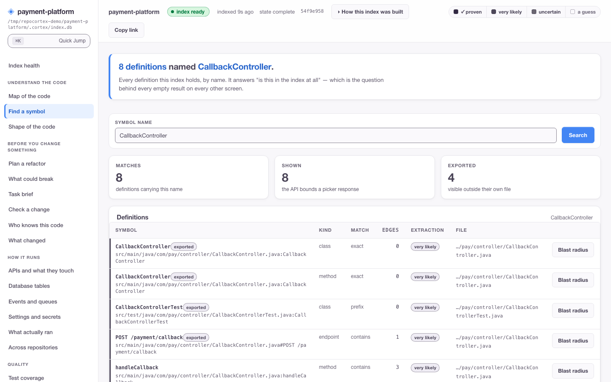

**Layout skeleton:**

```text
[ANSWER  8 definitions named CallbackController.]
[SYMBOL NAME ______________________________] [Search]
[MATCHES] [SHOWN] [EXPORTED]
[Definitions: symbol + fqn | kind | match | edges | extraction | file | [Blast radius]]
```

**How to read it:**

- **Answer line.** How many definitions carry that name. Zero here is the
  real "not in the index" answer that every empty result elsewhere depends on.
- **Match column.** `exact`, `prefix` or `contains`. Results are ranked with
  exact matches first.
- **Edges.** How many relationships touch the definition. Zero edges on a
  class you know is used points to a blind spot (see Index health).
- **Extraction.** The confidence word for how the definition was read.
- **Blast radius button.** Opens What could break for that exact definition,
  which avoids the "this name matches several things" step.

### Shape of the code (`?s=metrics`)

**Answers:** Which symbols are most connected, so a change there is most
dangerous, and are there cycles?
**Data comes from:** `/api/metrics`. CLI: `repocortex export` (the full ranking
under the same keys).

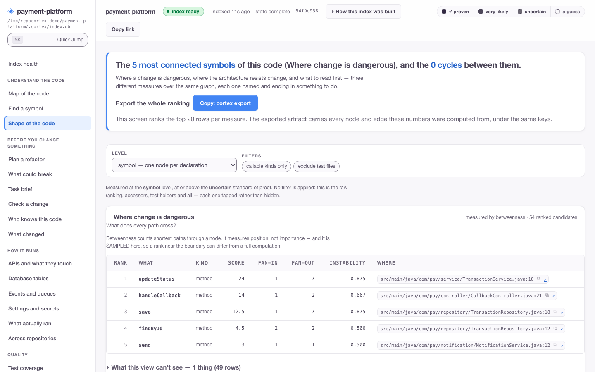

**Layout skeleton:**

```text
[ANSWER  The 5 most connected symbols ... and the 0 cycles between them.  [Copy: repocortex export]]
[LEVEL symbol v]  [FILTERS: callable kinds only | exclude test files]
(note: level, standard of proof, filters applied)
[Where change is dangerous: rank | what | kind | score | fan-in | fan-out | instability | where]
[... further measures ...]
> What this view can't see
```

**How to read it:**

- **Level and filters.** Rank symbols, files or groups. "callable kinds only"
  drops fields and types; "exclude test files" drops test code. The note
  under the controls states exactly what was applied.
- **Where change is dangerous.** Ranked by betweenness: how many shortest paths
  run through a symbol. It measures position, not importance, and it is
  sampled, so ranks near the cut-off can differ from a full computation.
- **Fan-in, fan-out, instability.** High fan-in means many callers depend on
  it. Instability near 1 means it depends on much and little depends on it.
- **Where to go next:** click through to What could break for the top rows.

### Plan a refactor (`?s=planchange`)

**Answers:** In what order should a change to this symbol be made, and what
must hold before and after?
**Data comes from:** `/api/planchange`. CLI: `repocortex plan-change <symbol>`.

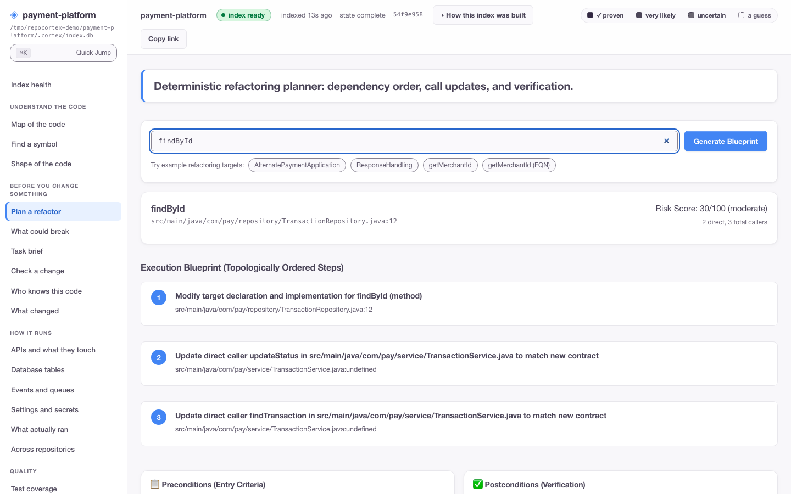

**Layout skeleton:**

```text
[ANSWER  Deterministic refactoring planner: ...]
[symbol ____________________] [Generate Blueprint]
 example chips
[Target: name, file:line            Risk score, direct and total callers]
Execution Blueprint (ordered steps)
 (1) Modify the target ...
 (2) Update direct caller ...
[Preconditions]        [Postconditions]
```

**How to read it:**

- Type a symbol name and press Generate Blueprint. If the name matches several
  definitions you get a list to pick from.
- **Target card.** The definition that was planned, with a risk score and how
  many callers it has.
- **Steps.** Change the target first, then each caller, in dependency order.
- **Preconditions and postconditions.** What should be true before you start
  and which tests should pass after.
- This screen does not read `?sym=` from the URL, so a link cannot reopen a
  plan; use the CLI command for something you can share.

### What could break (`?s=blast`)

**Answers:** If I change this symbol, what else could be affected?
**Data comes from:** `/api/blast`. CLI: `repocortex callers <name>` gives the
first step; the full walk is the MCP tool `analyze_impact`.

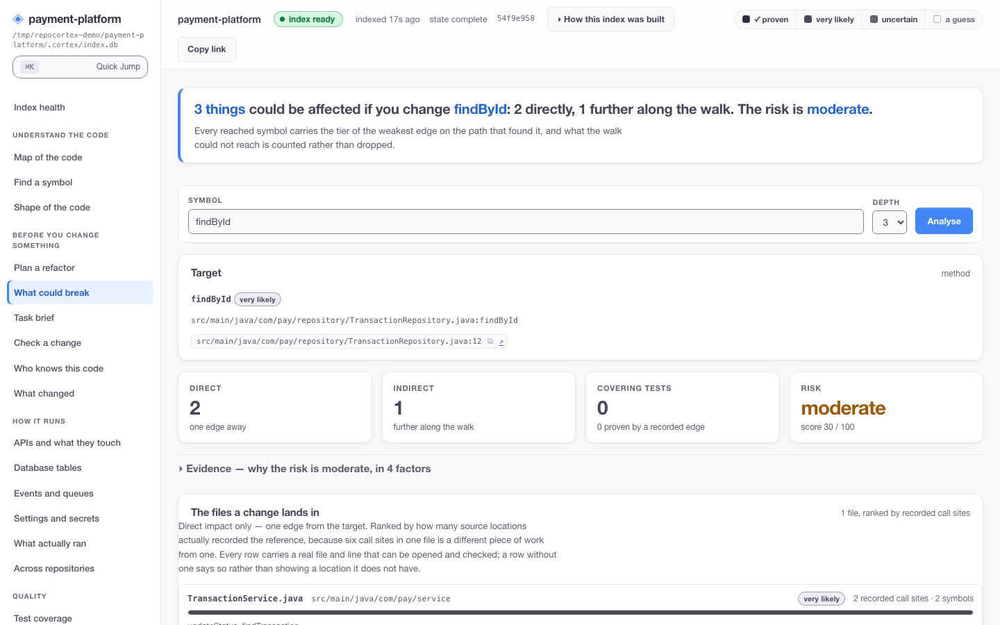

**Layout skeleton:**

```text
[ANSWER  3 things could be affected if you change findById: 2 directly, 1 further ...]
[SYMBOL ______________________] [DEPTH 3 v] [Analyse]
[Target: name, confidence, fqn, file:line]
[DIRECT] [INDIRECT] [COVERING TESTS] [RISK]
> Evidence — why the risk is <level>, in N factors
[The files a change lands in]
[What it reaches: symbol | depth | via | confidence | file]
[What it touches outside the code: tables read/written, endpoints exposed]
[Tests that cover it]
[What this walk could not see]
> This answer is a lower bound — N caveats
```

**How to read it:**

- **No symbol yet.** The screen explains why a bare name may not be enough and
  waits for input.
- **Ambiguous name.** You get a list of candidates, each with an "Analyse this
  one" button. Use the fully qualified form (`path/File.java:Name`) to skip
  this.
- **Counts.** Direct is one hop away. Indirect is further along, up to the
  chosen depth. Every reached symbol carries the confidence of the weakest
  link on the path that found it.
- **Risk.** Low, moderate or high with a score out of 100. Open the Evidence
  fold to see the factors behind it.
- **Tests that cover it.** Proven tests and tests that only share a name are
  shown apart. A test matched by name alone is marked uncertain.
- **What this walk could not see.** Unbound calls and depth limits. A result of
  zero with caveats here is a lower bound, not a guarantee.
- **Where to go next:** Who knows this code to find a reviewer, Task brief to
  scope the work.

### Task brief (`?s=contract`)

**Answers:** For this task, what is in scope, what is not, and what could the
index not find out?
**Data comes from:** `/api/contract`. CLI: `repocortex compile "<task>"` (add
`--json` to save the contract for Check a change).

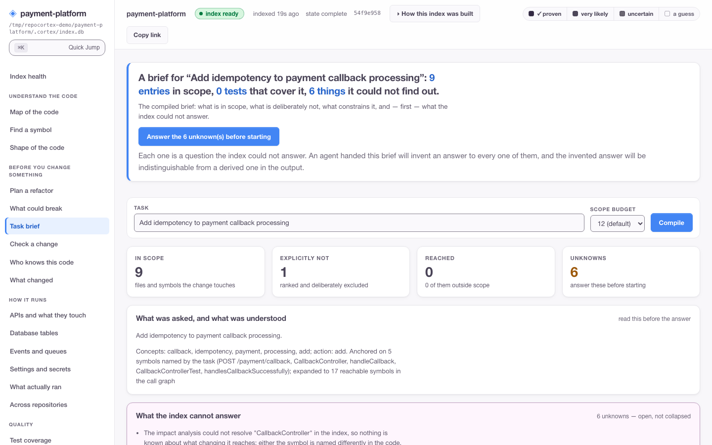

**Layout skeleton:**

```text
[ANSWER  A brief for "<task>": 9 entries in scope, 0 tests ..., 6 things it could not find out.
         [Answer the 6 unknowns before starting]]
[TASK ______________________________] [SCOPE BUDGET 12 v] [Compile]
[IN SCOPE] [EXPLICITLY NOT] [REACHED] [UNKNOWNS]
[What was asked, and what was understood]
[What the index cannot answer]   (open by default, listed first)
> Evidence — scope, non-scope, constraints, tests ...
[Open -> Check a change]
```

**How to read it:**

- **Unknowns come first.** Each one is a question the index could not answer.
  An agent given this brief would have to guess them, so answer them before
  starting.
- **What was understood.** The concepts and anchor symbols the task was matched
  to. If these are wrong, reword the task.
- **In scope and explicitly not.** What the change should touch, and nearby
  code it should leave alone. Scope budget caps the in-scope list.
- **Where to go next:** "Open" carries the same task to Check a change.

### Check a change (`?s=verify`)

**Answers:** Did a finished change stay inside its brief and break nothing
the index can see?
**Data comes from:** `/api/verify`. CLI:
`repocortex verify --contract contract.json --changed <files>`.

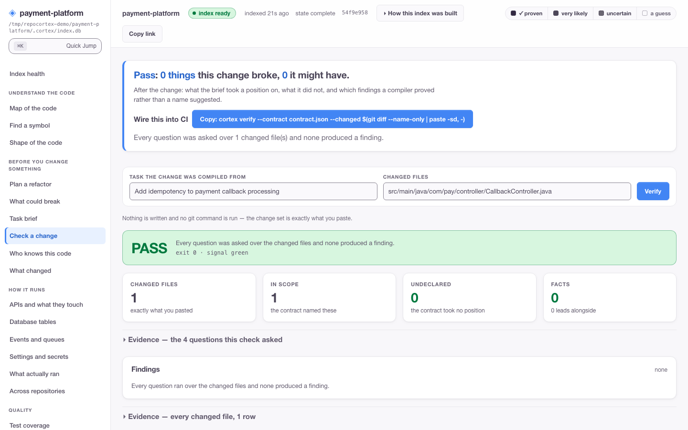

**Layout skeleton:**

```text
[ANSWER  Pass: 0 things this change broke, 0 it might have.  [Copy: repocortex verify ...]]
[TASK THE CHANGE WAS COMPILED FROM ____] [CHANGED FILES ____] [Verify]
[PASS | ADVISORY | UNVERIFIED banner, exit code]
[CHANGED FILES] [IN SCOPE] [UNDECLARED] [FACTS]
> Evidence — the questions this check asked
[Findings]
> Evidence — every changed file
```

**How to read it:**

- Paste the task and a comma-separated list of changed files (for example from
  `git diff --name-only | paste -sd, -`). Nothing is written and no git command
  is run.
- **Banner.** Pass, advisory or unverified are shown in different styles. The
  exit code is what the same check returns in CI.
- **Undeclared.** Files the change touched that the brief took no position on.
  More than zero means the change went outside its scope.
- **Findings.** Each finding says whether a compiler proved it or a name
  suggested it.

### Who knows this code (`?s=ownership`)

**Answers:** Who has touched the code that a change to this symbol can reach?
**Data comes from:** `/api/who`. CLI: `repocortex owners <symbol>`.

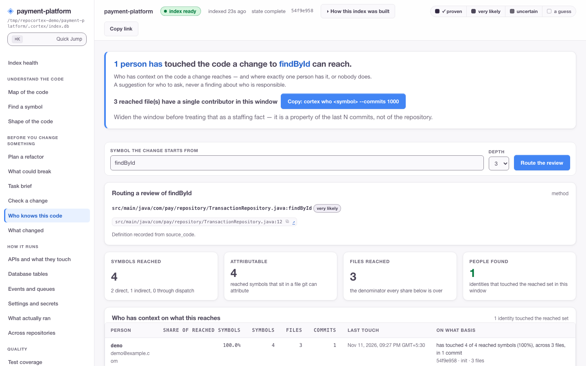

**Layout skeleton:**

```text
[ANSWER  1 person has touched the code a change to findById can reach.]
[SYMBOL ____] [DEPTH v]
[Routing a review of findById]
[SYMBOLS REACHED] [ATTRIBUTABLE] [FILES REACHED] [PEOPLE FOUND]
[Who has context: person | share | symbols | files | commits | last touch | basis]
[Bus factor over the reached files]
> Evidence — the reached set
> The window of history this was read over
[What a name in this ranking does and does not mean]
```

**How to read it:**

- The ranking is over the same set What could break would reach, then read
  from git history.
- **Bus factor.** Files that only one person touched. Many rows here mean
  review knowledge is thin.
- A name in the ranking means that person changed those files in the history
  window. It does not mean they own or understand the code.

### What changed (`?s=diff`)

**Answers:** Which facts about the code changed between two indexed runs?
**Data comes from:** `/api/diff`. CLI: `repocortex diff`.

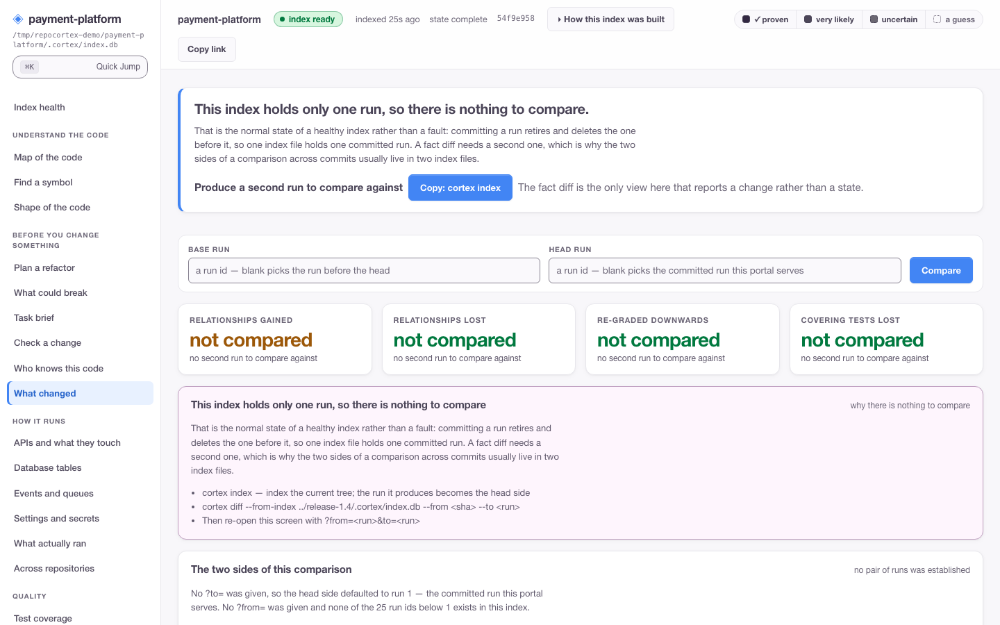

**Layout skeleton:**

```text
[ANSWER  This index holds only one run, so there is nothing to compare.  [Copy: repocortex index]]
[BASE RUN ____] [HEAD RUN ____] [Compare]
[RELATIONSHIPS GAINED] [LOST] [RE-GRADED DOWNWARDS] [COVERING TESTS LOST]
[why there is nothing to compare / the diff rows]
```

**How to read it:**

- One index file normally holds one committed run, so this screen is usually
  empty. That is the normal state, not a fault. To compare across commits, run
  `repocortex diff --from-index <other index.db> ...` in a terminal.
- With two runs, watch "lost" and "re-graded downwards": a relationship that
  got weaker or a test that stopped covering code.
- The run ids go in the URL as `dfrom` and `dto`. (The empty-state text
  mentions `?from=`/`?to=`; those are the API's own parameter names.)

### APIs and what they touch (`?s=crossstack`)

**Answers:** For each endpoint, which handler serves it and which database
tables it reaches?
**Data comes from:** `/api/crossstack`. CLI: `repocortex api`.

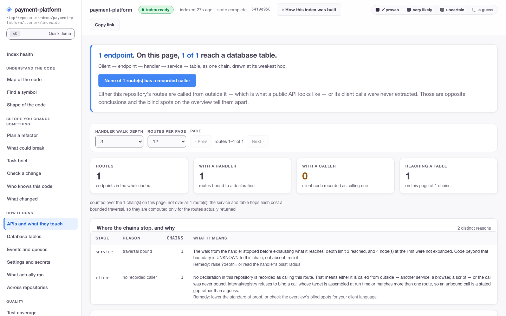

**Layout skeleton:**

```text
[ANSWER  1 endpoint. On this page, 1 of 1 reach a database table.  [next step]]
[HANDLER WALK DEPTH v] [ROUTES PER PAGE v] [< Prev] routes 1-1 of 1 [Next >]
[ROUTES] [WITH A HANDLER] [WITH A CALLER] [REACHING A TABLE]
[Where the chains stop, and why: stage | reason | chains | what it means]
[Chains: client -> endpoint -> handler -> service -> table, drawn at the weakest hop]
```

**How to read it:**

- Each chain runs client, endpoint, handler, service, table, and is shown at
  the confidence of its weakest step.
- **With a caller = 0.** Either the routes are called from outside this
  repository (a public API) or client calls were never extracted. The
  overview's blind spots tell these apart.
- **Where the chains stop.** Every chain that ended early says where and why,
  with a remedy such as raising the walk depth.
- Counts on the cards are for the chains on this page; paging moves through
  the rest.

### Database tables (`?s=tables`)

**Answers:** Which tables does this code use, and who writes and reads each?
**Data comes from:** `/api/db`. CLI: `repocortex db` and `repocortex db table <name>`.

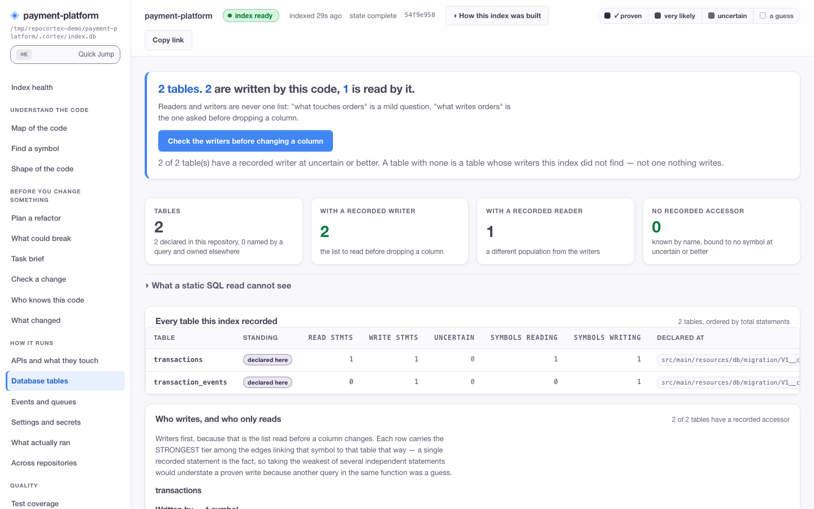

**Layout skeleton:**

```text
[ANSWER  2 tables. 2 are written by this code, 1 is read by it.]
[TABLES] [WITH A RECORDED WRITER] [WITH A RECORDED READER] [NO RECORDED ACCESSOR]
> What a static SQL read cannot see
[Every table: table | standing | read stmts | write stmts | uncertain | readers | writers | declared at]
[Who writes, and who only reads — per table: written by / read by, with confidence and evidence]
```

**How to read it:**

- A table with writers but no readers, or no accessor at all, is worth a look:
  it may be read by another service, or by SQL this index cannot parse.
- Open "What a static SQL read cannot see" before concluding a table is unused.
  Dynamic SQL and ORM-generated queries can be invisible.

### Events and queues (`?s=events`)

**Answers:** Which message topics does this code publish to or consume from?
**Data comes from:** `/api/events`. CLI: `repocortex events`.

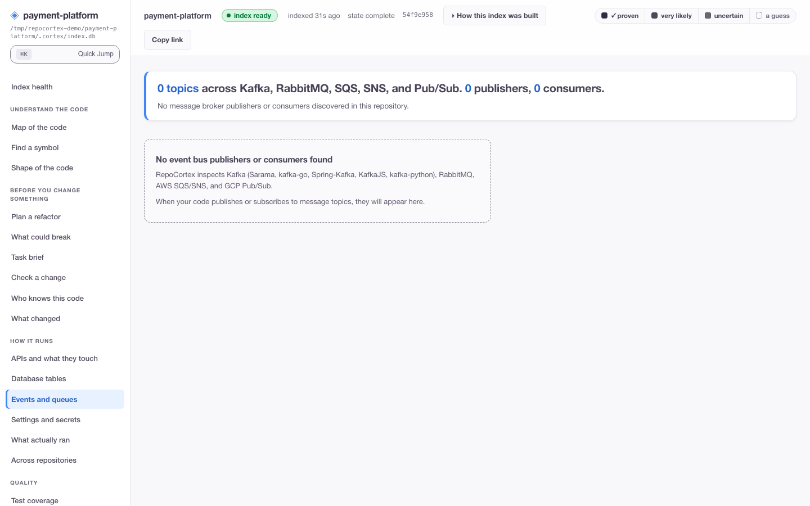

**Layout skeleton:**

```text
[ANSWER  0 topics across Kafka, RabbitMQ, SQS, SNS, and Pub/Sub. 0 publishers, 0 consumers.]
[topic list: topic | publishers | consumers]   or   [empty-state card]
```

**How to read it:**

- The sample service uses no message broker, so this screen is empty. The card
  lists the client libraries that are recognised.
- A topic with publishers but no consumers (or the reverse) in one repository
  is normal when the other side lives elsewhere; check Across repositories.

### Settings and secrets (`?s=config`)

**Answers:** Which configuration keys exist, which are read, and which look
sensitive?
**Data comes from:** `/api/config`. CLI: `repocortex config`.

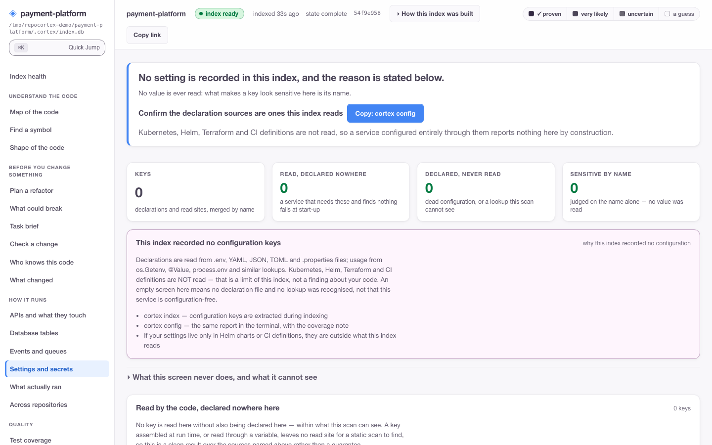

**Layout skeleton:**

```text
[ANSWER  No setting is recorded in this index, and the reason is stated below.  [Copy: repocortex config]]
[KEYS] [READ, DECLARED NOWHERE] [DECLARED, NEVER READ] [SENSITIVE BY NAME]
[keys table]  or  [why this index recorded no configuration]
> What this screen never does, and what it cannot see
```

**How to read it:**

- No value is ever read. A key is marked sensitive by its name alone.
- **Read, declared nowhere.** The most urgent column: a service that needs
  these keys and does not find them fails at start-up.
- **Declared, never read.** Dead configuration, or a lookup this scan cannot
  see.
- Kubernetes, Helm, Terraform and CI definitions are not read. An empty screen
  means nothing recognisable was found, not that the service has no settings.

### What actually ran (`?s=trace`)

**Answers:** Which endpoints and code paths were exercised in a real trace?
**Data comes from:** `/api/trace`. CLI: `repocortex trace repocortex.trace.json`.

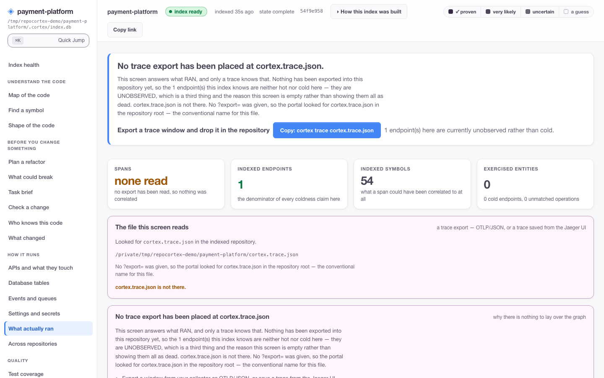

**Layout skeleton:**

```text
[ANSWER  No trace export has been placed at repocortex.trace.json.  [Copy: repocortex trace ...]]
[SPANS] [INDEXED ENDPOINTS] [INDEXED SYMBOLS] [EXERCISED ENTITIES]
[The file this screen reads: where it looked]
[hot / cold endpoints]  or  [why there is nothing to lay over the graph]
```

**How to read it:**

- Export an OpenTelemetry (OTLP/JSON) or Jaeger trace and save it as
  `repocortex.trace.json` in the repository root, or pass `?export=<path>`.
- Without a trace, endpoints are "unobserved", which is different from "cold".
  The screen will not call code dead because no trace was given.

### Across repositories (`?s=estate`)

**Answers:** How does this repository connect to the other repositories in the
system?
**Data comes from:** `/api/system`. CLI: `repocortex system --members repocortex.system.yml`.

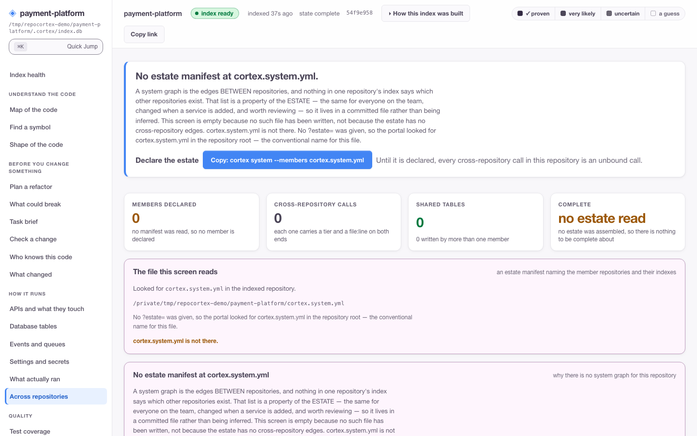

**Layout skeleton:**

```text
[ANSWER  No estate manifest at repocortex.system.yml.  [Copy: repocortex system --members ...]]
[MEMBERS DECLARED] [CROSS-REPOSITORY CALLS] [SHARED TABLES] [COMPLETE]
[The file this screen reads]
[members, cross-repo calls, shared tables]  or  [why it is empty]
```

**How to read it:**

- Which repositories make up your system is not something one index can
  know, so you list them in a committed `repocortex.system.yml` (or pass
  `?estate=<path>`).
- Once declared, each cross-repository call has a confidence word and a file
  and line on both ends. Shared tables written by more than one member are
  worth a review.

### Test coverage (`?s=tests`)

**Answers:** Which symbols does a test provably reach?
**Data comes from:** `/api/tests`. There is no separate CLI command in this
build; the MCP tool `find_tests` gives the same answer for one symbol.

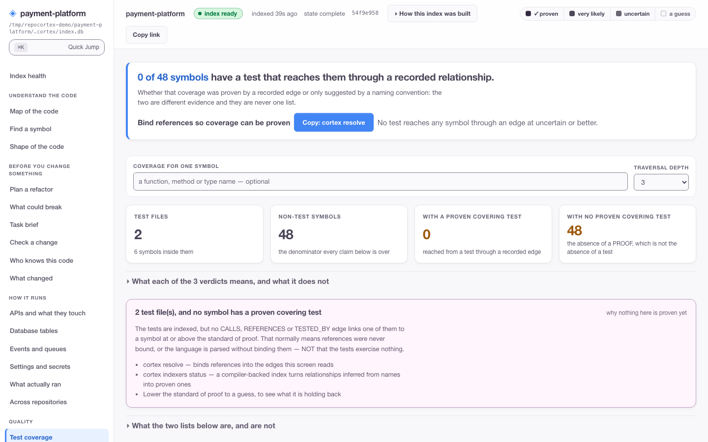

**Layout skeleton:**

```text
[ANSWER  0 of 48 symbols have a test that reaches them ...  [Copy: repocortex resolve]]
[COVERAGE FOR ONE SYMBOL (optional) ____] [TRAVERSAL DEPTH v]
[TEST FILES] [NON-TEST SYMBOLS] [WITH A PROVEN COVERING TEST] [WITH NO PROVEN COVERING TEST]
> What each of the 3 verdicts means
[explanation card when nothing is proven]
> What the two lists below are, and are not
> Evidence — every test file
[Symbols a test reaches through a recorded edge]
[Tests suggested by a naming convention only]
```

**How to read it:**

- "Proven" coverage means a test reaches the symbol through a recorded
  relationship. A test that only shares a name (for example
  `CallbackControllerTest`) is listed separately and never counted as proven.
- **With no proven covering test.** This is an absence of proof, not proof of
  no test. On the sample service every symbol lands here because Java test
  calls are not bound to their targets without a compiler-backed index.
- Enter a symbol to see the tests for that one symbol.

### Code blindspots (`?s=missed`)

**Answers:** Where can the index see code but not prove anything about it?
**Data comes from:** `/api/missed`. CLI: `repocortex blindspots`.

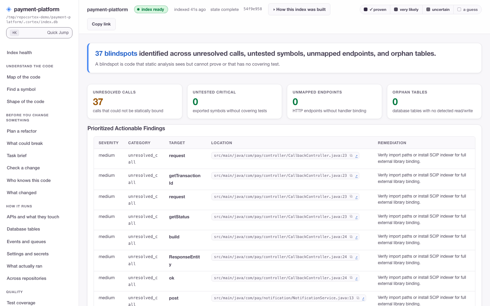

**Layout skeleton:**

```text
[ANSWER  37 blindspots identified across ...]
[UNRESOLVED CALLS] [UNTESTED CRITICAL] [UNMAPPED ENDPOINTS] [ORPHAN TABLES]
[Prioritized findings: severity | category | target | location | remediation]
```

**How to read it:**

- **Unresolved calls.** Calls that could not be bound to a definition, often
  library calls. Many of these lower the confidence of every walk.
- **Untested critical, unmapped endpoints, orphan tables.** Exported code with
  no proven test, routes with no handler, and tables nothing reads or writes.
- Each row has a file and line you can copy, and a suggested fix.

### Architecture rules (`?s=governance`)

**Answers:** Does the code cross any line the declared architecture forbids?
**Data comes from:** `/api/governance`. CLI: `repocortex arch` (add
`--fail-on <severity>` in CI).

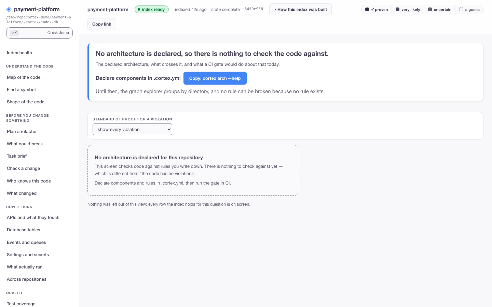

**Layout skeleton:**

```text
[ANSWER  No architecture is declared, so there is nothing to check ...  [Copy: repocortex arch --help]]
[STANDARD OF PROOF FOR A VIOLATION v]
[violations table]  or  [No architecture is declared for this repository]
```

**How to read it:**

- Declare components and rules in `.repocortex.yml`. Until then the map groups by
  directory and no rule can be broken. That is different from "no
  violations".
- Once rules exist, each violation has a confidence word. Choose the standard
  of proof that should count as a real violation in your CI gate.

### Dependencies (`?s=deps`)

**Answers:** What does this repository declare it depends on, and does anything
import each one?
**Data comes from:** `/api/deps`. CLI: `repocortex deps`.

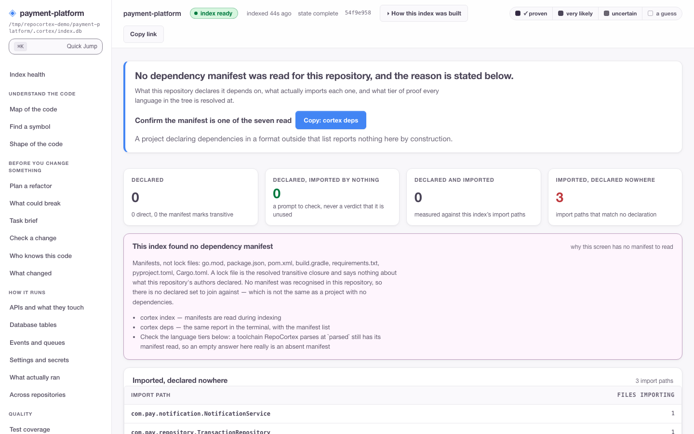

**Layout skeleton:**

```text
[ANSWER  No dependency manifest was read ...  [Copy: repocortex deps]]
[DECLARED] [DECLARED, IMPORTED BY NOTHING] [DECLARED AND IMPORTED] [IMPORTED, DECLARED NOWHERE]
[dependency table]  or  [why this screen has no manifest to read]
[language tiers]
```

**How to read it:**

- Manifests read: `go.mod`, `package.json`, `pom.xml`, `build.gradle`,
  `requirements.txt`, `pyproject.toml`, `Cargo.toml`. Lock files are not read.
- **Declared, imported by nothing** is a prompt to check, never a verdict that
  a dependency is unused.
- **Imported, declared nowhere** lists import paths that match no declaration.

### How accurate is this index (`?s=accuracy`)

**Answers:** How often are this index's relationships right, measured against
a compiler?
**Data comes from:** `/api/accuracy`. CLI: `repocortex accuracy`.

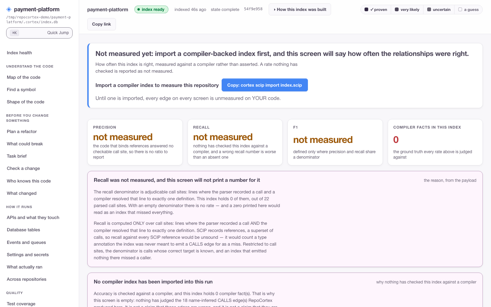

**Layout skeleton:**

```text
[ANSWER  Not measured yet: import a compiler-backed index first ...  [Copy: repocortex scip import index.scip]]
[PRECISION] [RECALL] [F1] [COMPILER FACTS IN THIS INDEX]
[why recall was not measured]
> how the rates are computed
```

**How to read it:**

- Until a compiler (SCIP) index is imported, every rate reads "not measured".
  The screen never prints zero for a rate nothing has checked.
- After import, precision says how many of the index's relationships the
  compiler agrees with; recall says how many of the compiler's it found.

### Connect an agent (`?s=agent`)

**Answers:** How do I connect an AI coding agent to this index over MCP?
**Data comes from:** `/api/agent`. CLI: `repocortex agent` (prints the
registration) and `repocortex install` (registers with detected agents).

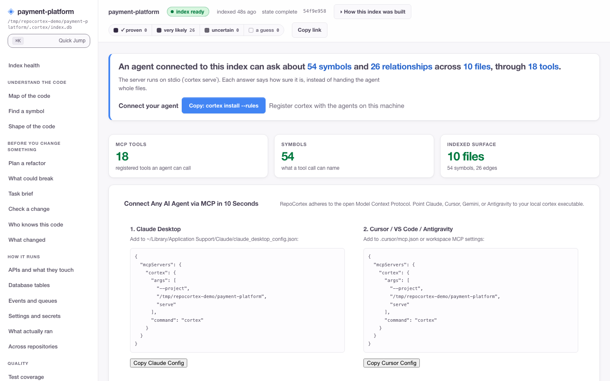

**Layout skeleton:**

```text
[ANSWER  An agent ... can ask about <N> symbols and <N> relationships ... through <N> tools.  [Copy: repocortex install --rules]]
[MCP TOOLS] [SYMBOLS] [INDEXED SURFACE]
[Connect via MCP:  client 1 config JSON [Copy]   client 2 config JSON [Copy]]
[sample file before and after pruning, when a readable file exists]
[MCP tools: name, category, what it does]
[What this pillar answers] [Why this screen is empty for this index]
```

**How to read it:**

- The counts are read from the index. The screen does not estimate token
  savings; the only token figures are on the sample file, measured by pruning
  a real file from this repository.
- Copy the configuration block for your agent client into its MCP settings
  file. It runs `repocortex --project <repo> serve`, the same entry
  `repocortex install` writes.
- The tool list is the server's own: the default `minimal` profile exposes the
  first seven tools, `standard` all 18.
- The guidance cards at the end explain why the portal cannot show an agent
  conversation: the MCP server is a separate process the portal is not part of.

### Retrieval quality (`?s=retrieval`)

**Answers:** Does the context engine hand an agent the right code for a task?
**Data comes from:** `/api/bench`. CLI: `repocortex bench repocortex.bench.yml`.

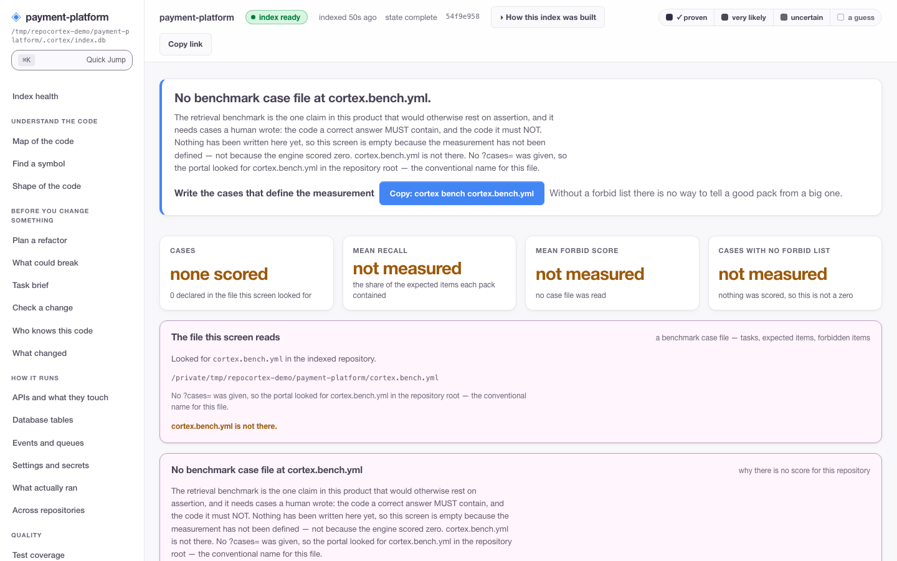

**Layout skeleton:**

```text
[ANSWER  No benchmark case file at repocortex.bench.yml.  [Copy: repocortex bench repocortex.bench.yml]]
[CASES] [MEAN RECALL] [MEAN FORBID SCORE] [CASES WITH NO FORBID LIST]
[The file this screen reads]
[per-case scores]  or  [why there is no score]
```

**How to read it:**

- You write the cases: a task, the code a correct answer must contain, and the
  code it must not. Save them as `repocortex.bench.yml` or pass `?cases=<path>`.
- Recall is the share of expected items each context pack contained. The
  forbid score catches packs that are simply too big. A case with no forbid
  list cannot tell a good pack from a large one.

---

## How the portal is designed to behave

These rules come from the comments in `internal/web/assets/app.js`, the Go
handlers, and the end-to-end specs in `internal/web/e2e/specs/`, which check
them on every screen.

- **It shows only what an endpoint returned.** Each answer line is built from
  the response the screen already has. When a response carries no summary
  number, the line says what the screen shows instead of making one up.
- **It never prints a number nothing measured.** Rates that were never
  checked read "not measured". Counts that were not recorded read "how many is
  not recorded", never zero. Empty pillar screens say "not compared" or "none
  read" rather than showing 0%.
- **It labels uncertainty everywhere.** Every relationship carries a confidence
  word and an example file and line. Proven and name-matched evidence are
  never mixed into one list.
- **It states what it left out.** Hidden rows are counted with a reason and,
  where possible, the command that reveals them. A narrowed map shows how many
  filters are active.
- **Empty is explained, not blank.** Every empty screen says why (no file, no
  second run, nothing declared) and which command or file fills it. It also
  says when empty is not the same as "none exists".
- **Plain language.** The specs block internal jargon on screen and require
  confidence ids to be shown as words. A short glossary covers the terms that
  remain.
- **Answer first, details folded.** One sentence leads each screen. Evidence
  and caveats are kept, one click down, and `?open=1` shows all of them.
- **Everything is a link.** Screen, filters and selection live in the URL, so a
  finding can be shared as a link rather than a screenshot.
- **Accessible by default.** Real buttons in tab order, a skip link, a
  labelled canvas with a full text table below it, keyboard control of the
  map, and confidence shown by lightness, glyph and line style as well as
  colour.

## Troubleshooting

**`error: no index at .../.repocortex/index.db`**
The portal needs an index. Run `repocortex init`, `repocortex index` and
`repocortex resolve` in the project root, or pass `--project <dir>`.

**`listen on 127.0.0.1:7777: ... bind: address already in use`**
Another process (often an earlier `repocortex ui`) holds the port. Stop it, or
start on another port with `repocortex ui --port 7790`, or let the system choose
with `--port 0` and read the printed address.

**The index bar is amber or red**
Click the verdict. Index health shows why: a partial run, parse failures, or an
index more than a day old. Run `repocortex index` (and `repocortex resolve`), then
reload. Start the portal with `--allow-refresh` to get a Refresh index button
in the bar. Run `repocortex watch` in another terminal to keep the index current
while you work.

**The index is older than my latest commit**
Open "How this index was built" in the index bar to see the revision it read.
A matching revision still does not include uncommitted edits. Re-index.

**A screen is empty**
Read its answer line and the card under it; each one says why. Common causes:

- Trace, estate and retrieval need a file you write
  (`repocortex.trace.json`, `repocortex.system.yml`, `repocortex.bench.yml`).
- What changed needs two runs.
- Architecture rules needs components declared in `.repocortex.yml`.
- How accurate is this index needs `repocortex scip import`.
- Settings and dependencies only read the file formats they list.
- What could break, Task brief, Check a change and Who knows this code wait for
  input; Plan a refactor waits for a symbol name.

**Counts look too low, or Test coverage shows nothing proven**
Check Resolution coverage and Blind spots on Index health. If many references
are unbound, run `repocortex resolve`, and for full accuracy install a
compiler-backed indexer (`repocortex indexers status`). Lower the standard of proof
to "a guess" in the index bar to see what is being held back.

**"This name matches several definitions"**
Pick one of the listed candidates, or type the fully qualified form shown in
Find a symbol, such as `src/main/java/com/pay/repository/TransactionRepository.java:findById`.

**A screen says "could not load"**
The error card under it gives the reason. Check the terminal running
`repocortex ui`; if the process stopped, start it again and reload.
