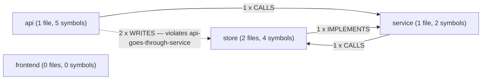
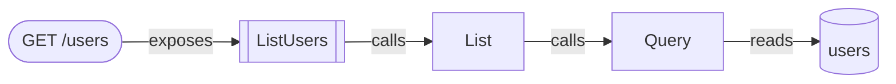
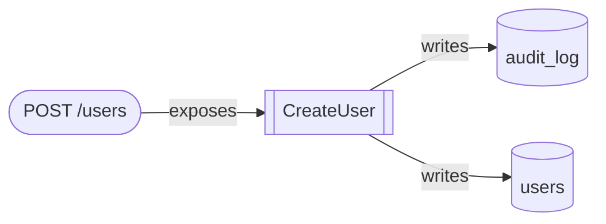
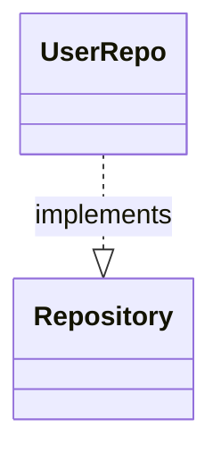

# Architecture

Derived from the RepoCortex index. Every node and every arrow below is a fact recorded by an indexer, and every one cites the file and line it came from — nothing here is prose about the code.

The same index regenerates this document byte for byte, so its diff is a real diff: the lines that change are the architecture that changed.

Index run 7: 4 files, 11 symbols, 8 edges — of which 2 EXPOSES, 3 table read/write, 1 IMPLEMENTS/EXTENDS. 3 endpoints and 2 tables are declared.

## Components

The repository declares 4 components and 1 rule in `.repocortex.yml`.

| Component | Files | Symbols | Declared include patterns |
| --- | ---: | ---: | --- |
| api | 1 | 5 | internal/api/** |
| store | 2 | 4 | internal/store/**, migrations/** |
| service | 1 | 2 | internal/service/** |
| frontend | 0 | 0 | web/** |

A component with 0 files matched nothing: its patterns are wrong, and every rule naming it has been silently inert.

### Component dependencies

#### Evidence

| From | To | Edges | Kinds | Weakest confidence | Verdict | Cited at |
| --- | --- | ---: | --- | --- | --- | --- |
| api | store | 2 | WRITES | low | forbidden (api-goes-through-service) | internal/api/users.go:44 (source_code, low) |
| api | service | 1 | CALLS | high | allowed | internal/api/users.go:32 (source_code, high) |
| service | store | 1 | CALLS | medium | allowed | internal/service/user.go:14 (source_code, medium) |
| store | service | 1 | IMPLEMENTS | high | allowed | internal/store/users.go:8 (source_code, high) |

One representative citation per dependency — the earliest by file and line among the edges behind it — chosen so the table does not move when unrelated code is added.

## Endpoint flows

One diagram per HTTP endpoint, from the route through its handler and the calls it makes to the tables it reaches. Calls are followed to a depth of 3.

### GET /users

Declared at internal/api/users.go:10 (source_code, high).

| Step | Element | Cited at |
| --- | --- | --- |
| endpoint | GET /users | internal/api/users.go:10 (source_code, high) |
| handler | api.ListUsers | internal/api/users.go:30 (source_code, high) |
| exposes edge | GET /users -> ListUsers | internal/api/users.go:10 (source_code, high) |
| calls (depth 1) | service.UserService.List | internal/api/users.go:32 (source_code, high) |
| calls (depth 2) | store.UserRepo.Query | internal/service/user.go:14 (source_code, medium) |
| reads table | users (via Query) | internal/store/users.go:17 (source_code, high) |

### POST /users

Declared at internal/api/users.go:20 (source_code, high).

| Step | Element | Cited at |
| --- | --- | --- |
| endpoint | POST /users | internal/api/users.go:20 (source_code, high) |
| handler | api.CreateUser | internal/api/users.go:40 (source_code, high) |
| exposes edge | POST /users -> CreateUser | internal/api/users.go:20 (source_code, high) |
| writes table | audit_log (via CreateUser) | internal/api/users.go:46 (source_code, low) |
| writes table | users (via CreateUser) | internal/api/users.go:44 (source_code, low) |

### GET /health

Declared at internal/api/users.go:25 (source_code, high).

This route has no EXPOSES edge: the framework's syntax did not reveal which function serves it. The endpoint is shown because it is real; no handler is drawn because guessing one would be an invented edge, and the indexer declines to write it for the same reason.

| Step | Element | Cited at |
| --- | --- | --- |
| endpoint | GET /health | internal/api/users.go:25 (source_code, high) |

## Inheritance

| Child | Relationship | Parent | Cited at |
| --- | --- | --- | --- |
| store.UserRepo | implements | service.Repository | internal/store/users.go:8 (source_code, high) |

---

Nothing was omitted: every section fitted inside its cap.
